## Recap

Last week: tourist on numbers, then Needleman–Wunsch and Smith–Waterman on letters.

Today has two parts. First we push last week's alignment further. Then the same method fills two tables that have nothing to do with alignment.

## Last week’s grid

::: {.split .fig-right}
::: {.pane}
A diagonal step pairs two letters and adds $\sigma$. A down or right step is a gap.

On the toy, $\sigma$ is $+1$ for a match and $-1$ for a mismatch. $S(i,j)$ is the best score of the prefixes $v[1..i]$ and $w[1..j]$.
:::
::: {.pane}
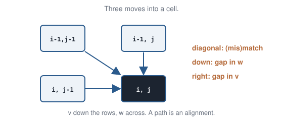{.sketch}
:::
:::

## Today in two parts

::: {.cards}
::: {.card}
**Part 1 · Alignment, extended**

1. Whole genomes: the same alignment in far less memory.
2. Long gaps: one insertion is one event.
3. Several sequences: from a rectangle to a cube.
:::
::: {.card .warm}
**Part 2 · Two other tables**

4. RNA folding: a cell is a substring.
5. CpG islands: a cell is a hidden state.
:::
:::

## Part 1 · Alignment, extended {.section-head}

Same grid, same three moves. Three limits of last week's version.

## Linear memory {.section-head}

The score fits in memory. The arrows do not.

## Two whole mitochondrial genomes

Human mitochondrial DNA is one ring of 16,569 bases carrying 37 genes. Comparing human and chimpanzee mitochondria base by base means aligning the whole ring.

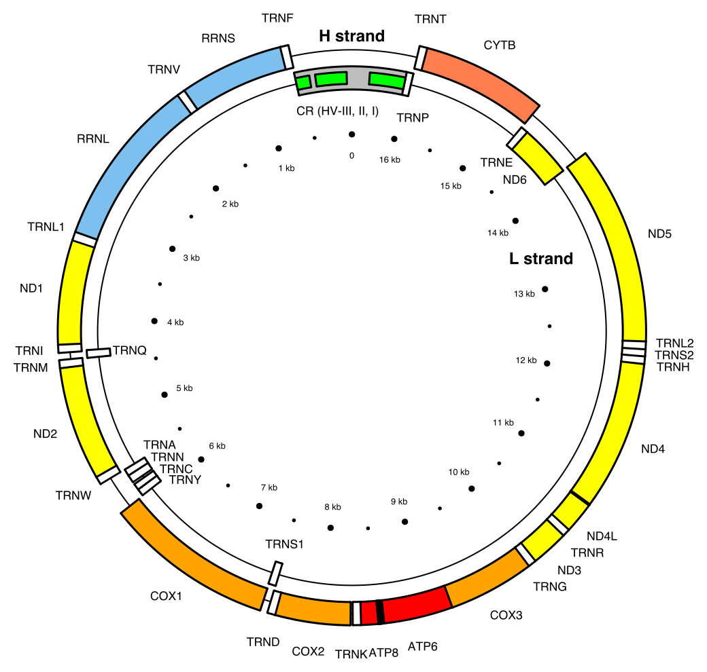

::: {.cite}
Map of the human mitochondrial genome. Picture: Emmanuel Douzery, Wikimedia Commons, [CC BY-SA 4.0](https://creativecommons.org/licenses/by-sa/4.0/). File: Map of the human mitochondrial genome.svg.
:::

## The grid is too big to keep

Two rings of about 16,600 bases give a grid of $16{,}600 \times 16{,}600 \approx 2.7\times10^8$ cells. One arrow per cell is hundreds of megabytes.

Two bacterial genomes of 5 million bases give $2.5\times10^{13}$ cells. No machine keeps that.

The score alone needs far less. The question is whether the path does too.

## The toy

`ACATATG` down the side, `ACTATA` across the top. Match $+1$, mismatch or gap $-1$, as last week. The best alignment:

```
A C A T A T G
A C - T A T A
```

Score $+3$: one gap, one mismatch. We want this alignment without keeping the grid.

## Idea 1 · The score needs two columns

A cell reads its left, upper, and diagonal neighbours. Left and diagonal sit in the previous column; upper sits in the same column. Fill column by column and keep two.

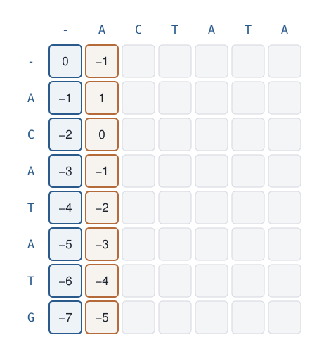{.sketch}

## Older columns can go

Filling a new column reads only the column before it. Every column further left is already thrown away.

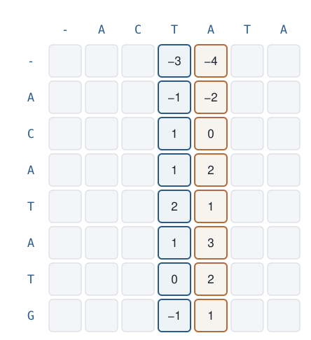{.sketch}

## The corner, from two columns

The corner is $+3$, the same as the full table. Memory is two columns, $O(n)$. But the arrows are gone, so the path is gone.

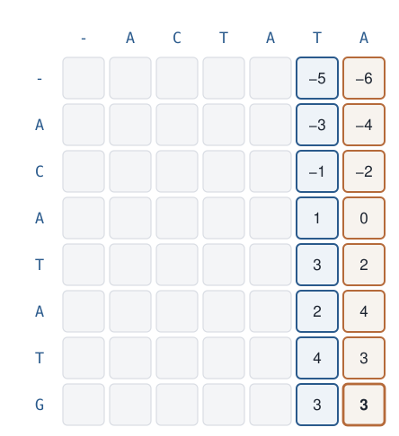{.sketch}

## Idea 2 · Every path crosses the middle column

The middle column sits after `ACT`, the first half of `ACTATA`. Any path from corner to corner passes through it. The best path crosses in one cell, here row 4. That cell splits the path into a left piece and a right piece.

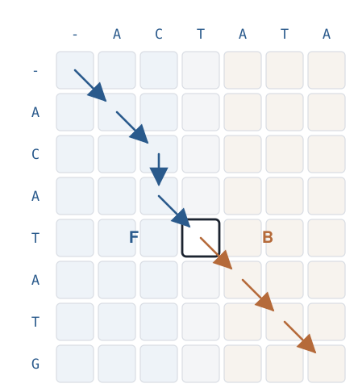{.sketch}

## The left half, forward

Sweep from the top-left corner with two columns and stop at the middle column. Cell $i$ holds $F(i)$: the best score of the first $i$ letters of `ACATATG` against `ACT`.

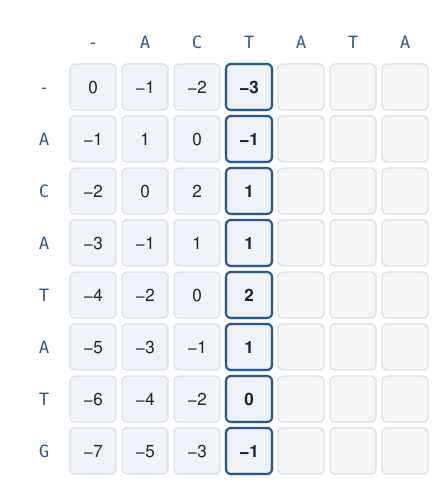{.sketch}

## The right half, backward

Sweep from the bottom-right corner, right to left, and stop at the same column. Cell $i$ holds $B(i)$: the best score of the rest of `ACATATG` against `ATA`. That is the forward sweep on both strings reversed.

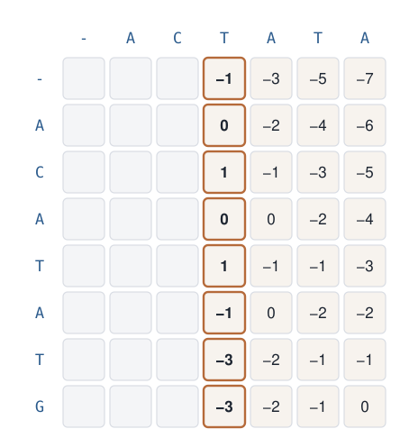{.sketch}

## Why the two numbers add

A path through row $i$ of the middle column is a left piece ending in that cell, then a right piece starting from it. The two pieces share only that cell, and each can be chosen on its own. So the best path through that cell is the best left piece plus the best right piece:

$$
\text{best path through row } i \;=\; F(i) + B(i).
$$

## The largest sum is the crossing

Add the two columns row by row. The largest sum is $+3$, in row 4, the same as the corner score. So the best alignment passes through that cell: `ACAT` against `ACT` on the left, `ATG` against `ATA` on the right.

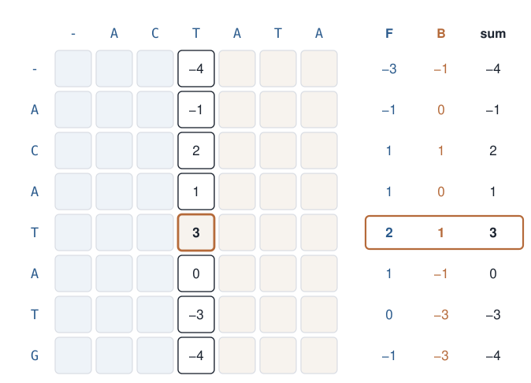{.sketch}

## Idea 3 · Repeat on the two pieces

The crossing leaves two smaller rectangles. Cut each at its own middle column, again with two columns of memory. Stop when a piece is one column wide and write that piece by hand. The dots are the crossings found, level by level.

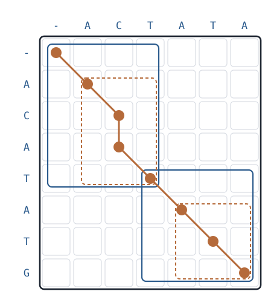{.sketch}

## The path, written down

The pieces, left to right: `A`/`A`, `C`/`C`, `AT`/`-T`, `A`/`A`, `T`/`T`, `G`/`A`. Glued together:

```
A C A T A T G
A C - T A T A
```

The same alignment as the full table. No arrows were stored.

## What it costs

Memory: each sweep keeps two columns, so $O(n+m)$. Time: the first cut sweeps the whole grid, $nm$ cells. The two pieces are half as wide, $nm/2$ together; then $nm/4$. In total $nm(1+\tfrac12+\tfrac14+\cdots) < 2\,nm$.

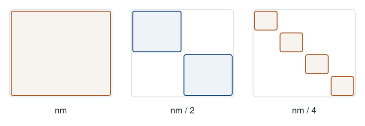{.sketch}

## Cut, recurse, repeat

Cutting at the middle and solving the two halves the same way is divide and conquer. For alignment it is Daniel Hirschberg's (1975).

::: {.takeaway}
On `ACATATG` against `ACTATA` the best path crosses the middle column in row 4, where $F+B=3$. Repeating the cut recovers the alignment in two columns of memory and less than twice the time.
:::

## Long gaps {.section-head}

One insertion of many letters is one mutation, not many.

## One mutation, many letters

A deletion removes a whole stretch in one event. An insertion adds a whole stretch. A substitution changes one letter.

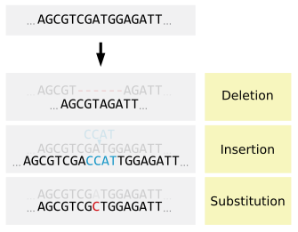

::: {.cite}
Deletion, insertion, substitution. Jonsta247, Wikimedia Commons, [CC BY-SA 4.0](https://creativecommons.org/licenses/by-sa/4.0/). File: Deletion Insertion Substitution-en.svg.
:::

## A long gap is one event

Needleman–Wunsch charges $-1$ for every gapped letter. The six-letter deletion above then costs as much as six separate one-letter deletions.

Opening a gap should be expensive. Each extra letter, the extension, should be cheap. That pair of costs is an affine gap penalty: $\text{open} + \text{length}\times\text{extend}$.

## Opening costs more than extending

Take open $= -5$ and extend $= -1$. These numbers are the gap cost only.

One gap, one letter long. Pay the opening cost once:

```
G C - T
G C A T     gap cost -5
```

One gap, two letters long. Pay to open, then one extension:

```
G C - - T
G C A A T   gap cost -5 + -1 = -6
```

Under $-1$ per letter the second alignment would have looked much worse ($-2$ against $-1$). Here the long gap is only slightly worse.

## Three scores in one cell

The sweep is still left to right, top to bottom. Each cell keeps three numbers, so a gap can be continued without paying the opening cost again.

- the best score if this column pairs two letters
- the best score if this column continues a gap in $v$ (a letter of $w$ is skipped)
- the best score if this column continues a gap in $w$ (a letter of $v$ is skipped)

Still one cell per corner, so the time stays $O(nm)$. Osamu Gotoh (1982) wrote this recurrence.

## Several sequences {.section-head}

The clock needs every species in one alignment.

## Several chains at once

Last week, human cytochrome *c* against yeast cytochrome *c* was one pair. The clock across many species needs every chain in one alignment: human, horse, and yeast in the same columns.

One column should be the same ancestral site in all of them.

## What a multiple alignment looks like

Ribosomal protein P0 from animals, yeast, and archaea, one row per species. Each column is one site; colours mark conserved residues. The runs of dashes on the left are long gaps.

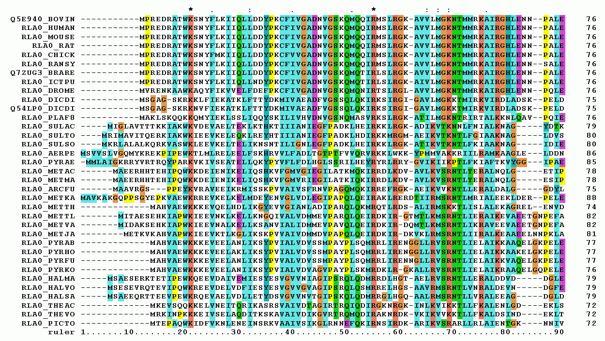

::: {.cite}
Multiple alignment of RPLP0, first 90 positions, ClustalW. Miguel Andrade, Wikimedia Commons, [CC BY-SA 3.0](https://creativecommons.org/licenses/by-sa/3.0/). File: RPLP0 90 ClustalW aln.gif.
:::

## Pairwise, one pair at a time

Two sequences are the rectangle you already fill. Needleman–Wunsch, three moves, one score.

For three sequences, score all three pairs that way. Keep the pair with the highest score. On last week's strings, `GCAT` against `GCT` scores $+2$:

```
G C A T
G C - T
```

## Add the third sequence, and stop

Do not reopen those columns. Align the next sequence to the columns you already wrote, with the same kind of moves: a letter lands in a column, or a gap does.

A fourth sequence is added the same way, to the columns that now exist. Each new sequence is optimal against a frozen alignment. Earlier gaps stay where they were. That is a greedy multiple alignment. The usual name is progressive alignment.

## Where `GT` sits

The locked pair is `GCAT` against `GCT`. The new sequence is `GT`. It uses the columns already written:

```
G C A T
G C - T
G - - T
```

G lands on the G column, T lands on the T column, and the two middle columns are gaps.

## What that row scores

A new letter scores $+1$ for each letter it matches in that column and $-1$ for each mismatch or gap it sits opposite. A gap opposite a gap scores $0$. The locked pair is not rescored.

- G against two G's: $+1+1 = +2$
- a gap against two C's: $-1-1 = -2$
- a gap against A and a gap: $-1+0 = -1$
- T against two T's: $+1+1 = +2$

The new row scores $+1$. Other ways to place `GT` score less against these columns.

## The early gap is never moved

The gap under A was chosen because it was best for two sequences. `GT` pays $-1$ to sit opposite that column.

If a gap in a different column would have been better for all three together, this procedure cannot find it. The first alignment is never opened again. Same weakness as the tourist who took the locally best street.

## All three, chosen together

Three sequences give a cube, one axis each. Cell $(i,j,k)$ is the best score of the first $i$, $j$, and $k$ letters. Each arrow into it is one new alignment column.

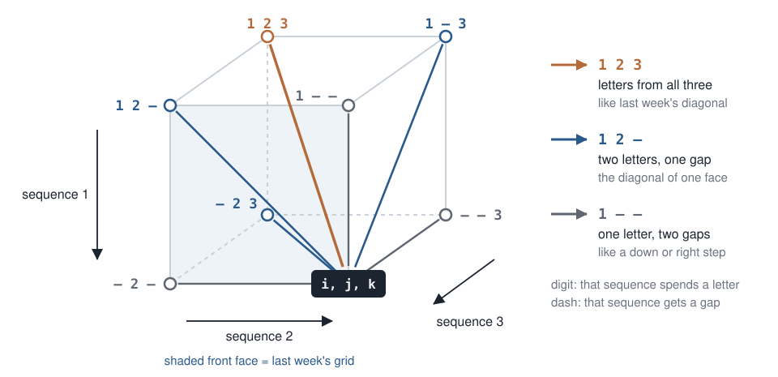{.sketch}

## Seven ways into a corner

Each sequence either spends its next letter or takes a gap, and at least one sequence spends a letter. That is $2^3 - 1 = 7$ predecessors:

- all three letters
- two letters, and a gap in the remaining sequence (three choices of who gaps)
- one letter, and gaps in the other two (three choices of who does not gap)

The cell is the best of those seven. Same rule as Needleman–Wunsch. The neighbours changed, not the idea.

## The cube fills in order

A corner $(i,j,k)$ is filled only after every corner with a smaller $i+j+k$, so all seven predecessors are already numbers.

If each sequence has length $n$, the cube has $n^3$ corners and a constant amount of work in each:

$$
T = O(n^3).
$$

## A fourth sequence is the same rule

Four sequences: a cell $(i,j,k,\ell)$, and $2^4 - 1 = 15$ predecessors. The table is four-dimensional, size $n^4$.

For $k$ sequences the cell has $2^k - 1$ predecessors and the table has $n^k$ entries. There is no new idea past two sequences.

## The table is what runs out

Three sequences of length $100$: $100^3 = 10^6$ cells. Easy.

Three of length $10^4$: $10^{12}$ cells. Ten sequences of length $100$: $100^{10} = 10^{20}$ cells.

The recurrence is fine. The table does not fit, so we do not run it. The greedy pass — lock a pair, add the next sequence — is what gets used. MUSCLE and MAFFT are programs that do that kind of progressive alignment.

## Part 2 · Two other tables {.section-head}

Same method, new cell: a substring of one RNA, then a hidden state.

## RNA folding {.section-head}

A tRNA works only if it folds.

## The cloverleaf

Yeast phenylalanine tRNA, written tRNA-Phe. One chain, drawn as its secondary structure: stems of base pairs in a cloverleaf.

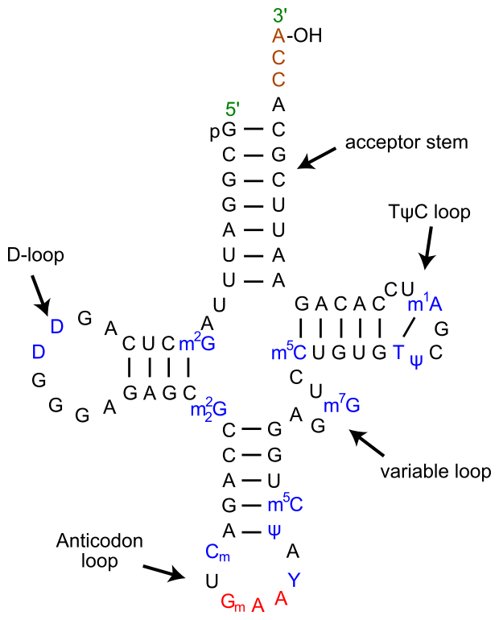

::: {.cite}
Yeast tRNA-Phe cloverleaf. Yikrazuul, Wikimedia Commons, [CC BY-SA 3.0](https://creativecommons.org/licenses/by-sa/3.0/). File: TRNA-Phe yeast en.svg.
:::

## What we compute

The input is one RNA string $x[1..n]$ over the alphabet A, C, G, U.

A pairing is a set of index pairs $(i,j)$ with $i < j$. Allowed partners in this lecture: A with U, and G with C. Guanine with uracil is a real wobble pair; we leave it out.

Each base belongs to at most one pair. The score of a pairing is the number of pairs. The output is a pairing of maximum score.

## Crossing pairs are forbidden here

Two pairs cross when the partner of one base lies between another base and its partner. That arrangement is a pseudoknot.

tRNA-Phe has none in the cloverleaf. Other RNAs do. Many viruses place a pseudoknot in the message just after a slippery sequence. Those crossing pairs stall the ribosome so that it shifts frame and translates a second protein from the same message.

## A real pseudoknot

The loop of the left stem pairs with bases beyond that stem. Drawn as arcs over the chain, those two sets of pairs would cross.

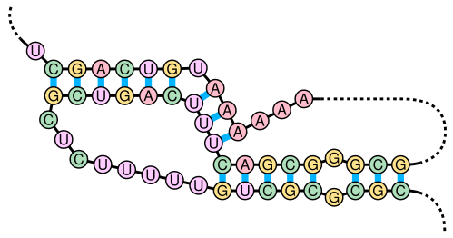

::: {.cite}
RNA pseudoknot. Sakurambo, Wikimedia Commons, [CC BY 2.5](https://creativecommons.org/licenses/by/2.5/). File: Pseudoknot.svg.
:::

## Crossing, as arcs

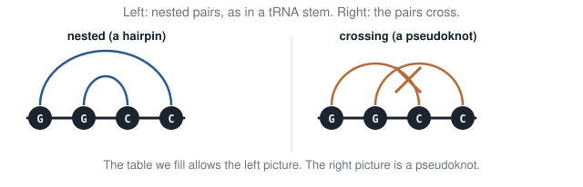{.sketch}

## That restriction is a modelling choice

The table allows a pair only when it sits inside another pair, or beside it. A crossing pair is not one of the moves.

That is not a fact about RNA. It fits the stems of tRNA-Phe. A pseudoknot scores zero here, even when the molecule has one, because a crossing pair would tie a substring to a base outside it.

We accept the restriction so that the best pairing of bases $i$ through $j$ depends only on shorter pieces of that same substring. That is what makes the cell $(i,j)$ a dynamic program.

## The toy is `GGCC`

Two nested G–C pairs. Score $2$.

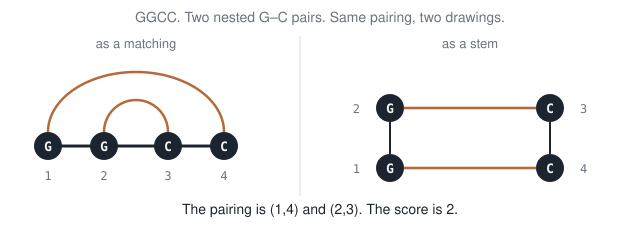{.sketch}

## One cell is one substring

$N(i,j)$ is the largest number of non-crossing pairs in the substring $x[i..j]$. The whole molecule is $N(1,n)$.

Fill short substrings first. A cell may use only shorter ones. Ruth Nussinov (1978).

## Base $i$ unpaired

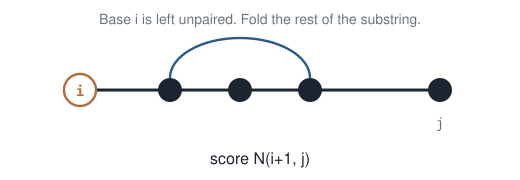{.sketch}

$$
N(i,j) \ge N(i+1,j).
$$

## Base $j$ unpaired

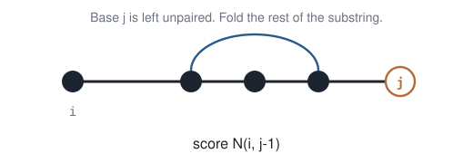{.sketch}

$$
N(i,j) \ge N(i,j-1).
$$

## Bases $i$ and $j$ paired

This move is allowed only when $x_i$ and $x_j$ are a legal pair.

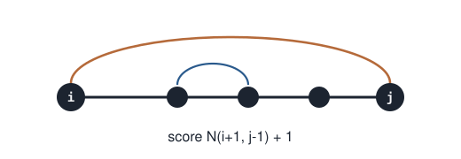{.sketch}

$$
N(i,j) \ge N(i+1,j-1)+1.
$$

## The substring splits after $k$

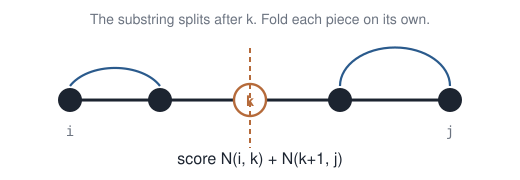{.sketch}

$$
N(i,j) \ge N(i,k)+N(k+1,j)
\quad\text{for every } i \le k < j.
$$

## The recurrence is the best of those four

A single base cannot pair, so $N(i,i)=0$.

$$
N(i,j)=\max
\begin{cases}
N(i+1,j) \\
N(i,j-1) \\
N(i+1,j-1)+1 & \text{if }x_i\text{ pairs with }x_j \\
\max_{i\le k<j}\bigl(N(i,k)+N(k+1,j)\bigr)
\end{cases}
$$

## Start on the diagonal

Row $i$ is where the substring starts, column $j$ where it ends, so only cells with $j \ge i$ exist. A diagonal cell is a single base. It cannot pair, so we write $0$ there before anything else. The answer we want is in the opposite corner.

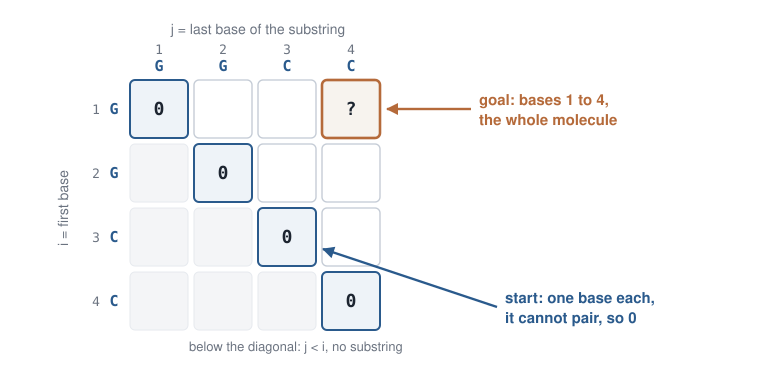{.sketch}

## Each cell reads shorter substrings

Every move in the recurrence drops at least one base. In the grid that means one step left, one step down, one step down-left, or a split into a piece of the same row and a piece of the same column. All of those cells lie closer to the diagonal.

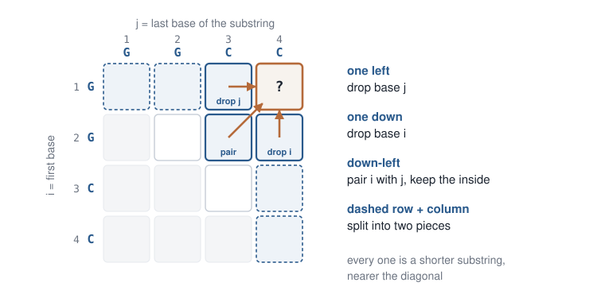{.sketch}

## Length 2 of `GGCC`

Every length-1 cell is $0$.

- `GG`: they are not a legal pair. $N=0$.
- `GC`: they are a legal pair, and the inside is empty. $N=\max(0,0,1)=1$.
- `CC`: they are not a legal pair. $N=0$.

## Length 3, then the molecule

Substring `GGC`: the outer G and C may pair, with one G inside. That scores $1$. Substring `GCC` is the same: $1$.

The whole string `GGCC`. Pair the first G with the last C, and add the inner `GC` which already scores $1$:

$$
N(1,4)=\max(\ldots,\; N(2,3)+1)=2.
$$

## The triangle, one diagonal at a time

A diagonal holds every substring of one length. It needs only the diagonals below it, so we fill length $1$, then $2$, $3$, $4$, moving toward the top-right corner. The last cell is the whole molecule.

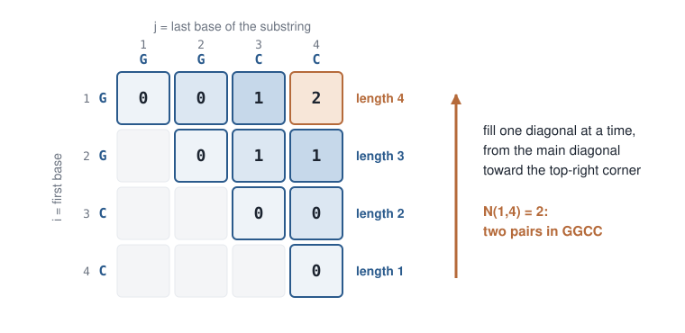{.sketch}

## What the triangle costs

There are about $n^2/2$ cells. Each one tries every split $k$, up to $n$ of them, so $T(n)=O(n^3)$.

## Traceback recovers the pairs

Start at $N(1,4)=2$. The winning move is “pair $1$ with $4$.” The inside is $N(2,3)=1$, which pairs $2$ with $3$.

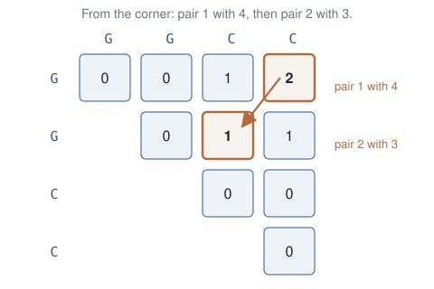{.sketch}

## What RNAfold actually does

ViennaRNA / RNAfold replaces “$+1$ per pair” with stacking energies (Turner). Same table, different numbers. A minimum hairpin length is a constraint on which pairs are allowed.

[Freiburg’s Nussinov playground](https://rna.informatik.uni-freiburg.de/Teaching/index.jsp?toolName=Nussinov) fills this triangle on a sequence you type.

## CpG islands {.section-head}

The file contains letters. It does not contain the label “this base sits in an island.”

## Why the label matters

In a vertebrate genome, C followed immediately by G — written CpG, the “p” being the phosphate between them — is rarer than chance. Methylated C tends to mutate to T, so those pairs disappear over evolutionary time.

Near the start of many genes, a few hundred bases are not methylated and keep their CpG. That stretch is a CpG island, and it often sits at a promoter.

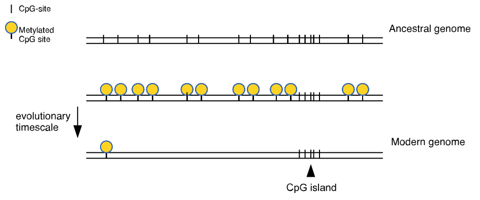

::: {.cite}
CpG island evolution. CFCF, Wikimedia Commons, [CC BY-SA 3.0](https://creativecommons.org/licenses/by-sa/3.0/). File: Cpg island evolution.svg.
:::

## What the file looks like

Left: a promoter, CpG every ten bases, start codon in red. Right: ordinary sequence, CpG every hundred. Finding the island means marking which bases belong to the left kind.

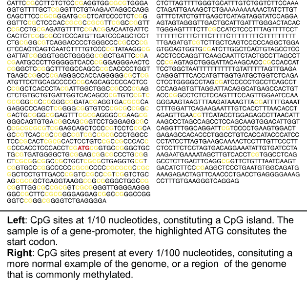

::: {.cite}
CpG islands. CFCF, Wikimedia Commons, [CC BY-SA 3.0](https://creativecommons.org/licenses/by-sa/3.0/). File: Cpg islands.svg.
:::

## A machine that writes DNA

Picture the genome written by a machine with two hidden states, **island** and **background**. The island state writes mostly C and G; the background state writes all four letters about equally. Between bases it usually stays in its state and now and then switches.

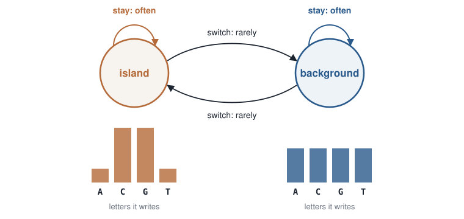{.sketch}

## Every labelling has a probability

Labelling the sequence means choosing a state for every base. For one labelling, the machine's chance of writing exactly these bases is a product: the chance of each stay or switch, times the chance that each state wrote its base.

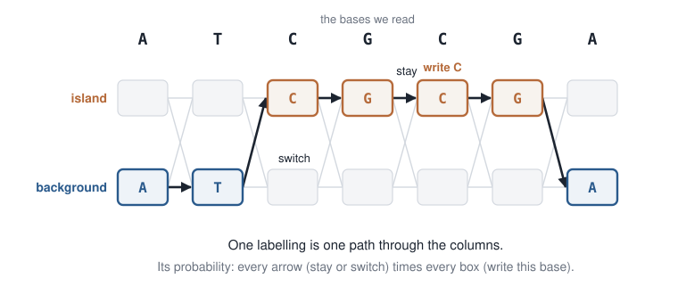{.sketch}

## Too many labellings to list

Two states and $n$ bases give $2^n$ labellings. An island is a few hundred bases long, and $2^{200} \approx 10^{60}$.

But two labellings that agree on the first $t$ bases share that whole part of the product. That is the same overlap as the tourist's paths sharing a first stretch of streets. So we store the best prefix once.

## One cell is a prefix and a state

The table has one row per state and one column per base. The cell for state $k$ at base $t$ holds the probability of the best labelling of bases $1$ to $t$ that **ends in state $k$**.

To fill it, take each cell of the column before, multiply by the chance of the step into $k$, and keep the larger. Then multiply by the chance that $k$ writes base $t$.

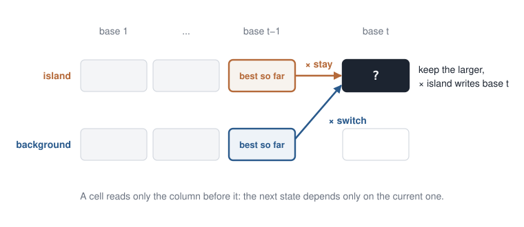{.sketch}

## The recurrence

Write $\mathrm{trans}(j,k)$ for the chance of the step from state $j$ to state $k$, and $\mathrm{emit}_k(x_t)$ for the chance that state $k$ writes base $x_t$.

$$
V_k(t)=\mathrm{emit}_k(x_t)\,\max_{j}\bigl(V_j(t-1)\,\mathrm{trans}(j,k)\bigr)
$$

Fill column by column and keep a pointer to the winning $j$. The larger cell in the last column is the best labelling; the pointers trace it back, as in the tourist.

## A product becomes a sum

Logarithms turn a product into a sum, and they keep the order: the largest probability has the largest log.

$$
\log V_k(t)=\log \mathrm{emit}_k(x_t)+\max_{j}\bigl(\log V_j(t-1)+\log \mathrm{trans}(j,k)\bigr)
$$

That is the alignment recurrence: best predecessor, plus the score of the step. Only the scores now come from probabilities.

## Max for the best, sum for the total

Replace $\max_j$ by $\sum_j$ and the same table adds up **every** labelling instead of keeping the best. The last column then gives the probability of the whole sequence under the model.

A second sweep from the right, multiplied with the first at one column, gives the chance that base $t$ sits in an island. It is the same meeting of a forward and a backward sweep as in Hirschberg.

## The name of the machine

The next state depends only on the current state: the Markov property, which is why a cell reads only the previous column. The states are not in the data, so the model is hidden. Together: a **hidden Markov model**.

Keeping the best is the **Viterbi** algorithm (Andrew Viterbi, 1967). Summing is the **forward** algorithm.

## Take-home: one idea, several tables

::: {.cards}
::: {.card}
**Diagnosis**

Candidates share sub-answers. Same disease as naive Fib.
:::
::: {.card .warm}
**Method**

Fill every subproblem once. Read off the answer. Pointers recover the object.
:::
:::

## Several tables, one method

| Problem | One cell means |
|:--------|:---------------|
| Tourist / Needleman–Wunsch | best walk to this intersection |
| Hirschberg | same score; only **two columns** in memory, cut at the middle |
| Nussinov | best number of non-crossing pairs in this substring |
| Viterbi | best probability of ending in this state after this prefix |

::: {.takeaway}
One method. The cell is a corner, a substring, or a hidden state.
:::

## Open `labs/04-dp-variants.ipynb`

::: {.lab}
::: {.lab-tag}
Lab · ~20 minutes · Python
:::

1. Hirschberg on `ACATATG` against `ACTATA`: two columns give the score $3$, the sums peak in row $4$, the cuts give `AC-TATA`.
2. Fill Nussinov on `GGCC`. Check that the whole-molecule cell is $2$.
3. Viterbi and the forward sum on the island machine: `CG`, then `ATCGCGA`.
:::

## A bit of history

::: {.history .small}
- **Hirschberg** (1975): linear-memory alignment by divide-and-conquer.
- **Gotoh** (1982): affine gaps — costly to open, cheap to extend. Three scores per cell, still $O(nm)$.
- **Nussinov** (1978): RNA secondary structure as DP.
- **Viterbi** (1967): the most likely labelling, one column per base.
:::

## Tools that use this

::: {.tools .small}
- **RNAfold** / ViennaRNA — Nussinov’s table with stacking energies.
- **HMMER** finds protein domains, and **GENSCAN** and **Augustus** find genes, by the Viterbi fill: hidden states, observed letters.
- Programs such as MUSCLE and MAFFT build a multiple alignment greedily: lock a pair, then add the next sequence. They do not fill the cube.
:::

## Takeaway / Questions

::: {.muted}
Without notes. One sentence each.
:::

::: {.qs}
::: {.q}
[Q1]{.tag} On `ACATATG` against `ACTATA`, in which row does the best path cross the middle column, and which two numbers add up there?
:::
::: {.q}
[Q2]{.tag} What does one Nussinov cell $N(i,j)$ store?
:::
::: {.q .q3}
[Q3]{.tag} Why does a Viterbi cell read only the column before it, and what changes if $\max$ is replaced by a sum?
:::
:::

## Takeaways

::: {.takeaway}
On `ACATATG` against `ACTATA` the best path crosses the middle column in row 4: $F=2$ from the left, $B=1$ from the right, sum $3$. Cutting again recovers the full alignment.
:::

::: {.takeaway}
$N(i,j)$ is the most non-crossing pairs in $x[i..j]$. On `GGCC` the corner is $2$, the two nested G–C pairs.
:::

::: {.takeaway}
A Viterbi cell is the best labelling of a prefix that ends in one state. It reads only the previous column, because the next state depends only on the current one. Taking the sum instead of the max gives the total probability of the sequence.
:::

## Next week

**Exhaustive search and branch-and-bound.**

Dynamic programming needs overlapping subproblems with a local recurrence. When we do not have that, we enumerate a tree — and skip a subtree when we can prove it cannot win.

## To read

::: {.read}
- Hirschberg (1975). A linear space algorithm for computing maximal common subsequences. *Comm. ACM*.
- Nussinov et al. (1978). Algorithms for loop matchings. *SIAM J. Appl. Math.*
- Viterbi (1967). Error bounds for convolutional codes.
- Gotoh (1982). Affine gaps: an opening cost plus a cost per extra letter.
- Durbin et al., *Biological Sequence Analysis* — ch. 3 (Viterbi) and ch. 10 (RNA).
- [Freiburg Nussinov teaching tool](https://rna.informatik.uni-freiburg.de/Teaching/index.jsp?toolName=Nussinov).
:::
