## Recap

Weeks 3–4: overlapping subproblems and a local recurrence. A table then beats enumeration.

Some problems have no such overlap. The honest first method is to **try all candidates**, organised as a **tree**.

## Restriction maps {.section-head}

Cut DNA at a known word. The list of those cuts was the first picture of a genome.

## The first pictures of DNA were cut sites

Phage λ is $48.5$ kb. In 1975 that was too long to sequence. EcoRI cut it at five sites. The **restriction map** — where those cuts sit — told you which fragment held a gene.

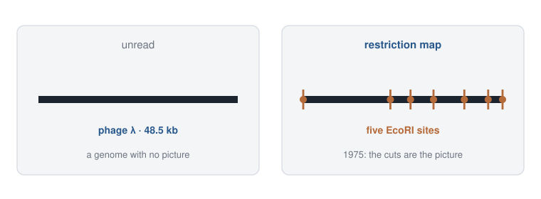{.sketch}

## EcoRI cuts a six-letter word

A restriction enzyme recognises a short DNA word and **cuts** there. EcoRI cuts `GAATTC`. Sticky ends let two molecules cut with the same enzyme join.

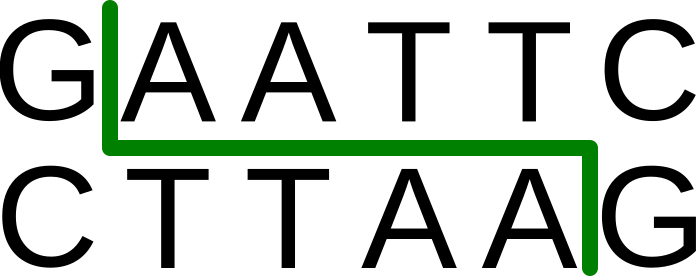{.photo}

::: {.cite}
EcoRI recognition site and cut. Bryan Derksen, Wikimedia Commons, public domain. File: EcoRI restriction enzyme recognition site.svg.
:::

## A plasmid is still a restriction map

pUC19 is $2686$ bp. Ampicillin (`amp`) and the origin (`ori`) must stay intact. EcoRI sits in the **polylinker**. Every cloning vector on Addgene is still drawn this way.

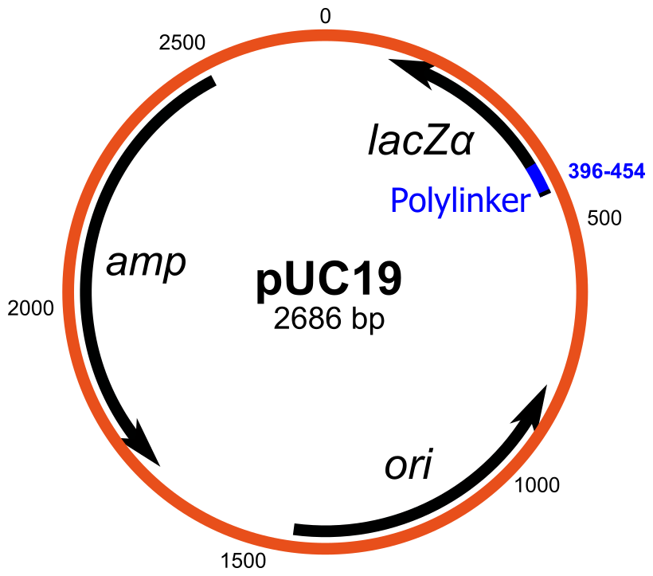

::: {.cite}
pUC19. Yikrazuul, Wikimedia Commons. Public domain (simple structural formula). File: PUC19.svg.
:::

## We sequence genomes. We still cut plasmids.

λ is a sequence now. You still open a plasmid at EcoRI. Restriction maps of *genomes* are history. Restriction *enzymes* are bench tools.

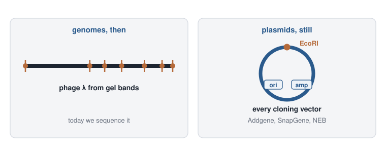{.sketch}

## How they measured the map

Many identical copies of the phage DNA. Add EcoRI. Each copy is cut at *some* of its `GAATTC` sites — you do not choose which. Load the mixture on a gel: short fragments run farther.

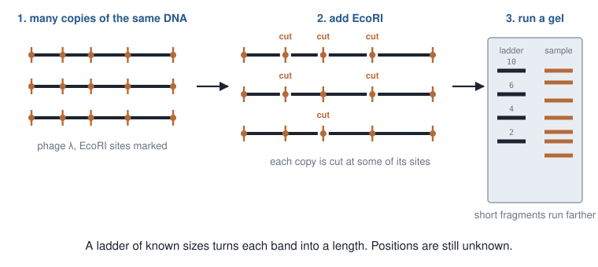{.sketch}

## The gel gives lengths

Each band is a fragment length. The cut positions are the unknown.

{.photo}

::: {.cite}
Agarose gel with DNA ladders (UV). Joseph Elsbernd, Wikimedia Commons, [CC BY-SA 2.0](https://creativecommons.org/licenses/by-sa/2.0/). File: Agarose gel with DNA ladders on a UV transilluminator.jpg.
:::

## A complete digest loses the order

Wait long enough, or use enough enzyme, and almost every copy is cut at **every** site. The gel then shows only neighbouring pieces. Two fragments of length $2$ and two of length $3$ do not say which $2$ sits next to which $3$.

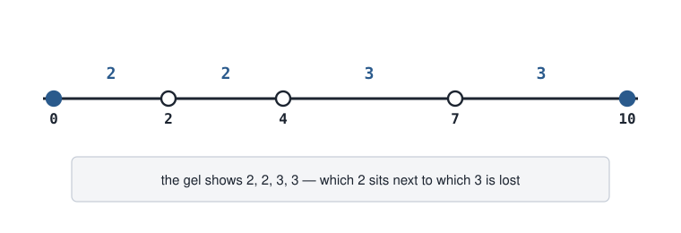{.sketch}

## A partial digest lists every pair

Stop early, or use less enzyme. Some copies are cut at two sites $i$ and $j$ with nothing cut in between, so that molecule is one fragment of length $|x_j-x_i|$. Across many copies, **every pair** of sites appears as a band.

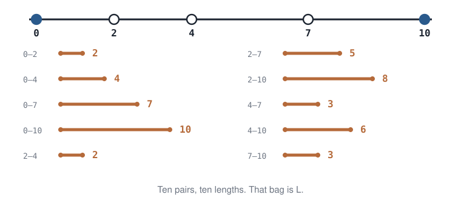{.sketch}

## The formulated problem

The gel gave an **unordered bag** $L$. Each length is $|x_i-x_j|$ for some pair of sites — neighbours, and every longer span. Lining the numbers up does not place the cuts: $8$ might sit $8$ from the left end, or $8$ from the right. A map $X$ is a solution only if **every** pairwise distance of $X$ equals $L$.

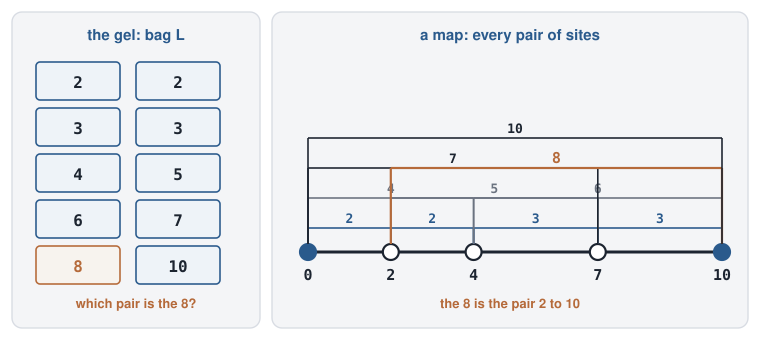{.sketch}

## Input / output

::: {.io}
::: {.in}
**Input**

A multiset $L$ of pairwise distances among unknown points on a line.
:::
::: {.arrow}
→
:::
::: {.out}
**Output**

Positions $X$ (including the two ends) whose pairwise distances are exactly $L$.
:::
:::

## Today's toy

::: {.toy}
**Toy.** Distances $L=\{2,2,3,3,4,5,6,7,8,10\}$. Ends are $0$ and $10$. Recover $X=\{0,2,4,7,10\}$. Lab: `labs/05-search.ipynb`.
:::

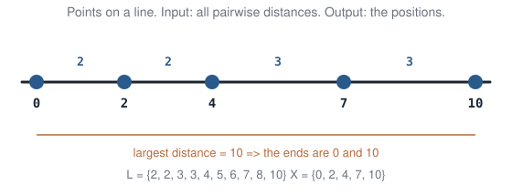{.sketch}

## How many sites are on the map?

$n$ sites produce one length for every pair of sites:

$$
\binom{n}{2} = \frac{n(n-1)}{2} = |L|.
$$

Here $|L|=10$, so $n=5$ (including the two ends).

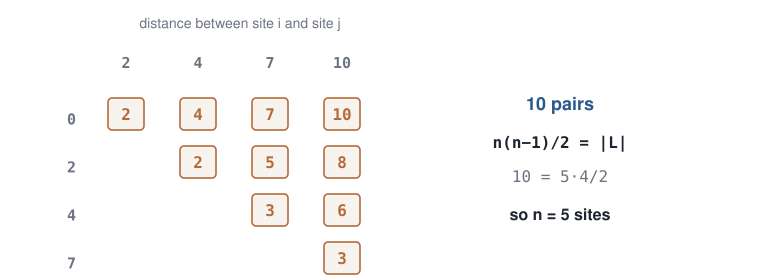{.sketch}

## Four smallest lengths, four gaps

$n=5$ sites sit on a line, so there are $n-1=4$ neighbouring gaps. A longer pair is a sum of two or more gaps, hence at least $2+2=4$. The four smallest numbers in $L$ — $2,2,3,3$ — are those neighbouring distances. Their order is still unknown.

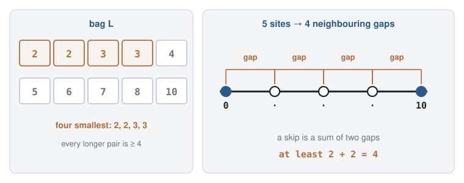{.sketch}

## Six ways to line up $2,2,3,3$

Line those four gaps up. Distinct orders: $4!/(2!\,2!)=6$. Check each against the full bag $L$. Two maps match (a placement and its reverse). Four fail.

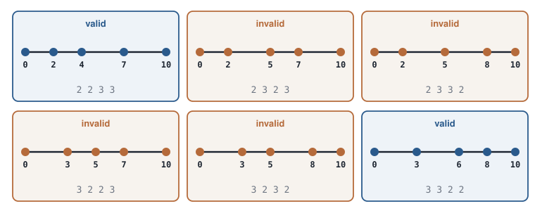{.sketch}

## One valid, one invalid

$X=\{0,2,4,7,10\}$ reproduces $L$. $X=\{0,2,5,7,10\}$ produces three $5$s and no $4$. Four of the six orders fail.

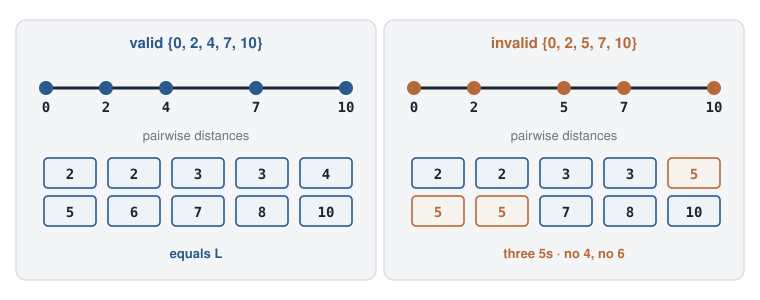{.sketch}

## List the maps as a tree

The largest leftover length $\delta$ must sit $\delta$ from one of the two ends. Two children: place it from the left, or from the right. A node is a partial set $X$; an edge adds one site.

Start from $X=\{0,10\}$. Largest leftover is $8$. Both children live.

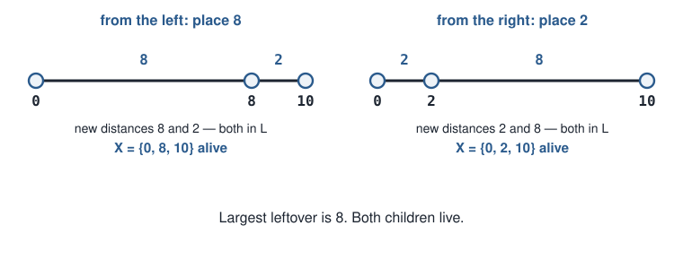{.sketch}

## Some branches are illegal

From $\{0,8,10\}$, leftover max is $7$. Place $7$ from the left: new distances $7$, $|7-8|=1$, and $|7-10|=3$. The length $1$ is not in the experimental bag $L$.

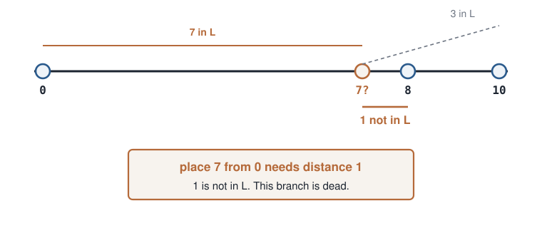{.sketch}

That map cannot be completed to match the gel. Stop the branch. The other child — place $3$ from $10$ — has $3$, $5$, $7$, all in $L$. Continue.

## Skip that subtree

No completion of “place $7$ from $0$” can match $L$. One living branch later reaches $X=\{0,2,4,7,10\}$.

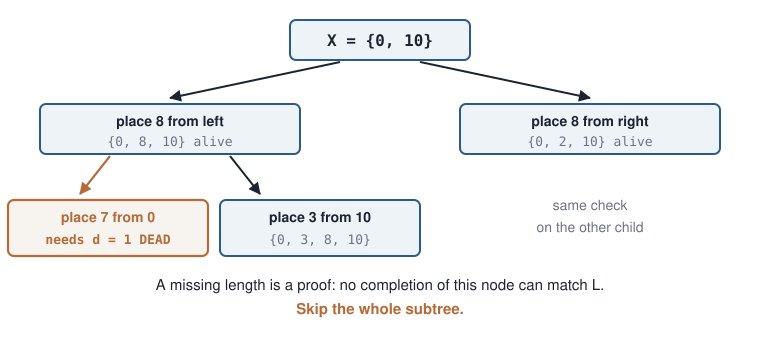{.sketch}

## The notebook checks that prune

`legal(X, x, L)` asks: do the new distances from $x$ still sit in leftover $L$? If a length is missing, it returns that length.

```python
legal([0, 8, 10], 7, L)   # (False, 1)  — illegal
legal([0, 8, 10], 3, L)   # (True, None)
```

In the lab: Run All, then uncomment `legal([0, 2, 10], 7, L)` — does that child live?

## The algorithm, in steps

1. Start from $X=\{0,W\}$, where $W$ is the longest length in $L$ (the two ends of the molecule).
2. While leftover lengths remain, let $\delta$ be the largest unused length.
3. Two children: place a site $\delta$ from the left end, or $\delta$ from the right end.
4. A child lives only if every new pairwise distance still sits in leftover $L$. If a length is missing, skip that whole subtree.
5. Repeat. Each surviving leaf is a map whose pairwise distances are exactly $L$.

## The algorithm is exact

A branch dies only when it already needs a length the gel did not produce. Every map whose pairwise distances *are* $L$ is still a leaf of the remaining tree.

We skip work. We do not skip answers. The output is the same as walking every legal placement to the end.

## That method is branch-and-bound

Walk a tree of partial solutions. At a node, a **bound** proves that no completion can succeed (here: a required length is missing). Skip the whole subtree.

::: {.idea}
The skip is a proof about every descendant, so the search stays exact.
:::

## 90 seconds: guess or proof?

Pair: is that bound a **guess**, or a **proof**?

If even the dream future of this node cannot match $L$, the real future cannot. Skip.

## Cost of walking the whole tree

If every node has branching factor $b$ and the depth is $d$, the tree has $\Theta(b^d)$ nodes. Illegal children cut that down.

::: {.takeaway}
The search is a **binary tree of placements**. A missing length kills a branch. That skip is branch-and-bound.
:::

## Motifs {.section-head}

A short noisy word that turns genes on. Same kind of search tree. The bound will be a number.

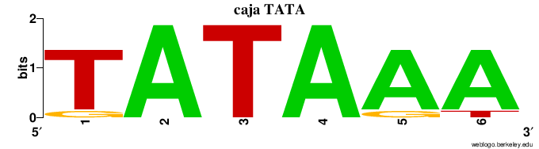

::: {.cite}
TATA-box sequence logo. Ericbf10, Wikimedia Commons, [CC BY-SA 4.0](https://creativecommons.org/licenses/by-sa/4.0/). File: Caja TATA.png.
:::

## Why we care about motifs

A transcription factor binds a short word in the promoter and turns the gene on. Genes that fire **together** often share that word.

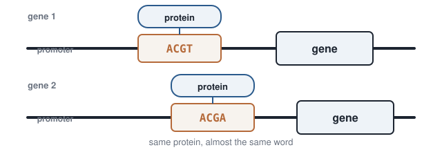{.sketch}

::: notes
Regulation first. Do not start MEME. The question is: why hunt a short pattern at all?
:::

## The protein contacts a handful of bases

The DNA-binding domain sits on a few base pairs — a zinc finger, a homeodomain, a helix–loop–helix. That is why the motif is short, and why a mismatch can still bind.

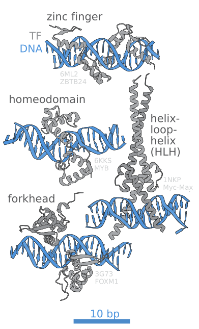{.photo}

::: {.cite}
DNA-binding domains of transcription factors (zinc finger, homeodomain, helix–loop–helix, forkhead). J.J. Froehlich, Wikimedia Commons, [CC BY-SA 4.0](https://creativecommons.org/licenses/by-sa/4.0/). File: Transcription factors DNA binding sites.svg.
:::

## The copies are not identical

The protein tolerates mismatches. The site in sequence 2 may be `ACGA` while the others are `ACGT`. One substitution, same biology.

If you take the promoters of co-expressed genes, the shared motif is a **hypothesis about who binds**.

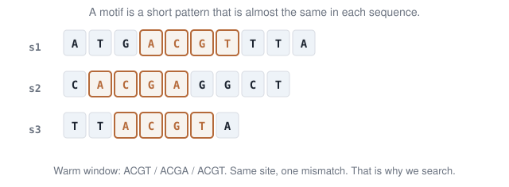{.sketch}

## The formulated problem

Find a short word that sits, with a few mismatches, in every sequence.

::: {.io}
::: {.in}
**Input**

$t$ DNA strings (promoters) and a length $k$.
:::
::: {.arrow}
→
:::
::: {.out}
**Output**

Starting positions $s=(s_1,\ldots,s_t)$ and a motif of length $k$.
:::
:::

## Input / output

Starting positions $s=(3,1,2)$: $s_i$ is the start in string $i$. The $k$ letters from each start form a $t \times k$ matrix. The motif is `ACGT`. **Hamming distance** against row $s_2$ is $1$.

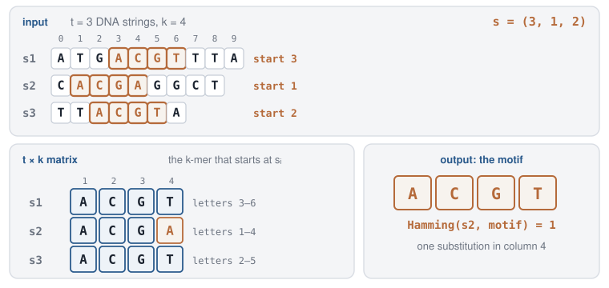{.sketch}

## Hamming distance

**Hamming distance** counts substitutions between two words of the same length. Alignment in weeks 3–4 used **edit distance**: substitutions and gaps. On `GCT` versus `GCAT` that is one insertion.

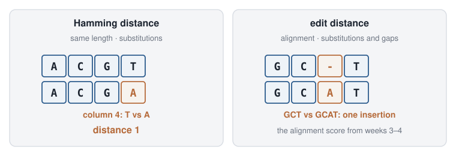{.sketch}

## A tree whose leaves are motifs

Each edge adds one letter. Depth $k$. A leaf is one $k$-mer — one candidate motif. Branching factor $4$. For $k=4$ there are $4^4=256$ leaves.

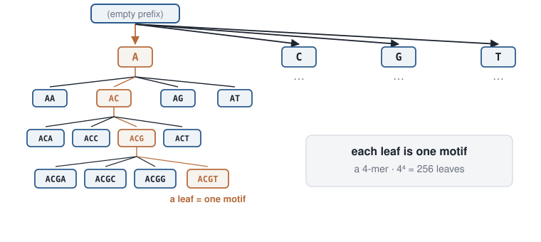{.sketch}

## Brute force: every motif, every start

Walk every leaf. At a leaf, Hamming that $k$-mer against **every** start; keep the closest window in each string and sum.

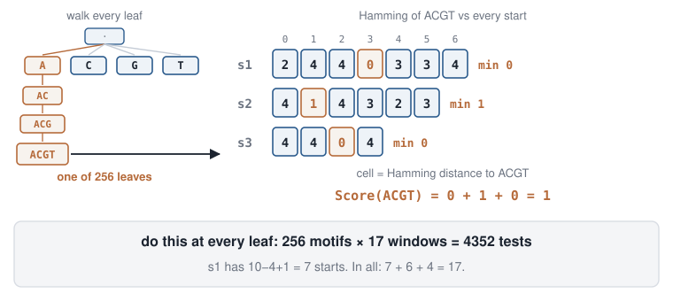{.sketch}

## Fix the starts instead

Choose one start in each sequence. The warm windows in the DNA **are** the alignment. Most frequent letter per column is the motif. Smaller score is better.

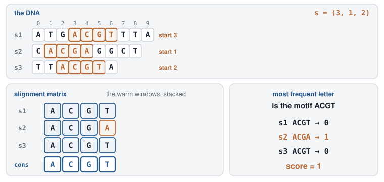{.sketch}

## How the score is computed

::: {.split .fig-right}
::: {.pane}
$n_c(a)$ = how many of the $d$ rows have letter $a$ in column $c$. That column costs every letter that is not the majority.

$$
\mathrm{Score}=\sum_{c=1}^{k}\bigl(d-\max_a n_c(a)\bigr)
$$

On a complete alignment $d=t$. Smaller is better.
:::
::: {.pane}
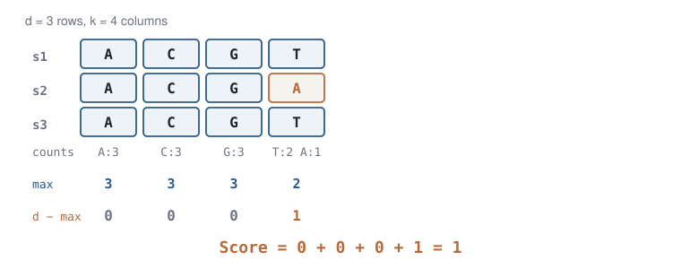{.sketch}
:::
:::

## So the tree is over starting positions

Each edge picks a start in the next sequence. A leaf is already an alignment, so the consensus motif and its score come in one $O(tk)$ pass.

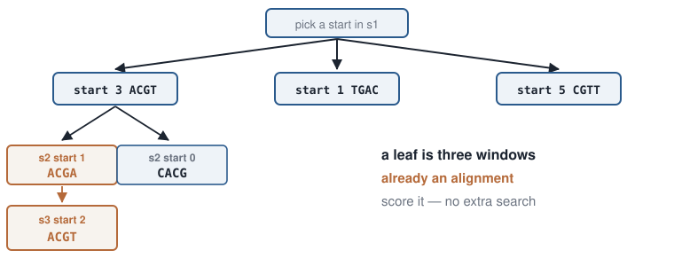{.sketch}

## A complete alignment we will keep

The leaf $s=(3,1,2)$ is already an alignment. Consensus `ACGT`, one mismatch in $s_2$. Score $=1$. Call that best-so-far $B=1$.

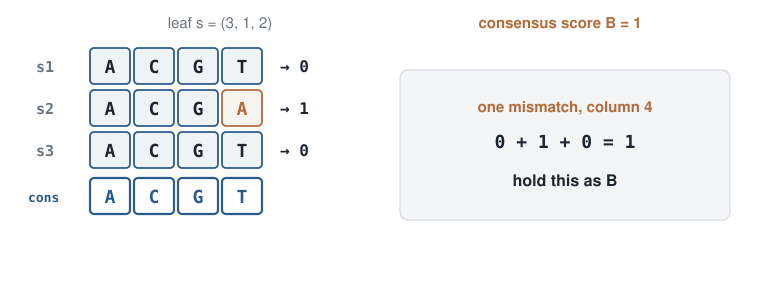{.sketch}

## Score a subalignment

Only two starts are chosen: $s_1=3$ (`ACGT`) and $s_2=0$ (`CACG`). Each column whose letters differ already costs $1$. That is $\mathrm{Score}=4$ on $d=2$ rows.

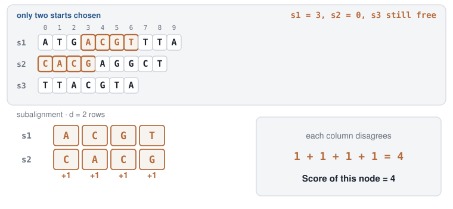{.sketch}

## Best possible: the rest matches perfectly

If unused rows copy a row we already have, they add $0$. Then $U$ equals the subalignment score — the best complete score this node can still reach.

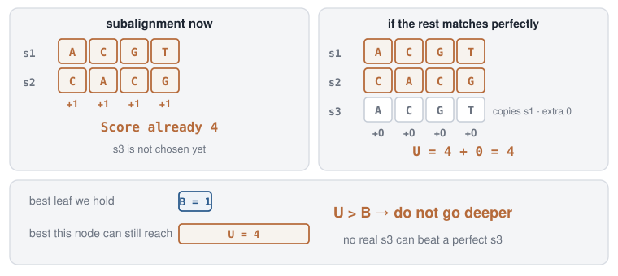{.sketch}

::: {.idea}
If $U>B$, even a perfect rest cannot beat the leaf we hold. Do not go deeper.
:::

## $U=4$ is already worse than $B=1$

$U=4>B=1$. No start in $s_3$ can beat the leaf we hold. Skip every completion of this node.

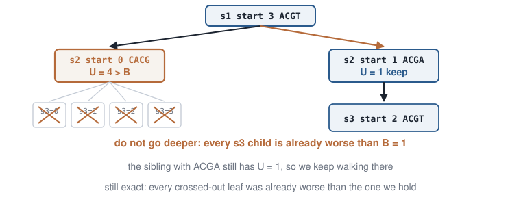{.sketch}

## The motif algorithm, in steps

$$
\mathrm{Score}=\sum_{c=1}^{k}\bigl(d-\max_a n_c(a)\bigr),\qquad U=\mathrm{Score}
$$

1. Walk the tree of starting positions. After the first complete leaf, hold its score as best-so-far $B$ (on the toy, $B=1$).
2. An edge picks a start in the next sequence. The windows chosen so far are a **subalignment** of $d$ rows.
3. Score that subalignment. Remaining rows add $0$ if they match perfectly, so $U$ is the best this node can still reach.
4. If $U>B$, do not go deeper.
5. At a leaf, if $\mathrm{Score}<B$, update $B$. The smallest $B$ among surviving leaves is the motif score.

## The notebook scores that bound

At a node, stack the windows you have. Per column: most frequent letter, then count the others. That sum is $U$. If $U>B$, prune.

```python
B = 1                          # leaf s = (3, 1, 2)
U = score(["ACGT", "CACG"])    # columns 1+1+1+1 = 4
print(U > B)                   # True  →  prune
```

In the lab: confirm $U=4$ prunes. Change the second window to `ACGA`. Does $U$ still beat $B$?

## Two bounds, one idea

::: {.small}
| | Restriction map | Motif |
|:--|:--|:-|
| A node is | a partial set of sites $X$ | starts chosen so far |
| An edge is | place from the left or from the right | a start in the next string |
| The bound | a required distance is **missing** | partial consensus score already $>B$ |
:::

::: {.takeaway}
Branch-and-bound is still exhaustive in the worst case (the tree may not prune). In good cases most subtrees die early.
:::

## 90 seconds: which tree?

Pair: digest or motif?

- The bound is Boolean (impossible vs possible).
- The bound is numeric (partial alignment score vs $B$).
- Branching factor 2. Branching factor $=$ starts in the next string.

## The same prune on a tour {.section-head}

Week 2’s salesman, as a tree: unused cities on the edges. The bound is “length so far.” If that already beats the best complete tour, skip.

## TSP as a search tree

Unused cities on the edges (week 2’s tour). Bound = length so far vs best complete tour.

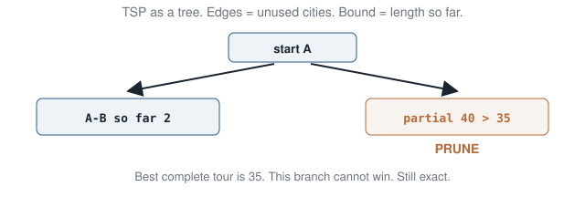{.sketch}

## Partial tour costs 40; best complete is 35

::: {.q .q3}
[Q3]{.tag} A partial tour already costs 40. You hold a complete tour of 35. What do you do with that branch, and why is the skip still exact?
:::

::: {.fragment}
This branch cannot win. **Prune.** Every skipped tour was already longer than one you hold. The bound is the length so far.
:::

::: notes
Wrap Q3, live. The digest prune was Boolean. The motif prune was Hamming. This one is “already too long.” Same sentence: a proof about the future.
:::

::: {.takeaway}
Three labels, one skip: a missing distance, an optimistic Hamming score, a tour already longer than $B$.
:::

## A tree that stores keys {.section-head}

So far a tree **searched candidates**. A binary search tree *stores* keys so each comparison can throw away half of them.

## A different tree: store keys

So far a tree **searched candidates**. A **binary search tree** stores keys: left subtree $<$ node $<$ right subtree.

Search, insert: follow one child at each step.

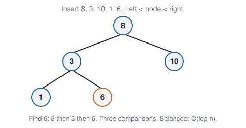{.sketch}

Find $6$: $8 \to 3 \to 6$. Three comparisons.

## Grow it, then find $6$

Insert $8$, then $3$ and $10$, then $1$ and $6$. Left of a node is smaller, right is larger.

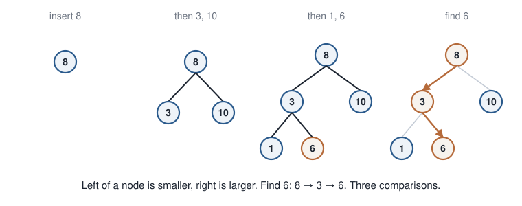{.sketch}

## Stick vs fan

Insert already-sorted keys $1,3,6,8,10$: each new key is larger, so it hangs on the right. A **stick** of height $4$. Find is $O(n)$. Same five keys as a fan: height $2$.

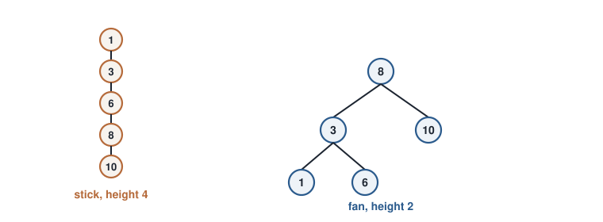{.sketch}

## One rotation turns a stick into a fan

A three-node right spine has height $2$. A **left rotation** on the middle edge lifts that edge: the middle key becomes the root, and the two sides become its children. Height $1$.

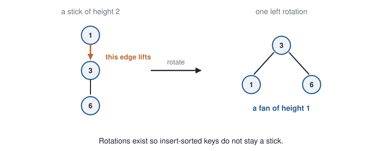{.sketch}

AVL trees and red-black trees rotate after insert so the height stays logarithmic.

## Cost is the height

If the tree is **balanced**, height $\Theta(\log n)$, so find/insert are $O(\log n)$.

If you insert already-sorted keys, the tree becomes a stick: height $n$, find is $O(n)$.

::: {.takeaway}
The data structure is the idea: **order the keys in a tree** so each comparison halves the search (when the tree is balanced).
:::

## Open `labs/05-search.ipynb`

::: {.lab}
::: {.lab-tag}
Lab · ~15 minutes · Python
:::

Select Kernel (Python 3). **Run All** (needs `matplotlib`). The lecture toys draw themselves: the cut map, then the DNA and the alignment.

1. **Digest.** `pairwise([0,2,4,7,10])` must equal $L$. Then read `legal([0,8,10], 7, L)` — it returns `(False, 1)`. That missing $1$ is the bound.
2. **Play the other child.** Uncomment `legal([0, 2, 10], 7, L)`. Does that branch live? Why?
3. **Motif.** Leaf $s=(3,1,2)$ has $B=1$. Partial `ACGT`/`CACG` has $U=4>B$, so prune. Change the second window to `ACGA`. Print $U$. Does this node die?
4. **Write Q1–Q3** in the notebook, without notes.
:::

## A bit of history

::: {.history}
- **Land & Doig** (1960): branch-and-bound for integer programs. The prune is a proof that the subtree cannot succeed.
- **Little et al.** (1963): BnB for TSP. Week 2’s tour list, as a tree.
- **Nathans & Smith** (1970s): restriction enzymes as a mapping tool — the biology that made today’s distances a real experiment.
- **Skiena:** partial digest as a reconstruction puzzle — the toy is from that tradition.
- **Bailey & Elkan, MEME** (1994): motif finding in practice is often EM / Gibbs. The search picture is still a tree; the software usually refuses to walk all of it.
:::

## Tools that use this

::: {.tools}
- **Gurobi**, **CPLEX**, SCIP: industrial BnB.
- Phylogenetic **branch-and-bound** (exact parsimony on small $n$) in PAUP* and friends — week 10’s tree space.
- **SAT** solvers: unit propagation is a bound by another name.
- Motif tools you will meet in a methods course: **MEME**, **HOMER**, **FIMO** — different algorithms, same biological question (a short noisy word).
- Databases and language runtimes: **balanced binary search trees** / B-trees, for lookups such as a gene name.
- [VisuAlgo BST](https://visualgo.net/en/bst)
:::

## Extensions

::: {.ext}
- **A\***: BnB with a heuristic bound that is still a proof if the heuristic never overestimates.
- Double-digest maps (two enzymes): more lengths, still a reconstruction. We stay with one enzyme.
- AVL / red-black: the four rotation cases that keep a binary search tree logarithmic.
:::

## What you must be able to say

::: {.muted}
Without notes. Q1–Q2 today’s idea. **Q3** a situation we did not drill.
:::

::: {.qs}
::: {.q}
[Q1]{.tag} Brute force as a tree: what sits on a node, what on an edge? (Digest *or* motif — say which.)
:::
::: {.q}
[Q2]{.tag} A bound that lets you skip a subtree — in one sentence. When does the whole tree still get explored?
:::
::: {.q .q3}
[Q3]{.tag} Week 2’s TSP: a partial tour already costs 40; you hold a complete tour of cost 35. What do you do with that branch, and why is that still exact?
:::
:::

::: {.takeaway}
Q3 asks about a situation we did not drill today.
:::

::: notes
2–3 minutes. Pair-share Q3.
:::

## Takeaways

::: {.takeaway}
A restriction map is recovered by walking a **tree of placements**. A missing distance kills a branch — that is branch-and-bound.
:::

::: {.takeaway}
Motifs: the tree is over **starting positions**. A partial alignment whose consensus score already beats $B$ dies.
:::

::: {.takeaway}
A balanced binary search tree makes lookup logarithmic: the tree stores keys, and each comparison halves the remaining set.
:::

## Next week

**Greedy algorithms and approximation.**

Nearest neighbor was greedy and $O(n^2)$. Next: pancake flipping / reversals, and a number that says how bad greedy is allowed to be — the **approximation ratio**.

## To read

::: {.read}
- Land & Doig (1960). Branch-and-bound (integer programs; the same prune idea).
- Little, Murty, Sweeney, Karel (1963). An algorithm for the traveling salesman problem.
- Skiena, *The Algorithm Design Manual* — partial digest as a reconstruction puzzle.
- Bailey & Elkan (1994). Fitting a mixture model by expectation maximization to discover motifs in biopolymers. *ISMB* — what motif software actually runs.
- [VisuAlgo — BST](https://visualgo.net/en/bst).
:::
