## Recap

So far we have met three ways of organising a search:

- **Weeks 3–4, a grid.** Every cell of a table is filled once, and the answer is read off a path through it.
- **Week 5, a search tree.** A bound lets us discard whole subtrees without losing the best answer.
- **Week 2, greedy rules.** Nearest neighbour picks the closest unused city and can miss the shortest tour. Earliest-finish interval scheduling is also greedy, but provably always optimal.

This week we study a greedy method that is *not* always optimal, and ask what can still be guaranteed about it.

## Genome rearrangements {.section-head}

Closely related species often carry the same genes in a different order.

## The blackspotted stickleback

:::: {.split .fig-right}
::: {.pane}
The **blackspotted stickleback** (*Gasterosteus wheatlandi*) is a small fish of the North American Atlantic coast.

- Its sex chromosomes are evolutionarily **young**.
- The steps that built its Y chromosome can still be read from the genome sequence.
- Sticklebacks are a model system for sex-chromosome evolution, including at the University of Bern.
:::
::: {.pane}
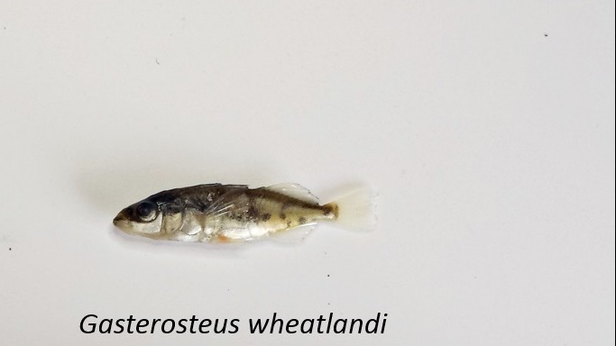

::: {.cite}
*G. wheatlandi*, from a four-species plate. Ghegeman, Wikimedia Commons, [CC BY-SA 4.0](https://creativecommons.org/licenses/by-sa/4.0/).
:::
:::
::::

## Why sex chromosomes stop recombining

On an ordinary chromosome pair, the two copies **recombine** in every meiosis. Recombination shuffles alleles and lets selection remove harmful mutations one at a time.

Sex chromosomes behave differently:

- Once the region around the **sex-determining gene** stops recombining, the Y copy and the X copy evolve independently.
- Without recombination, the Y region accumulates mutations and repeats, and slowly **degenerates**.
- A central question in evolutionary genetics is therefore *how* recombination was switched off.

## Inversions suppress recombination

An **inversion** cuts a chromosome at two points and reinserts the segment the other way round.

- With one inverted and one normal copy, crossing over in the segment is suppressed.
- A Y inversion containing the sex-determining gene is always heterozygous: recombination stays off.
- Successive inversions produce **evolutionary strata**.

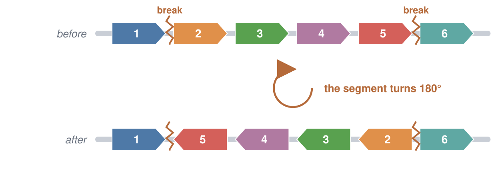{.sketch .below}

## Synteny blocks

Related genomes share long stretches with the **same genes in the same order**: **synteny blocks**.

- Number the blocks $1, 2, \ldots, n$ along one genome.
- Read the same numbers along the other genome.
- The result is a **permutation**, here $1\;5\;4\;3\;2\;6$. It records every difference in gene order.

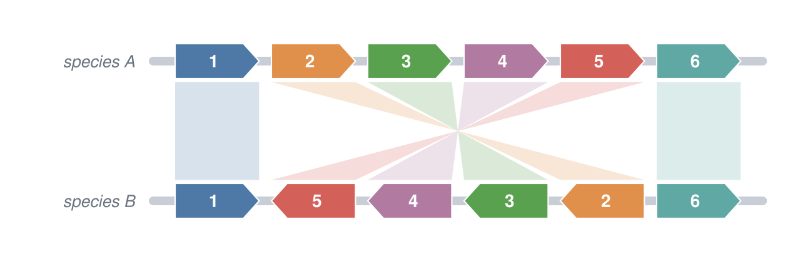{.sketch .below}

## Inversion and reversal

The same event has two names:

| | Biology | Algorithms |
|---|---|---|
| name | chromosomal **inversion** | **reversal** |
| what happens | DNA breaks at two points, the segment turns, the ends rejoin | a contiguous stretch of the permutation is written in reverse order |
| example | blocks 2–5 inverted | $1\;2\;3\;4\;5\;6 \;\to\; 1\;5\;4\;3\;2\;6$ |

We will say *inversion* for the event on the chromosome and *reversal* for the operation on the permutation.

## Reconstructing the history

We know the ancestral block order and today's order, but not the inversions in between.

- By parsimony, the most plausible history uses the **fewest** inversions.
- On a stickleback Y, the order of those inversions is the order in which the strata formed.

**The computational problem:** find the smallest number of reversals that turns one permutation into the other.

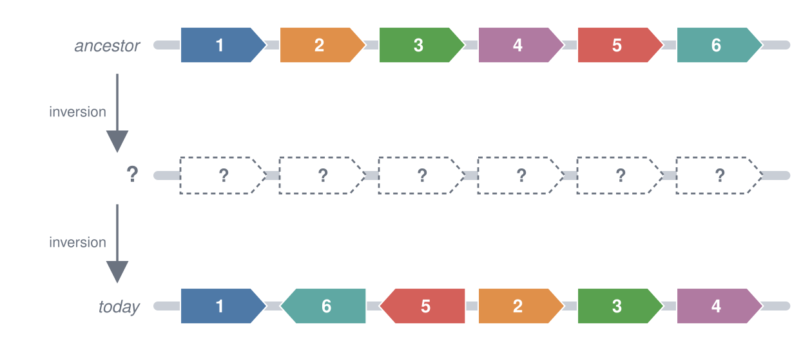{.sketch .below .tall}

## A Y chromosome, inversion by inversion

:::: {.split .fig-left}
::: {.pane}
Daniel Jeffries (Bern) reconstructed the history of the blackspotted stickleback Y.

- The Y arose by **fusion** of chromosomes 12 and 19; lines connect matching genes.
- Five inversions, **A–E**, followed.
- Each one enlarged the non-recombining region: strata **S1–S5**.
- *AmhY* (top right) is the male-determining gene.
:::
::: {.pane}
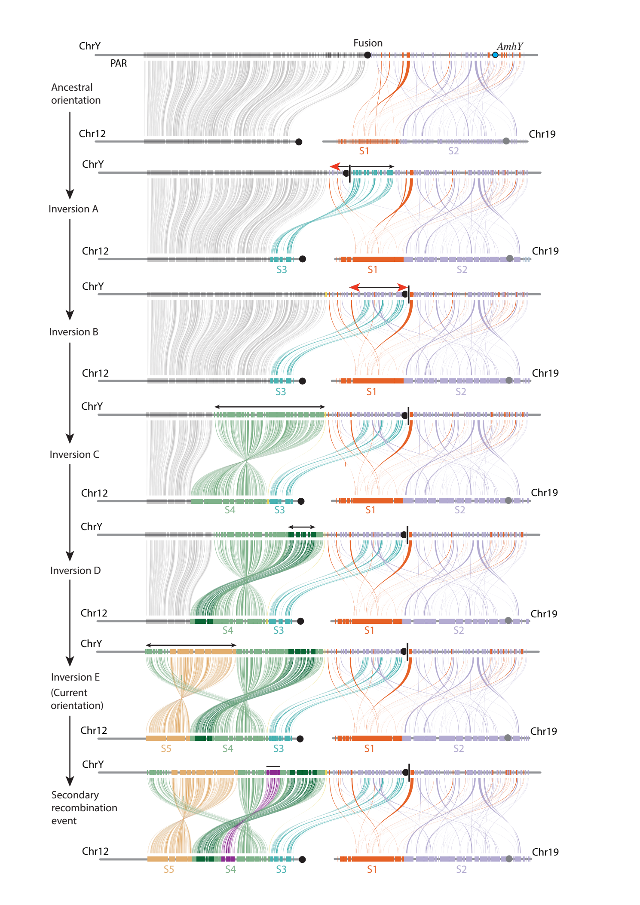
:::
::::

::: {.cite}
Daniel L. Jeffries, Institute of Ecology and Evolution, University of Bern. [preprint](https://www.biorxiv.org/content/10.64898/2026.07.23.740300v1).
:::

## Two versions of the problem

Real comparisons involve **hundreds** of synteny blocks, far too many to try every sequence of reversals. How hard the problem is depends on what we know about each block:

| What we know about each block | Version of the problem | Exact polynomial-time method? |
|---|---|---|
| its position only | **unsigned** reversals | none known; the problem is in the same hard class as TSP |
| its position and its orientation, written $+3$ or $-3$ | **signed** reversals | yes |

We first study the unsigned version. There, a fast method cannot promise the fewest reversals, so we ask what it *can* promise. At the end we return to signed blocks.

## The idea of this week

::: {.idea}
A greedy algorithm takes the step that looks best at the moment. That step can be wrong. If we use such a method anyway, we should prove an **approximation ratio**: a bound on how far its answer can be from the optimum.
:::

::: {.goals}
By the end of this meeting you should be able to:

1. Run a greedy reversal sort by hand and compute its ratio on one input.
2. Count breakpoints and use them as a lower bound on the number of reversals.
3. Sort with strips, and explain why the result is never more than four times the optimum.
:::

## Problem statement

::: {.io}
::: {.in}
**Input**

A permutation $\pi$ of $1, \ldots, n$: the order of the synteny blocks in one genome.
:::
::: {.arrow}
→
:::
::: {.out}
**Output**

A shortest sequence of reversals that turns $\pi$ into $1\;2\,\ldots\,n$.
:::
:::

We look for an algorithm that is fast on hundreds of blocks and whose answer is provably close to the shortest.

## Two running examples

Two greedy rules, each choosing the next reversal from the current order alone:

::: {.cards}
::: {.card}
**Rule 1: place one block at a time**

Find the first position $i$ that does not hold block $i$, and reverse the stretch that brings block $i$ there.

**Example 1:** $\pi = 6\;1\;2\;3\;4\;5$. The rule needs 5 reversals, although 2 are enough.
:::
::: {.card .warm}
**Rule 2: repair broken neighbours**

Choose a reversal that reduces the number of places where two neighbouring blocks do not belong together.

**Example 2:** $\pi = 4\;5\;6\;1\;2\;3$. No single reversal repairs anything, so the rule needs an extra step.
:::
:::

Both are worked out step by step below, and run in `labs/06-greedy.ipynb`.

## A first greedy rule {.section-head}

Bring the blocks into place one at a time.

## Put the next block in place

The simplest strategy fixes the order from left to right:

1. Find the first position $i$ that does not hold block $i$.
2. Reverse the stretch from position $i$ to the current position of block $i$.
3. Block $i$ is now in place and is never moved again. Repeat.

Each reversal places one block, so at most $n-1$ reversals are needed. Every step looks like progress.

## Example 1: the place-one-block rule

:::: {.split}
::: {.pane}
- Block 1 is at position 2: reverse 1–2.
- Block 2 is at position 3: reverse 2–3.
- Block 3 is at position 4: reverse 3–4.

Block 6 moves one position to the right with every reversal. How many reversals will the rule need in total?
:::
::: {.pane}
$$
\begin{align*}
6\;1\;2\;3\;4\;5 &\;\to\; 1\;6\;2\;3\;4\;5 \\
&\;\to\; 1\;2\;6\;3\;4\;5 \\
&\;\to\; 1\;2\;3\;6\;4\;5
\end{align*}
$$

::: {.fragment}
$$
\begin{align*}
&\;\to\; 1\;2\;3\;4\;6\;5 \\
&\;\to\; 1\;2\;3\;4\;5\;6
\end{align*}
$$

**Five** reversals. Is that the minimum?
:::
:::
::::

## A shorter solution

**Two** reversals are enough: reverse the ordered stretch $1\;2\;3\;4\;5$ as one piece, then reverse everything.

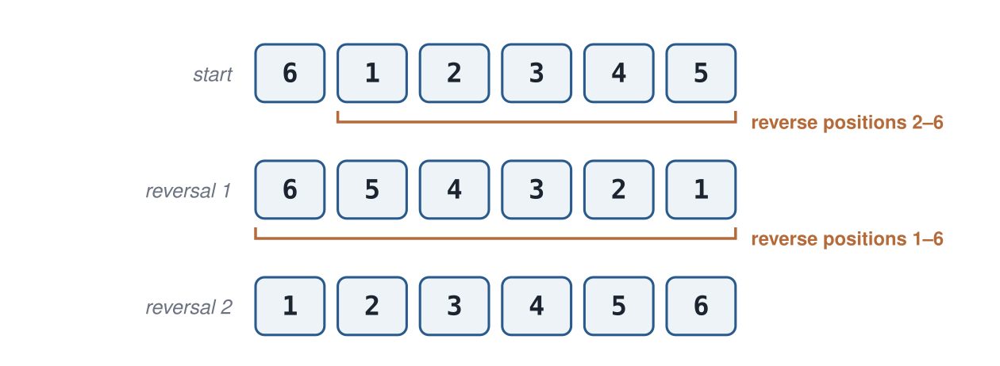{.sketch .below}

::: {.takeaway}
The greedy rule used five reversals where two are enough.
:::

::: notes
Do both sequences on the board. This instance is the whole argument.
:::

## Why the greedy rule went wrong

Every one of the five reversals did what the rule asks: it put one more block in its final place. The rule is correctly implemented; it is simply not optimal.

- The stretch $1\;2\;3\;4\;5$ was already in the right order at the start.
- To move block 6 past it, the rule took that stretch apart one block at a time.
- A rule that looked at the order of the *whole* permutation would have kept the stretch intact and reversed it as one piece.

## How far from optimal? {.section-head}

Measuring the quality of an answer that may not be the best.

## The ratio on one input

Let $A(\pi)$ be the number of reversals our algorithm uses, and $\mathrm{OPT}(\pi)$ the smallest number possible (the **optimum**). For a minimisation problem we compare them by the ratio

$$
r(\pi) = \frac{A(\pi)}{\mathrm{OPT}(\pi)}.
$$

For example 1 and the place-one-block rule, $A = 5$ and $\mathrm{OPT} = 2$, so

$$
r = 5/2 = 2.5.
$$

A ratio of $1$ means the algorithm found an optimal answer; larger values are worse.

## The ratio of an algorithm

The value $2.5$ describes one permutation. Another input might be worse. The **approximation ratio** of an algorithm is the worst case over all inputs:

$$
r = \max_\pi \frac{A(\pi)}{\mathrm{OPT}(\pi)}.
$$

An algorithm with approximation ratio $r$ is guaranteed never to use more than $r$ times the optimal number of reversals, whatever the input.

::: {.takeaway}
An approximation ratio is a guarantee for every input, not an average over typical inputs.
:::

## 90 seconds: one map, or every map?

In week 2, nearest neighbour starting from A gave a tour of length 13; the shortest tour has length 12.

Discuss with your neighbour:

- What is $r$ on that map?
- Suppose that on another map nearest neighbour gives a tour three times the optimum. What does that tell us about the approximation ratio of nearest neighbour?

## The optimum is unknown

To compute $r = 5/2$ we needed to know that $\mathrm{OPT} = 2$.

- For six blocks, the optimum can be found by trying all short sequences of reversals.
- For hundreds of blocks, computing the optimum *is* the hard problem we are trying to avoid.
- So we cannot evaluate $r$ directly on realistic inputs.

::: {.idea}
Week 5 met the same difficulty and used a **bound**: a quantity that is cheap to compute and that the optimum cannot beat. Here we need a **lower bound** on the number of reversals that can be read directly from the permutation.
:::

## Breakpoints {.section-head}

Counting the places where the order is broken gives a lower bound.

## Adjacencies and breakpoints

Add end markers $0$ and $n+1$, then look at each pair of neighbours:

- Values differing by one ($3\;4$ or $4\;3$) form an **adjacency**: these blocks already sit together as in the sorted order.
- Any other pair is a **breakpoint**, drawn as a bar.

The sorted permutation $0\;1\;2\,\ldots\,n{+}1$ has no breakpoints.

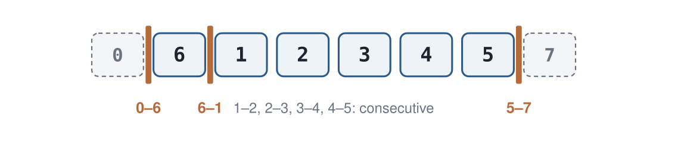{.sketch .below}

## Example 1 has three breakpoints

Write out the seven neighbouring pairs of $0\;6\;1\;2\;3\;4\;5\;7$:

| pair | $0\;6$ | $6\;1$ | $1\;2$ | $2\;3$ | $3\;4$ | $4\;5$ | $5\;7$ |
|---|---|---|---|---|---|---|---|
| breakpoint? | yes | yes | no | no | no | no | yes |

$$
0\;|\;6\;|\;1\;2\;3\;4\;5\;|\;7 \qquad b(\pi) = 3
$$

To sort the permutation, every one of these three breakpoints must be removed.

## One reversal removes at most two breakpoints

A reversal cuts the permutation at **two** places and turns the piece between them around.

- Inside the reversed piece, every block keeps the same two neighbours, only in the opposite order. Adjacencies inside stay adjacencies.
- Only the two pairs at the cut points can change.

So a single reversal changes the number of breakpoints by at most two.

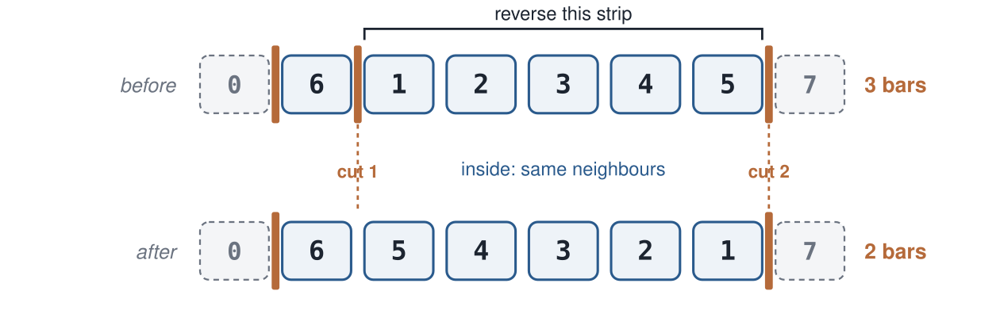{.sketch .below}

## A lower bound on the optimum

Each reversal removes at most two breakpoints, and all $b(\pi)$ must go. Therefore

$$
\mathrm{OPT}(\pi) \;\ge\; \frac{b(\pi)}{2}.
$$

- **Example 1:** $b = 3$, so $\mathrm{OPT} \ge 1.5$; since reversals come in whole numbers, at least **2**. The two-reversal solution meets this bound, so it is optimal.
- **In general:** $A/(b/2)$ is an upper bound on $r$ that can be computed without knowing the optimum.

## A greedy rule based on breakpoints {.section-head}

Choose each reversal by its effect on the breakpoints.

## Strips

A better rule chooses reversals that **reduce the number of breakpoints**. Is such a reversal always available? To answer this, we group the blocks:

- A **strip** is a maximal run of blocks between two breakpoints.
- It is **increasing** ($1\;2\;3$) or **decreasing** ($6\;5\;4$).
- By convention a single block is decreasing, and the strips containing the end markers are increasing.

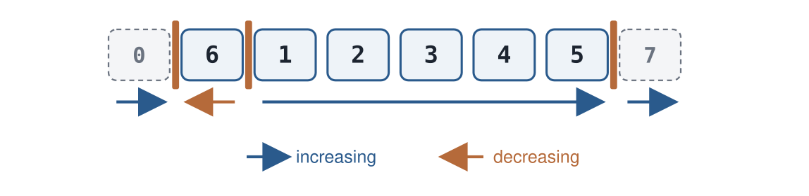{.sketch .below}

## The $k-1$ rule

If the permutation has at least one decreasing strip:

1. Let $k$ be the **smallest** block that lies in a decreasing strip.
2. Block $k-1$ then lies in an increasing strip, at its right end. (If it were in a decreasing strip, $k$ would not be the smallest.)
3. Reverse the stretch between the two blocks so that $k$ ends up directly next to $k-1$.

Both cut points of this reversal were already breakpoints, so no new breakpoint is created. One of them becomes the adjacency $k-1,\,k$.

**Result:** the number of breakpoints drops by at least one.

## Example 1, first reversal

$$
0\;|\;6\;|\;1\;2\;3\;4\;5\;|\;7
$$

- The only decreasing strip is the single block $6$, so $k = 6$.
- Block $5$ sits at the right end of the increasing strip $1\;2\;3\;4\;5$.
- Reversing $1\;2\;3\;4\;5$ puts $5$ next to $6$:

$$
0\;|\;6\;5\;4\;3\;2\;1\;|\;7
$$

The number of breakpoints falls from three to two.

## Example 1, second reversal

$$
0\;|\;6\;5\;4\;3\;2\;1\;|\;7
$$

- The decreasing strip is now $6\;5\;4\;3\;2\;1$; its smallest block is $k = 1$.
- Block $k - 1 = 0$ is the left end marker.
- Reversing the whole strip puts $1$ next to $0$:

$$
0\;1\;2\;3\;4\;5\;6\;7
$$

Two breakpoints become zero. The rule used **two** reversals, which is optimal.

## Example 1, step by step

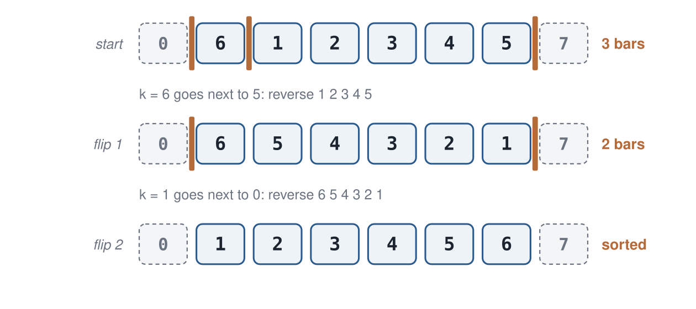{.sketch}

::: {.takeaway}
Both rules are greedy. The second one measures progress by breakpoints, which track the actual goal far better than "one more block in place".
:::

## Example 2: no decreasing strip

$$
0\;|\;4\;5\;6\;|\;1\;2\;3\;|\;7
$$

- There are three breakpoints, and every strip is increasing.
- There is no decreasing strip, so the $k-1$ rule does not apply.
- We can check all $15$ possible reversals: **none** reduces the number of breakpoints.

A rule that only accepts breakpoint-reducing reversals is stuck here.

## Creating a decreasing strip

The way out is to spend one reversal that removes no breakpoint: reverse an increasing strip.

- Reversing $4\;5\;6$ gives $6\;5\;4$.
- There are still three breakpoints.
- But $6\;5\;4$ is a decreasing strip, so the $k-1$ rule applies again.

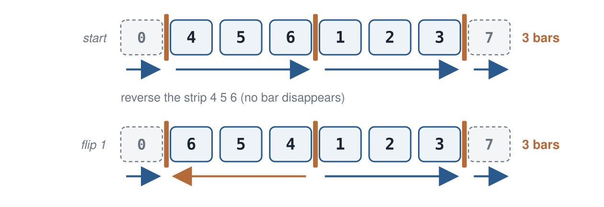{.sketch .below}

## Example 2, completed

The smallest block in a decreasing strip is $k = 4$; block $3$ ends the strip $1\;2\;3$. Reverse $1\;2\;3$:

$$
0\;|\;6\;5\;4\;|\;1\;2\;3\;|\;7
\;\to\;
0\;|\;6\;5\;4\;3\;2\;1\;|\;7
$$

Now $k = 1$, so reverse the whole strip:

$$
\;\to\; 0\;1\;2\;3\;4\;5\;6\;7
$$

In total, **three** reversals. The lower bound gives $\mathrm{OPT} \ge 2$; an exhaustive search in the notebook shows that $\mathrm{OPT} = 3$, so this solution is optimal too.

## The strips algorithm

1. Add the end markers $0$ and $n+1$.
2. Mark the breakpoints and divide the permutation into strips.
3. If there is a decreasing strip, apply the $k-1$ rule. At least one breakpoint disappears.
4. Otherwise, reverse an increasing strip. No breakpoint disappears, but a decreasing strip is created.
5. Repeat until no breakpoints are left.

## A guarantee {.section-head}

Comparing the number of reversals with the number of breakpoints.

## The strips algorithm is a 4-approximation

**Lower bound.** One reversal removes at most two breakpoints, so $\mathrm{OPT} \ge b/2$.

**Upper bound.** A step-3 reversal removes at least one breakpoint. A step-4 reversal removes none, but it is always followed by a step-3 reversal. So every breakpoint costs at most two reversals:
$$
A \le 2b.
$$

**Ratio.** Dividing the two bounds,
$$
\frac{A(\pi)}{\mathrm{OPT}(\pi)} \;\le\; \frac{2b}{b/2} \;=\; 4.
$$

On every input, the strips algorithm uses at most four times the optimal number of reversals.

## Better guarantees

The factor 4 comes from step-4 reversals that remove nothing. A more careful choice avoids most of them:

- In step 3, prefer a reversal that **leaves a decreasing strip** behind.
- Kececioglu and Sankoff (1995) proved that if no such reversal exists, some reversal removes **two** breakpoints, which pays for the next step-4 reversal.
- With this choice $A \le b$, and the approximation ratio is **2**.

The best ratio known today is $1.375$. An exact polynomial-time algorithm for unsigned reversals is not expected: Caprara (1997) showed the problem is in the same hard class as TSP.

## Signed reversals {.section-head}

When the orientation of every block is known, the fewest reversals can be computed exactly.

## Blocks have an orientation

Each block lies on one of the two DNA strands, so it reads either in the same direction as in the reference genome ($+3$) or backwards ($-3$). Sequence data show this **orientation** directly; older gene-order maps often give only the order.

- An inversion turns the segment around.
- So a **signed reversal** reverses the order of the blocks *and* changes every sign.
- $(+1\ {-3}\ {-2}\ {+4})$ is sorted by one reversal of positions 2–3.

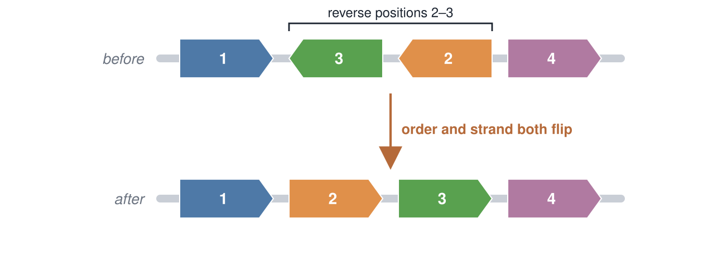{.sketch .below .tall}

## The sign records a flip

Compare the same three blocks with and without orientation:

| Data | Looks like | What we can conclude |
|---|---|---|
| order only | $1\;2\;3$ | already sorted: no inversion is visible |
| order and orientation | $(+1\ {-2}\ {+3})$ | block 2 is backwards: it was inside an odd number of inversions, so **at least one** inversion happened |

The order alone hides this history. A minus sign is evidence of an inversion even when the block is back in its original position.

## A graph of block ends {.section-head}

Hannenhalli and Pevzner (1995) replaced the search over reversals by a graph whose cycles can be counted.

## Each block has two ends

Give block $x$ a tail, numbered $2x-1$, and a head, numbered $2x$.

- A forward block $+x$ reads tail then head: $2x{-}1,\ 2x$.
- A backwards block $-x$ reads head then tail: $2x,\ 2x{-}1$.
- Add the end markers $0$ and $2n+1$.

Example: $(+2\ {-1}\ {+3})$ becomes $0\;\;3\,4\;\;2\,1\;\;5\,6\;\;7$.

{.sketch .below}

## Two kinds of edges

The ends are the vertices. We connect them in two ways:

- **Reality edges** join ends that touch *now*, between neighbouring blocks: $(0,3)$, $(4,2)$, $(1,5)$, $(6,7)$.
- **Desire edges** join ends that touch in the *sorted* genome, where end $2i$ meets end $2i+1$: $(0,1)$, $(2,3)$, $(4,5)$, $(6,7)$.

Every end has exactly one edge of each kind. Start at any end and alternate reality, desire, reality, …: you always come back to where you started. The graph falls apart into **cycles**.

## The sorted genome

$(+1\ {+2}\ {+3})$ becomes $0\;\;1\,2\;\;3\,4\;\;5\,6\;\;7$. Every reality edge is also a desire edge, so each pair of ends forms its own small cycle (grey).

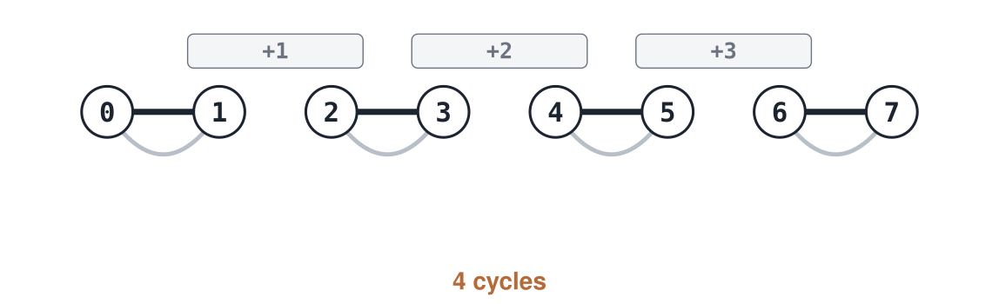{.sketch}

With $n$ blocks the sorted genome has $n+1$ cycles, the largest number possible.

## Our example has two cycles

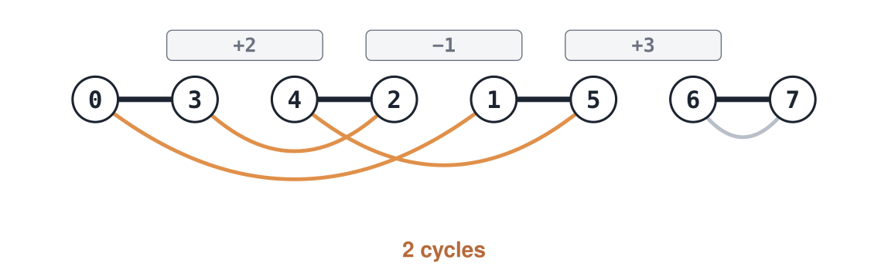{.sketch}

- Follow the orange cycle, alternating reality and desire edges: $0 \to 3 \to 2 \to 4 \to 5 \to 1 \to 0$.
- The grey cycle $6$–$7$ is already sorted.
- So $c = 2$: two cycles short of the sorted genome.

## What a reversal does to the graph

A reversal cuts the genome at two places: it **cuts two reality edges** and reconnects the four loose ends the other way. Desire edges never change.

| The two cut edges lie … | Number of cycles |
|---|---|
| in **different** cycles | the cycles merge: $c$ goes down by one |
| in the **same** cycle | the cycle may split: $c$ goes up by one, or stays the same |

So each reversal adds at most one cycle, which gives a lower bound:

$$
d(\pi) \;\ge\; (n+1) - c(\pi) \qquad \text{example: } d \ge 4 - 2 = 2.
$$

## Three possible first moves

From $(+2\ {-1}\ {+3})$:

| Reversal | Cuts the reality edges | Same cycle? | Cycles after |
|---|---|---|---|
| positions 1–2 | $(0,3)$ and $(1,5)$ | yes | **3**: the cycle splits |
| position 2 | $(4,2)$ and $(1,5)$ | yes | 2: no split |
| positions 1–3 | $(0,3)$ and $(6,7)$ | no | 1: two cycles merge |

Only the first move brings us closer to the sorted genome.

## Step 1: split the orange cycle

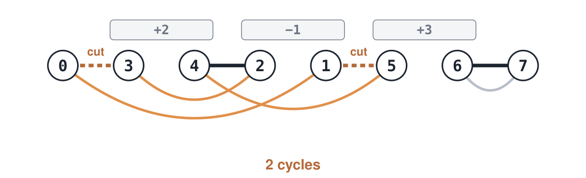{.sketch}

Reverse positions 1–2: $(+2\ {-1}\ {+3}) \to (+1\ {-2}\ {+3})$. Both cut edges lie on the orange cycle, and the reversal splits it: block 1 is now in place, and $c$ rises from 2 to **3**.

## Step 2: the last cycle

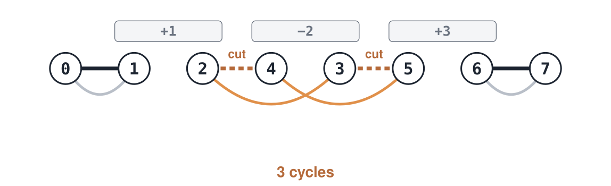{.sketch}

One coloured cycle is left: $2 \to 4 \to 5 \to 3 \to 2$. Reverse position 2: $(+1\ {-2}\ {+3}) \to (+1\ {+2}\ {+3})$. The cycle splits into two sorted ones, $c = 4$, and the genome is sorted.

**Two reversals**, exactly the lower bound $4 - 2$: the solution is optimal.

## The algorithm

1. Write each block as two ends; draw the reality and desire edges.
2. Count the cycles, $c$.
3. While $c < n+1$: choose a reversal that cuts two reality edges of the **same** cycle and **splits** it.
4. Each step adds one cycle, so the algorithm uses $(n+1) - c$ reversals, exactly the lower bound.

::: {.idea}
This greedy algorithm is **exact**: each step makes the best possible progress, and the lower bound shows that nothing shorter exists. In rare configurations no splitting reversal is available; Hannenhalli and Pevzner showed how to handle these with a few extra reversals, still in polynomial time.
:::

## Why orientation makes the problem easy

:::: {.cards}
::: {.card}
**With orientation**

Every block has a known head and tail. For each pair of neighbours we know *which ends* touch.

Each end gets exactly one reality edge and one desire edge, so the graph is fixed. It splits into cycles in exactly one way, and we count them.
:::
::: {.card .warm}
**Without orientation**

We know that block 3 sits next to block 2, but not whether 3 is forward or backwards, so we do not know which ends touch.

We must guess the orientation of every block: $2^n$ possibilities.
:::
::::

::: {.idea}
The unsigned distance is the signed distance for the **best** choice of signs. Each choice is easy to evaluate; choosing among the $2^n$ is the hard part (Caprara, 1997).
:::

## Back to the stickleback Y

The reconstruction in the Jeffries figure was computed with **GRIMM** (*Genome Rearrangements In Man and Mouse*, Tesler 2002), a program built on this graph.

- Knowing the orientation of each block makes the problem exact.
- Without orientations, the best a fast algorithm can offer is an approximation ratio.

::: {.idea}
A hard-looking question about orders became a question about cycles in a graph. **Next week** we make this move deliberately: genome assembly becomes easy once the reads are drawn as the right graph.
:::

## When greedy is exact

For some problems a greedy rule can be proved optimal:

- **Interval scheduling** (week 2): always take the interval that finishes first.
- **Huffman coding:** repeatedly merge the two least frequent symbols.
- **Kruskal's algorithm:** add the cheapest edge that does not close a cycle.

For unsigned reversals no greedy rule is known to be optimal, so we prove a ratio instead.

## Open `labs/06-greedy.ipynb`

::: {.lab}
::: {.lab-tag}
Lab · ~20 minutes · Python · needs `matplotlib`
:::

1. Place-one-block rule on example 1: confirm 5 reversals.
2. Strips algorithm on examples 1 and 2: confirm 2 and 3 reversals.
3. Example 2: confirm that none of the 15 reversals removes a breakpoint.
4. Random permutations: compare $A/\mathrm{OPT}$ with $A/(b/2)$ for both rules.
5. Answer Q1–Q3 without notes.
:::

Look closely at the histogram: the ratio on one input is not the ratio of the algorithm.

## A bit of history

::: {.history}
- **Sturtevant & Dobzhansky** (1936) used inversions in *Drosophila pseudoobscura* chromosomes to reconstruct the history of populations.
- **Gates & Papadimitriou** (1979) studied sorting a stack of pancakes by flipping its top, a version of the problem in which only prefixes may be reversed. It is Bill Gates's only research paper.
- **Kececioglu & Sankoff** (1995) introduced breakpoints and strips and gave a 2-approximation for unsigned reversals.
- **Hannenhalli & Pevzner** (1995) showed that sorting by *signed* reversals can be done in polynomial time ("Transforming cabbage into turnip").
- **Caprara** (1997) proved that the unsigned problem is in the same hard class as TSP.
:::

## Tools that use this

::: {.tools}
- **GRIMM** and **UniMoG** compute rearrangement distances and shortest histories for signed synteny blocks.
- **Mauve**, **MCScanX** and **Progressive Cactus** identify the synteny blocks in whole genomes, which produces the permutation.
- Nearest neighbour (week 2) and neighbour-joining (week 10) are greedy algorithms in the same sense, with different local criteria.
:::

## Extensions

::: {.ext}
- Other rearrangements, such as **transpositions** (a segment moves elsewhere) and **translocations** (chromosome ends are exchanged), have their own breakpoint bounds.
- The **double-cut-and-join** model treats inversions, translocations, fusions and fissions together; its distance is again obtained from a cycle count.
- From ratio 4 to 2 to 1.375, the lower bound $b/2$ stays the same; better algorithms waste fewer reversals.
:::

## What you should be able to answer

::: {.muted}
Without notes. Q1–Q2 cover today's material; **Q3** asks about a situation we did not practise.
:::

::: {.qs}
::: {.q}
[Q1]{.tag} The place-one-block rule uses 5 reversals on example 1, while the optimum is 2. Describe the rule, and give $r$ for this input.
:::
::: {.q}
[Q2]{.tag} Why can a single reversal remove at most two breakpoints? How does this, together with the strips algorithm, give an approximation ratio of at most 4?
:::
::: {.q .q3}
[Q3]{.tag} In the lab histogram, the maximum of $A/(b/2)$ is larger than its mean and larger than the maximum of $A/\mathrm{OPT}$. Why? What can such a histogram tell us about the approximation ratio, and what can it not?
:::
:::

::: notes
2–3 minutes. Pair-share Q3.
:::

## Summary

::: {.takeaway}
Inversions on sex chromosomes suppress recombination and create evolutionary strata. The fewest reversals between two block orders reconstruct this history.
:::

::: {.takeaway}
Breakpoints give the lower bound $\mathrm{OPT} \ge b/2$. The strips algorithm removes at least one breakpoint every two reversals, so its approximation ratio is at most 4 (and 2 with a more careful choice).
:::

::: {.takeaway}
When block orientations are known, the problem becomes exact: draw a graph of block ends and count its cycles. Without them, every orientation must be guessed, and that is what makes the problem hard.
:::

## Next week

**Graphs: Eulerian and Hamiltonian paths.**

Today, drawing block ends as a graph turned rearrangements into counting cycles. Next week the same move solves genome assembly: phrased as visiting every *vertex* of a graph once, it is hard; phrased as using every *edge* once, it is easy. Choosing the right graph makes the difference.

## Reading

::: {.read}
- Jones & Pevzner, *An Introduction to Bioinformatics Algorithms*, ch. 5: greedy sorting by reversals, breakpoints and strips.
- Kececioglu & Sankoff (1995). Exact and approximation algorithms for sorting by reversals. *Algorithmica* 13.
- Hannenhalli & Pevzner (1999). Transforming cabbage into turnip: polynomial algorithm for sorting signed permutations by reversals. *J. ACM* 46.
- Tesler (2002). GRIMM: genome rearrangements web server. *Bioinformatics* 18.
- Jeffries / Peichel lab (University of Bern): sex-chromosome inversions in sticklebacks; [Dr Daniel Lee Jeffries](https://www.ee.iee.unibe.ch/about_us/team/persons/dr_jeffries_daniel_lee/index_eng.html).
:::
