## Recap

- **Week 2:** to assemble a genome we ordered overlapping reads. Visiting every read once looked like the travelling salesman problem, with no fast exact method.
- **Week 6:** drawing the ends of synteny blocks as a graph turned a question about orders into counting cycles.

This week we make the same move for genome assembly: choose the right graph, and a hard problem becomes easy.

## Genome assembly {.section-head}

A new genome has to be put together from millions of short pieces.

## A new virus, January 2020

In December 2019, patients in Wuhan developed a pneumonia of unknown cause.

- Researchers sequenced the RNA in fluid from one patient's lungs: tens of millions of short reads, from human cells, bacteria and an unknown virus.
- From these reads alone, with no reference to compare against, they assembled the genome of a new coronavirus: 29,903 letters (Wu et al., 2020).
- The sequence was shared in January 2020. Within days it was used to design diagnostic tests, and within weeks the first vaccine candidates.

::: {.takeaway}
Nobody had seen this genome before. It had to be reconstructed from the reads themselves.
:::

## From reads to a genome

A sequencer cannot read a genome from one end to the other. It reads millions of short fragments taken from random positions.

- Every position of the genome is covered by many reads, typically 30 or more (the **coverage**).
- Reads from neighbouring positions **overlap**.

**The computational problem:** reconstruct the genome from its overlapping reads.

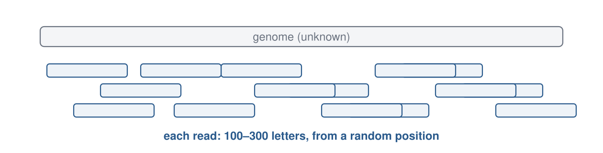{.sketch .below}

## The idea of this week

::: {.idea}
In week 2, assembly meant visiting every read once: a **Hamiltonian path**, as hard as TSP. With different vertices, the genome becomes a walk that uses every edge once: an **Eulerian path**, found in linear time.
:::

::: {.goals}
By the end of this meeting you should be able to:

1. Tell an Eulerian path (every edge once) from a Hamiltonian path (every vertex once).
2. Build the overlap graph and the de Bruijn graph of a short string.
3. Find an Eulerian path with Hierholzer's algorithm, and explain why it always succeeds.
4. Explain how repeats, the choice of $k$ and sequencing errors shape the graph.
:::

## Problem statement

::: {.io}
::: {.in}
**Input**

A set of reads: short strings from an unknown genome.
:::
::: {.arrow}
→
:::
::: {.out}
**Output**

A genome sequence that contains every read.
:::
:::

::: {.toy}
**Two small examples used throughout.**

- **Example 1:** the genome $\mathtt{ACAAT}$, seen as its three-letter pieces $\mathtt{ACA}$, $\mathtt{CAA}$, $\mathtt{AAT}$.
- **Example 2:** the genome $\mathtt{AAACAA}$, which contains a repeat.

The lab notebook `labs/07-graphs.ipynb` builds both graphs and runs the walks.
:::

## Two kinds of walks {.section-head}

Visiting every vertex and using every edge are very different problems.

## Graph vocabulary

- A **graph** consists of **vertices** (nodes) and **edges** that join pairs of vertices.
- In a **directed** graph every edge has a direction, drawn as an arrow.
- The **in-degree** of a vertex is the number of arrows coming in; the **out-degree** is the number going out.
- A **path** is a walk from vertex to vertex along edges.

## Euler and Hamilton

| A walk that … | Name | Known method |
|---|---|---|
| uses every **edge** exactly once | Eulerian path | easy: check the degrees, then walk; time proportional to the number of edges |
| visits every **vertex** exactly once | Hamiltonian path | no polynomial-time method known; the travelling salesman problem is the weighted version |

The two questions look almost the same. Their difficulty is completely different.

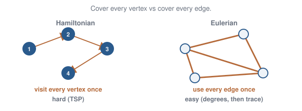{.sketch .below}

## Reads as vertices {.section-head}

The first idea: one vertex for every read.

## The overlap graph

Make each read a vertex. Draw an arrow from read $u$ to read $v$ when the end of $u$ matches the beginning of $v$.

- In example 1, $\mathtt{ACA}$ ends with $\mathtt{CA}$, and $\mathtt{CAA}$ begins with it, so $\mathtt{ACA} \to \mathtt{CAA}$.
- The genome is a path that visits every read once: $\mathtt{ACA} \to \mathtt{CAA} \to \mathtt{AAT}$ spells $\mathtt{ACAAT}$.

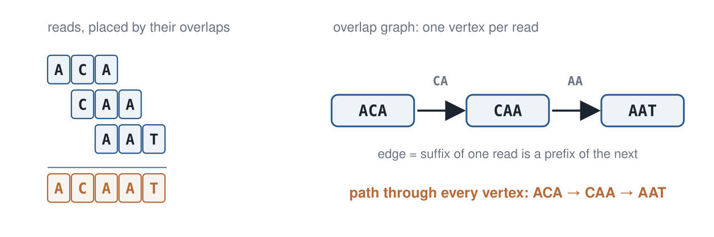{.sketch .below}

## Why the overlap graph is hard

- A path through every vertex once is a **Hamiltonian path**. Finding one is as hard as the travelling salesman problem (week 2).
- A real data set has millions of reads, so the graph has millions of vertices.
- Coverage makes it worse: at 30× coverage every stretch of the genome appears in about 30 reads, so the graph is about 30 times larger than the genome requires.

::: {.takeaway}
The overlap graph asks the hard question. We need a graph in which the genome is a walk over **edges** instead.
:::

## k-mers as edges {.section-head}

The second idea: put the sequence on the edges.

## The de Bruijn graph

Cut every read into its substrings of length $k$, called **$k$-mers**.

- **Vertices:** all substrings of length $k-1$.
- **Edges:** each $k$-mer becomes an arrow from its first $k-1$ letters to its last $k-1$ letters. For $k = 3$, the $k$-mer $\mathtt{ACA}$ is the arrow $\mathtt{AC} \to \mathtt{CA}$.
- The genome is now a walk that uses **every edge once**: an Eulerian path.

The graph is named after Nicolaas de Bruijn, who studied it in 1946 for a puzzle about sequences that contain every $k$-mer.

## Example 1 as a de Bruijn graph

$\mathtt{ACAAT}$ with $k = 3$: three edges $\mathtt{ACA}$, $\mathtt{CAA}$, $\mathtt{AAT}$ between four vertices.

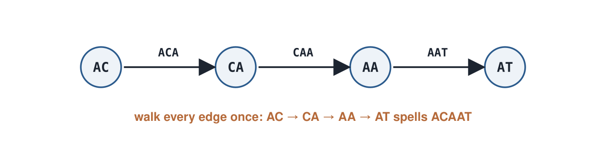{.sketch .below}

To spell the walk, write the first vertex, then the last letter of every edge: $\mathtt{AC} + \mathtt{A} + \mathtt{A} + \mathtt{T} = \mathtt{ACAAT}$.

## Why the de Bruijn graph stays small

Identical $k$-mers from different reads become the **same** edge.

- **Overlap graph:** one vertex per read, so it grows with the amount of data.
- **de Bruijn graph:** at most one vertex per distinct $(k-1)$-mer of the genome, so it grows only with the genome.

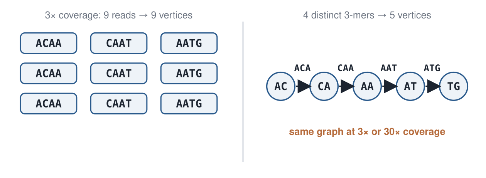{.sketch .below}

## Finding an Eulerian path {.section-head}

Count the degrees, then walk.

## When does an Eulerian path exist?

Every time a walk passes through a vertex, it uses one arrow in and one arrow out. So, in a connected directed graph:

- If every vertex has in-degree equal to out-degree, there is an Eulerian **circuit**: a closed walk.
- If exactly one vertex has one more arrow out (the **start**) and exactly one has one more arrow in (the **end**), there is an Eulerian **path** from start to end.
- Otherwise there is none.

Checking this takes a single pass over the edges.

## Degrees in example 1

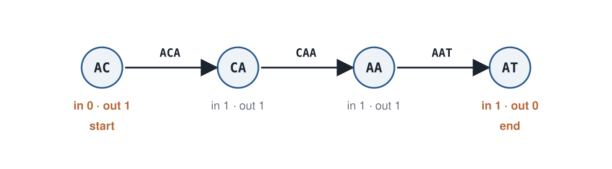{.sketch}

- $\mathtt{AC}$ has one more arrow out than in: the walk must **start** there.
- $\mathtt{AT}$ has one more arrow in than out: the walk must **end** there.
- $\mathtt{CA}$ and $\mathtt{AA}$ are balanced. An Eulerian path exists, from $\mathtt{AC}$ to $\mathtt{AT}$.

## Hierholzer's algorithm

1. Start at the start vertex (or anywhere, for a circuit) and follow unused edges until you are stuck.
2. If unused edges remain, choose a vertex on your walk that still has an unused edge. Walk a new loop from there until you are stuck again; you will be back at that vertex.
3. **Splice** the new loop into the walk at that vertex. Repeat until every edge is used.

Every edge is walked exactly once, so the time is proportional to the number of edges. There is no search over orders.

## Hierholzer, step 1: walk until stuck

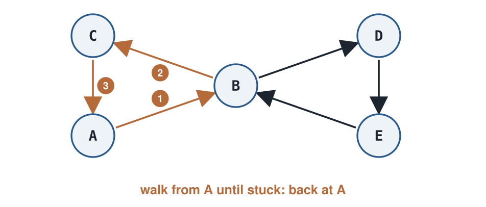{.sketch}

Six edges; every vertex is balanced, so an Eulerian circuit exists. From $A$ we walk $A \to B \to C \to A$. At $A$ no unused arrow is left, but three edges are still unused.

## Hierholzer, step 2: a leftover loop

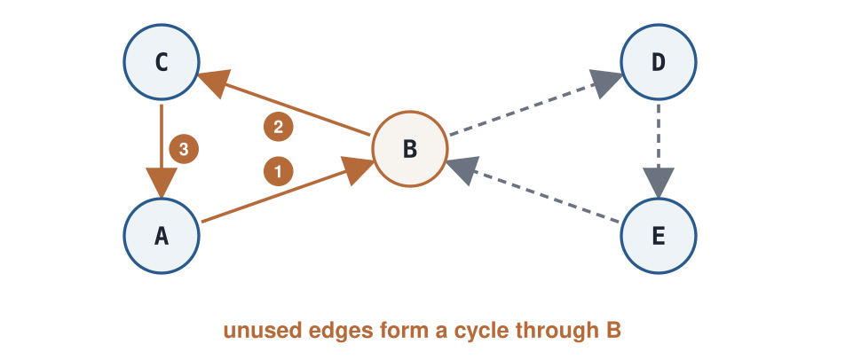{.sketch}

The unused edges form a loop $B \to D \to E \to B$. It passes through $B$, which already lies on our walk.

## Hierholzer, step 3: splice

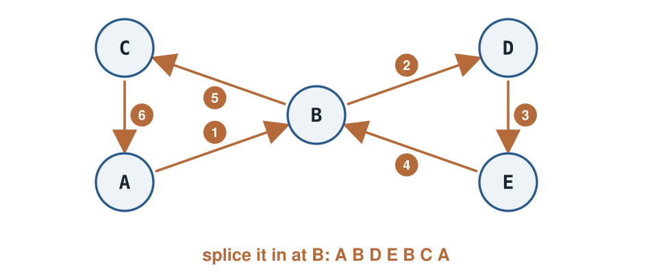{.sketch}

Insert the loop at $B$: $A \to B \to D \to E \to B \to C \to A$. All six edges are used, each exactly once.

## Why the walk gets stuck only at its start

Suppose every vertex is balanced (in-degree = out-degree), and we walk from $s$ along unused edges.

- Each time the walk **enters** a vertex $v \neq s$, it has used one more arrow into $v$ than out of $v$.
- Since $v$ has as many arrows out as in, at least one arrow out of $v$ is still unused, so the walk can always continue.
- The walk therefore cannot get stuck at $v$. It can only get stuck back at $s$, after closing a loop.

## Why splicing always finishes the job

- The closed walk used one arrow in and one arrow out at every vertex it passed, so all vertices are **still balanced** among the unused edges.
- By the same argument, the unused edges form closed loops.
- The graph is connected, so every leftover loop touches a vertex already on the walk, and can be spliced in there.

For a **path** from start to end: add one temporary arrow from the end back to the start, which balances every vertex; find the circuit; then remove that arrow again.

## The house and the bridges of Königsberg

:::: {.split .fig-right}
::: {.pane}
Can you draw this house in one stroke, using each line once?

- Vertices $A$ and $B$ have odd degree (3); all others are even.
- Two odd vertices: an Eulerian **path** exists, from $A$ to $B$, but no closed circuit.
- Euler (1736) asked the same about the seven bridges of Königsberg. Four land masses had odd degree, so no such walk exists.
:::
::: {.pane}
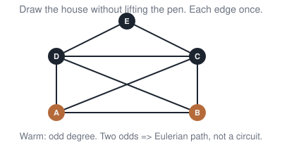{.sketch}
:::
::::

## Repeats {.section-head}

When a piece of sequence occurs twice, the walk is no longer unique.

## Example 2: a repeated 2-mer

$\mathtt{AAACAA}$ with $k = 3$: the $k$-mers are $\mathtt{AAA}$, $\mathtt{AAC}$, $\mathtt{ACA}$, $\mathtt{CAA}$.

- $\mathtt{AA}$ occurs at several places in the genome, so its vertex has two ways out.
- All vertices are balanced, so Eulerian circuits exist.

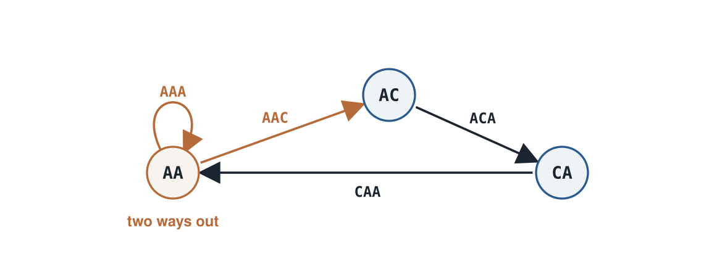{.sketch}

## Two walks, two genomes

Both walks start at $\mathtt{AA}$ and use every $k$-mer exactly once:

| Leave $\mathtt{AA}$ first by … | Walk | Spells |
|---|---|---|
| the loop $\mathtt{AAA}$ | $\mathtt{AA} \to \mathtt{AA} \to \mathtt{AC} \to \mathtt{CA} \to \mathtt{AA}$ | $\mathtt{AAACAA}$ |
| the edge $\mathtt{AAC}$ | $\mathtt{AA} \to \mathtt{AC} \to \mathtt{CA} \to \mathtt{AA} \to \mathtt{AA}$ | $\mathtt{AACAAA}$ |

::: {.takeaway}
The algorithm still finds a walk in linear time. But the data contain exactly the same $k$-mers for both genomes, so the $k$-mers cannot tell us which one is correct.
:::

## Choosing $k$ {.section-head}

A larger $k$ can separate the copies of a repeat.

## A larger $k$ resolves the repeat

The same genome $\mathtt{AAACAA}$, now with $k = 4$: the $k$-mers are $\mathtt{AAAC}$, $\mathtt{AACA}$, $\mathtt{ACAA}$.

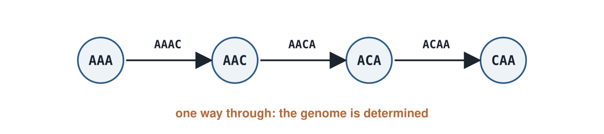{.sketch .below}

- No 3-mer occurs twice, so no vertex has two ways in or out.
- There is exactly one Eulerian path, and it spells $\mathtt{AAACAA}$.
- In general: a repeated stretch creates a fork only if it is at least $k - 1$ letters long. Choosing $k$ longer than the repeat removes the fork.

## The price of a larger $k$

A larger $k$ separates repeats. But a $k$-mer can only enter the graph if some read contains it **without an error**. How many such reads are there, and how does that change with $k$?

To find out we simulate a sequencing run, where we know the true genome and can check every answer:

- **Genome:** 20,000 random letters.
- **Reads:** 6,000 reads of $L = 100$ letters, each copied from a random place in the genome.
- **Errors:** each letter of a read is misread, independently, with probability $e = 1\%$.

## A simulated sequencing run

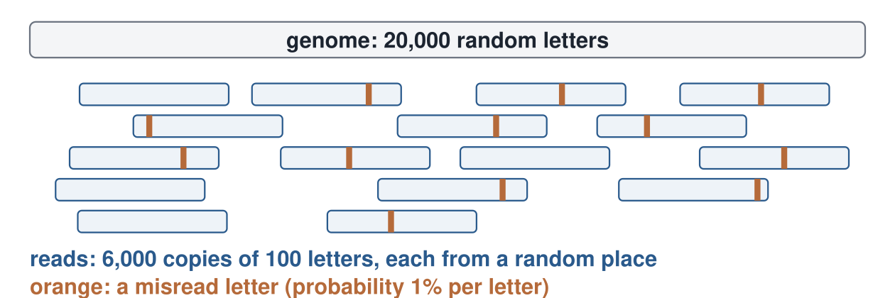{.sketch .below .tall}

The **coverage** $c$ is the number of reads that cover a letter, on average: $c = 6{,}000 \times 100 / 20{,}000 = 30$.

## Which reads contain a given $k$-mer?

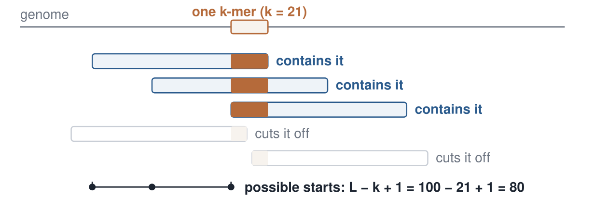{.sketch .below .tall}

A read contains the whole $k$-mer only if it starts in a window of $L - k + 1$ positions.

## Count the reads

Reads start everywhere with the same chance. Since $c$ reads cover each letter, and a read covers $L$ letters, on average $c / L$ reads **start** at each position.

$$
\text{reads containing a given } k\text{-mer} \;=\; \frac{c}{L}\,(L - k + 1)
$$

- $k = 21$: $\dfrac{30}{100} \times 80 = 24$ reads.
- $k = 81$: $\dfrac{30}{100} \times 20 = 6$ reads.

## Count the error-free copies

A copy is useful only if all $k$ letters were read correctly. Each letter is correct with probability $1 - e = 0.99$, so all $k$ of them with probability $0.99^k$.

$$
\lambda(k) \;=\; \frac{c}{L}\,(L - k + 1)\,(1 - e)^k
$$

- $k = 21$: $0.99^{21} = 0.81$, so $\lambda = 24 \times 0.81 = 19.4$ error-free copies.
- $k = 81$: $0.99^{81} = 0.44$, so $\lambda = 6 \times 0.44 = 2.7$ error-free copies.

## The formula against the simulation

Count, for every $k$-mer of the true genome, the reads that contain it without an error, and average:

| $k$ | reads containing it | $(1-e)^k$ | $\lambda(k)$, formula | simulation |
|---|---|---|---|---|
| 21 | 24 | 0.81 | 19.4 | 19.4 |
| 41 | 18 | 0.66 | 11.9 | 11.8 |
| 61 | 12 | 0.54 | 6.5 | 6.4 |
| 81 | 6 | 0.44 | 2.7 | 2.6 |

Both effects push the same way: a longer $k$-mer fits into fewer positions of a read, and it is more likely to contain an error.

## Thin coverage breaks the genome

$\lambda$ is only an average: reads land at random, so some $k$-mers get fewer copies than others. A $k$-mer with **no** error-free copy is missing from the graph, and the walk through the genome breaks there.

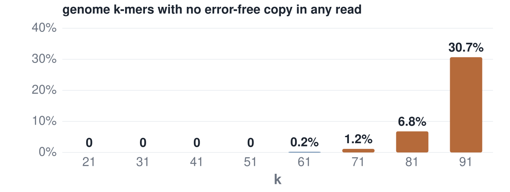{.sketch .below .tall}

## Small $k$ or large $k$?

| | small $k$ (21) | large $k$ (81) |
|---|---|---|
| repeats shorter than $k - 1$ | collapse into forks | separated |
| error-free copies per $k$-mer | about 19 | about 3 |
| genome $k$-mers missing | none | 6.8%, scattered over the genome |

::: {.takeaway}
Small $k$: robust, but repeats collapse. Large $k$: repeats separate, but coverage thins out. Assemblers build graphs for several values of $k$ and combine them.
:::

## Real reads: errors and coverage {.section-head}

Sequencing errors add false $k$-mers. Counting tells them apart.

## Counting $k$-mers

Before building the graph, an assembler counts how often every $k$-mer occurs in the reads.

- Go through every read and every position; look up the $k$-mer in a **hash table** and add one to its count.
- The time is proportional to the total length of the reads: one pass over the data.
- A $k$-mer from the genome occurs in many reads; a $k$-mer created by a sequencing error usually occurs only once.

## Counting by hand

The genome $\mathtt{ATGCTCAGG}$, read as four reads of 6 letters, plus a fifth read $\mathtt{TGTTCA}$ in which one $\mathtt{C}$ was misread as $\mathtt{T}$. Count every 3-mer:

:::: {.split}
::: {.pane}
| read | its 3-mers |
|---|---|
| $\mathtt{ATGCTC}$ | ATG TGC GCT CTC |
| $\mathtt{TGCTCA}$ | TGC GCT CTC TCA |
| $\mathtt{GCTCAG}$ | GCT CTC TCA CAG |
| $\mathtt{CTCAGG}$ | CTC TCA CAG AGG |
| $\mathtt{TG\textcolor{#b56a3a}{T}TCA}$ | TGT GTT TTC TCA |
:::
::: {.pane}
| 3-mer | count |
|---|---|
| CTC, TCA | 4 |
| GCT | 3 |
| TGC, CAG | 2 |
| ATG, AGG | 1 |
| TGT, GTT, TTC | 1 |
:::
::::

## Counts of counts

Now ask, for each count: **how many different 3-mers have it?**

| times seen | 1 | 2 | 3 | 4 |
|---|---|---|---|---|
| number of 3-mers | 5 | 2 | 1 | 2 |

- The three 3-mers seen once that contain the misread $\mathtt{T}$ are the error.
- $\mathtt{ATG}$ and $\mathtt{AGG}$ are also seen once, because they sit at the very ends of the genome, where few reads reach. In a long genome these are a handful among millions.

This table is the **$k$-mer spectrum**. Drawn as a bar chart: times seen on the horizontal axis, number of $k$-mers as the bar height.

## The spectrum of the simulated run

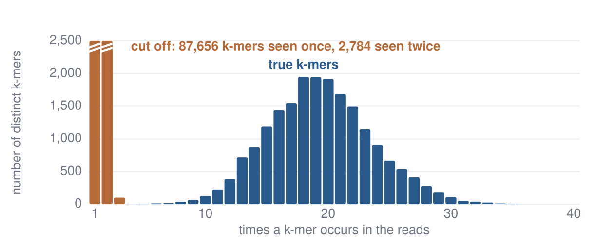{.sketch .below .tall}

The same simulated run as above, $k = 21$. Each bar: how many distinct 21-mers were seen exactly that many times.

## Two kinds of $k$-mers

The reads contain 110,499 distinct 21-mers; the genome only 19,980.

- **Errors (orange).** The run has 6,153 misread letters. Each one changes up to 21 overlapping $k$-mers into strings that are almost never in the genome, and almost never made twice: 87,656 $k$-mers are seen exactly once.
- **True $k$-mers (blue).** They form a hump around 19 copies: the $\lambda(21) = 19.4$ error-free copies computed above. The hump has a width because reads land at random.

::: {.takeaway}
A gap between the two groups (here around 5 copies) is the threshold that separates errors from the genome.
:::

## The genome size from the spectrum

The true $k$-mers occur, in total, 386,468 times in the reads (all $k$-mers counted 5 or more times). Each occurs about 19 times, the position of the peak. So the genome contains about

$$
\frac{386{,}468}{19} \approx 20{,}340 \text{ distinct } k\text{-mers},
$$

close to the true 20,000.

::: {.takeaway}
The genome size is estimated before any assembly, from counts alone. This is routine for new species, whose genome size is unknown.
:::

## An error creates a bubble

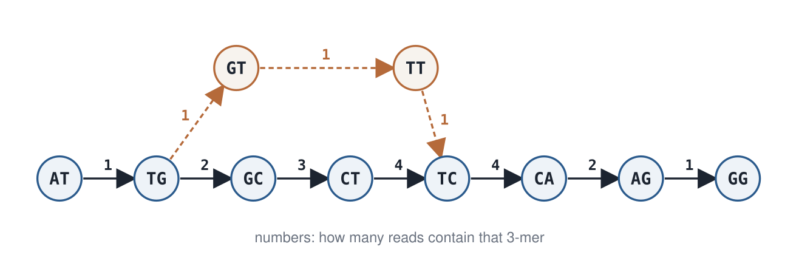{.sketch .below}

The five reads from the hand count, now as a de Bruijn graph ($k = 3$). The wrong letter changes $k = 3$ consecutive $k$-mers. They form a side path from $\mathtt{TG}$ to $\mathtt{TC}$, seen once, next to the true path seen 2 to 4 times.

## Cleaning the graph

Assemblers remove what the counts mark as errors:

- **Rare edges:** drop $k$-mers below a threshold read off the spectrum (here, fewer than 5 copies).
- **Bubbles:** two paths between the same vertices; keep the one with the higher counts.
- **Tips:** short dead ends, created by errors near the end of a read.

Real biology also creates bubbles: two virus variants in one sample, or the two copies of a chromosome in a diploid genome. Then both paths have high counts, each about half the coverage, and both must be kept.

## Contigs {.section-head}

Report the pieces that are certain.

## Maximal non-branching paths

At a branching vertex, the walk may continue in more than one way. Between branches there is no choice.

- A vertex with exactly one arrow in and one arrow out lies **inside** a piece; merge all such chains into single sequences.
- Each merged chain is a **contig** (from "contiguous"): a stretch of the genome that the data determine without ambiguity.
- Finding all contigs takes one pass over the graph.

## One repeat, four contigs

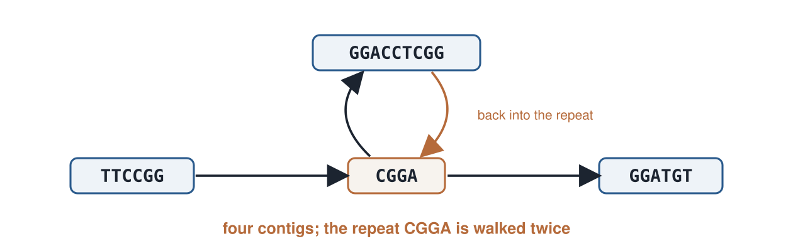{.sketch .below}

The genome $\mathtt{TTCCGGACCTCGGATGT}$ contains the repeat $\mathtt{CGGA}$ twice. With $k = 4$, the graph splits into four contigs: $\mathtt{TTCCGG}$, $\mathtt{CGGA}$, $\mathtt{GGACCTCGG}$, $\mathtt{GGATGT}$. The repeat is a single contig, walked twice.

## Repeats in real genomes

About half of the human genome consists of repeated sequence; the Alu element alone occurs more than a million times.

- A short read that lies entirely inside a repeat fits every copy equally well.
- In the graph, a repeat becomes a vertex with several ways in and out.
- Assemblers therefore stop at repeats and report the genome in pieces, called **contigs**.

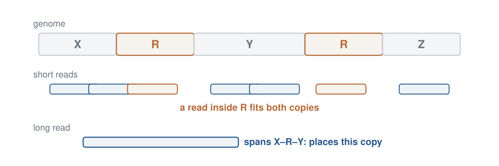{.sketch .below}

## Long reads change the picture

Since about 2020, long-read sequencing produces accurate reads of tens of thousands of letters.

- A long read can span a whole repeat together with its unique neighbours, and so places that copy.
- With fewer, longer reads, overlap graphs become practical again.
- In 2022 the Telomere-to-Telomere consortium used long reads to complete the first human genome from end to end, adding the roughly 8% that short reads had left unresolved (Nurk et al., 2022).

::: {.takeaway}
Short reads: put the $k$-mers on the edges. Long reads: the read itself becomes a useful vertex again. The data decide which graph is useful.
:::

## The Towers of Hanoi as a graph {.section-head}

In week 1 we solved the puzzle with a recursion. Now we draw every position of the puzzle as a vertex.

## Arrangements as words

:::: {.split .fig-right}
::: {.pane}
- The pegs are $\mathtt{S}$ (start), $\mathtt{A}$ (aux) and $\mathtt{G}$ (goal).
- An arrangement is a **word**: for each disk, largest first, the peg it sits on.
- Each disk has 3 choices: $3^n$ arrangements, the **vertices**.
- An **edge** joins two arrangements one legal move apart.
:::
::: {.pane}
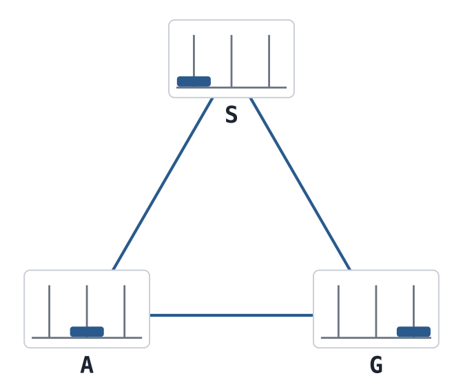{.sketch}
:::
::::

## Two disks: nine arrangements

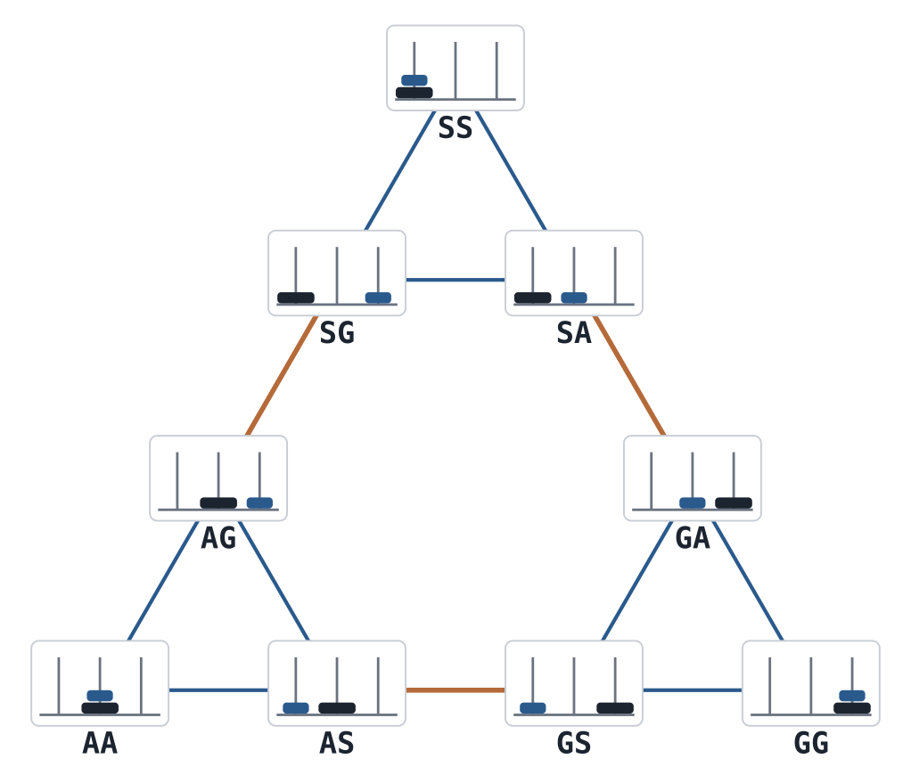{.sketch .huge}

Blue edges move the small disk; orange edges move the large disk.

## Reading the two-disk graph

- **The small disk** can always move to either other peg: two edges at every vertex. These form three small triangles, one for each position of the large disk.
- **The large disk** may move only when the small disk is on neither its peg nor the target peg, so the small disk must sit on the **third** peg. For example, $\mathtt{SA} \to \mathtt{GA}$: large disk from $\mathtt{S}$ to $\mathtt{G}$, small disk waiting on $\mathtt{A}$.
- That gives exactly one edge between each pair of triangles.

::: {.takeaway}
The two-disk graph is three copies of the one-disk triangle, joined by three single edges.
:::

## Three disks: three copies again

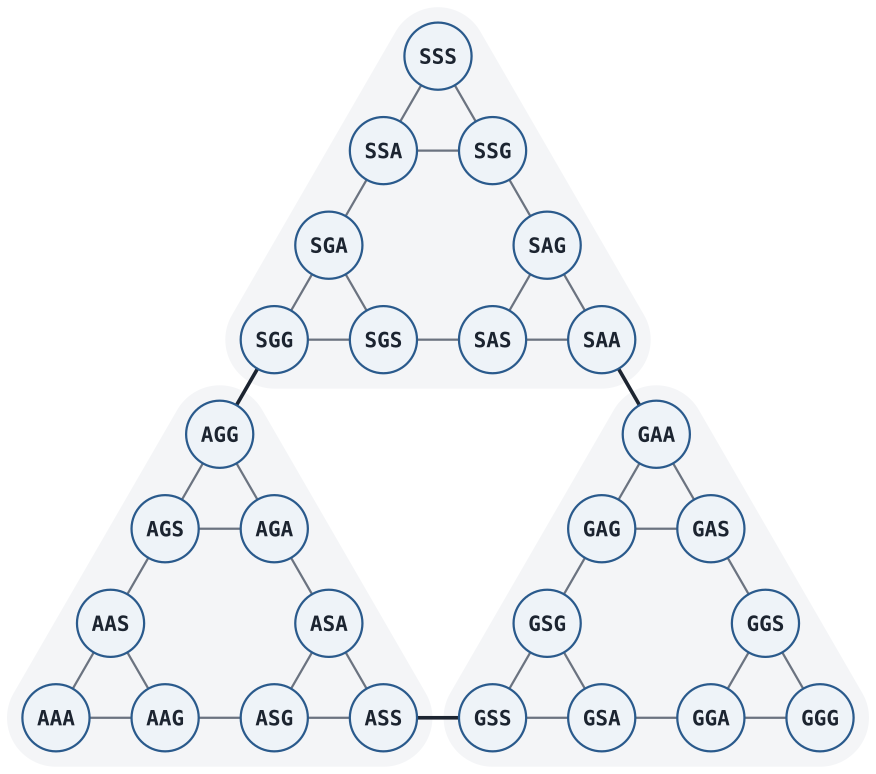{.sketch .huge}

Each shaded part is the two-disk graph, with the largest disk on $\mathtt{S}$ (top), $\mathtt{A}$ (left) or $\mathtt{G}$ (right).

## Why the graph repeats itself

The same argument works for every $n$:

- **Fix the largest disk.** It never blocks a smaller disk, so the other $n - 1$ disks play an $(n-1)$-disk puzzle: a copy of the smaller graph.
- **Three pegs for the largest disk:** three copies.
- **The largest disk moves** only when all smaller disks sit on the third peg. That is one corner of each copy, so there is exactly one edge between each pair of copies.

## Counting vertices and edges

Three copies, plus three edges that join them:

$$
V(n) = 3\,V(n-1) = 3^n, \qquad E(n) = 3\,E(n-1) + 3 = \tfrac{3}{2}\,(3^n - 1)
$$

| disks $n$ | 1 | 2 | 3 | 6 |
|---|---|---|---|---|
| arrangements $V(n)$ | 3 | 9 | 27 | 729 |
| moves $E(n)$ | 3 | 12 | 39 | 1,092 |

## Six disks: a Sierpiński triangle

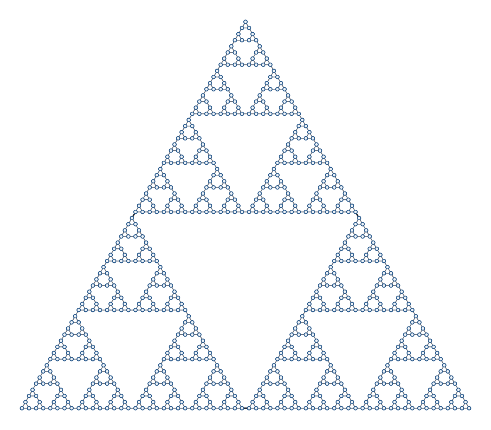{.sketch .huge}

729 arrangements: triangles made of three smaller triangles, down to the smallest disk. This is the **Sierpiński triangle**.

## The solution runs along one side

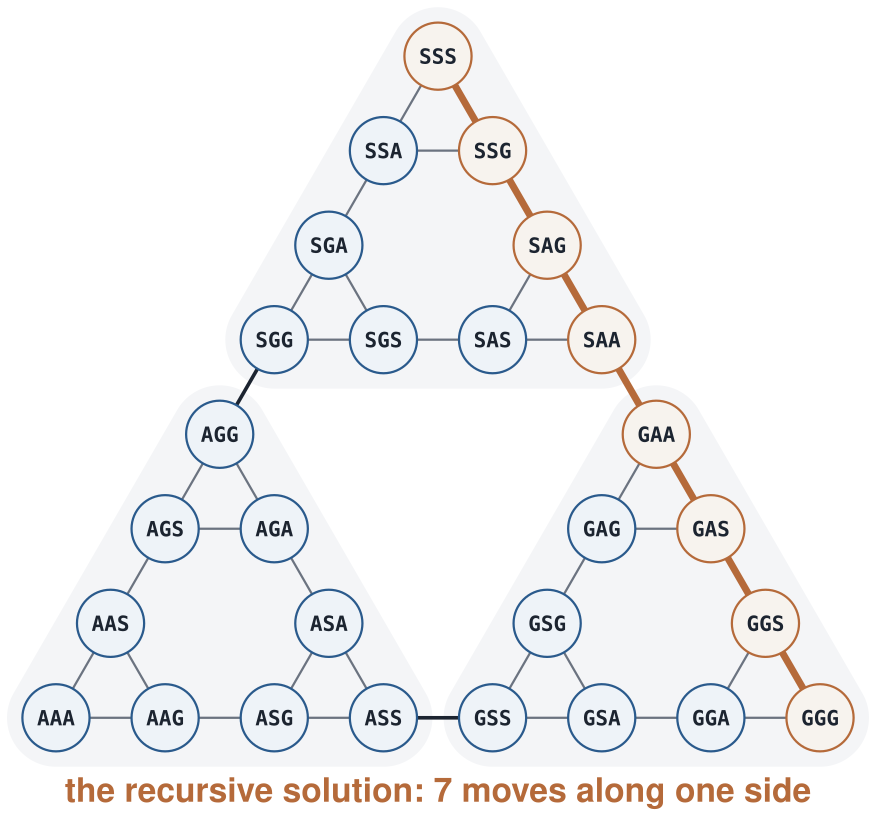{.sketch .huge}

## Why the side is the shortest path

$d(n)$: the fewest moves that solve the puzzle with $n$ disks.

- **Before the largest disk first moves**, the smaller disks must all leave $\mathtt{S}$ for one peg: at least $d(n-1)$ moves.
- **After its last move** onto $\mathtt{G}$, the smaller disks must all come onto $\mathtt{G}$: at least $d(n-1)$ moves.

$$
d(n) \ge d(n-1) + 1 + d(n-1) \quad\Rightarrow\quad d(n) = 2^n - 1
$$

::: {.takeaway}
The recursion uses exactly $d(n-1) + 1 + d(n-1)$ moves, so it is a shortest path: down one copy, across one bridge, down the next.
:::

## Euler or Hamilton?

Back to this week's question, on the Hanoi graph:

- **Degrees.** The three corners (all disks on one peg) have degree 2. Every other arrangement has degree 3: two moves of the smallest disk, plus exactly one move between the two other pegs (the smaller of their top disks goes onto the other).
- **Euler:** for $n \ge 2$ there are $3^n - 3$ vertices of odd degree. No walk uses every move exactly once.
- **Hamilton:** is there a walk that visits every arrangement exactly once?

## A walk through every arrangement

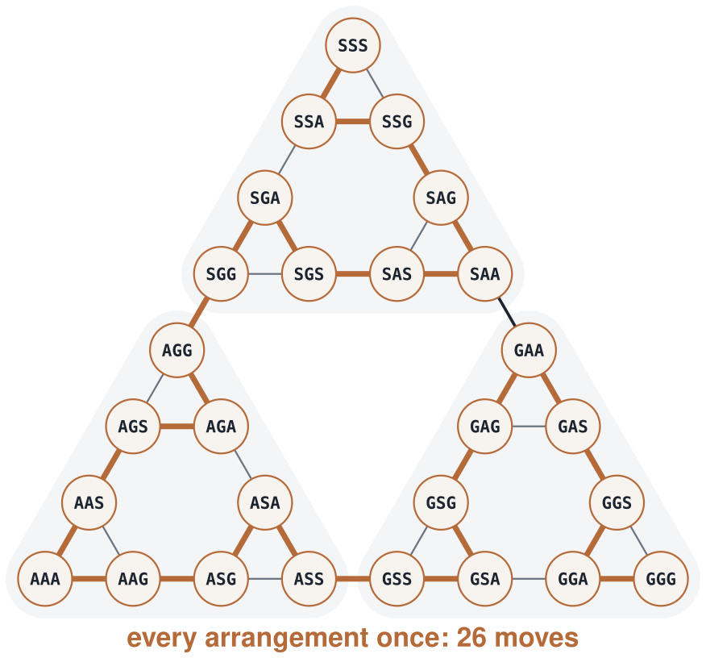{.sketch .huge}

## Built like the solution

To visit every arrangement, from all on $\mathtt{S}$ to all on $\mathtt{G}$:

1. Visit all of the $\mathtt{S}$ copy, ending with the smaller disks on $\mathtt{G}$. Move the largest disk to $\mathtt{A}$.
2. Visit all of the $\mathtt{A}$ copy, ending with the smaller disks on $\mathtt{S}$. Move the largest disk to $\mathtt{G}$.
3. Visit all of the $\mathtt{G}$ copy, ending with all disks on $\mathtt{G}$.

Each step is the same task with $n - 1$ disks: $3^n - 1$ moves in total, 26 for three disks.

::: {.takeaway}
Finding a Hamiltonian path is hard for a general graph. Here the repeated structure hands it to us, with the same recursion that solved the puzzle.
:::

## 90 seconds: which problem is easy?

Discuss with your neighbour:

- Euler or Hamilton: which one has a fast algorithm, and why do degrees decide it?
- If a vertex has two unused ways out, is the reconstruction unique?

## Open `labs/07-graphs.ipynb`

::: {.lab}
::: {.lab-tag}
Lab · ~20 minutes · Python
:::

1. Both graphs for example 1; how their sizes grow with the genome.
2. Degrees and Hierholzer's algorithm on example 1 and the bow-tie.
3. Example 2 with $k = 3$ (two circuits) and $k = 4$ (one path).
4. Count 3-mers by hand; error-free copies for each $k$ against $\lambda(k)$; the spectrum, genome size, bubble and contigs.
5. The Hanoi graph: vertices, edges, degrees, shortest solution by breadth-first search, and the walk through every arrangement.
6. Answer Q1–Q3 without notes.
:::

## A bit of history

::: {.history}
- **Euler** (1736): the bridges of Königsberg; walking every edge once.
- **Hierholzer** (1873): constructing the walk in linear time.
- **de Bruijn** (1946): sequences that contain every $k$-mer; the graph is named after him.
- **Idury & Waterman** (1995) and **Pevzner, Tang & Waterman** (2001): genome assembly as an Eulerian path.
- **Wu et al.** (2020): the SARS-CoV-2 genome, assembled from short reads with a de Bruijn assembler.
- **Nurk et al.** (2022): the first complete human genome, from long reads.
:::

## Tools that use this

::: {.tools}
- **Velvet**, **SPAdes**, **MEGAHIT**: de Bruijn assembly of short reads, built on Eulerian walks over $k$-mer edges.
- **hifiasm**, **Canu**, **Flye**: long-read assemblers that return to overlap graphs, because a read can span a repeat.
- **Bandage** draws an assembly graph; a repeat appears as a vertex with extra edges, like $\mathtt{AA}$ in example 2.
:::

## Extensions

::: {.ext}
- **Paired reads**, coverage and diploid genomes add constraints that help choose the right Eulerian path; they do not change Euler versus Hamilton.
- **Sequencing by hybridization** measured all $k$-mers of a DNA molecule on a chip; it motivated the de Bruijn approach before shotgun short reads took over.
:::

## What you should be able to answer

::: {.muted}
Without notes. Q1–Q2 cover today's material; **Q3** asks about a situation we did not practise.
:::

::: {.qs}
::: {.q}
[Q1]{.tag} Which path problem has a fast algorithm, Eulerian or Hamiltonian? How do the degrees decide whether a walk exists?
:::
::: {.q}
[Q2]{.tag} In the overlap graph and in the de Bruijn graph, what are the vertices and the edges? Which search is Hamiltonian, which Eulerian?
:::
::: {.q .q3}
[Q3]{.tag} A plasmid is a circular DNA molecule (week 5). If all reads come from a plasmid, what do the degrees of its de Bruijn graph look like, and where does the walk start?
:::
:::

::: notes
2–3 minutes. Pair-share Q3. A circular genome has no ends: every vertex is balanced, so there is an Eulerian circuit and the walk can start anywhere — the reconstruction is determined only up to rotation.
:::

## Summary

::: {.takeaway}
Visiting every vertex once (Hamiltonian) is hard; using every edge once (Eulerian) is easy: check the degrees, then walk with Hierholzer's algorithm.
:::

::: {.takeaway}
Reads as vertices give the overlap graph and a Hamiltonian problem. $k$-mers as edges give the de Bruijn graph and an Eulerian problem.
:::

::: {.takeaway}
Repeats make the walk non-unique; a larger $k$ separates short repeats but thins the coverage. Counting $k$-mers removes errors and estimates the genome size; assemblers report the non-branching pieces as contigs.
:::

## Next week

**Pattern matching and suffix trees.**

We can now assemble a reference genome. Next we search it: where does a short sequence, such as a primer or a read, occur in 3 billion letters? Scanning the whole genome for every query is too slow, so we build an **index** of the genome once.

## Reading

::: {.read}
- Compeau, Pevzner & Tesler (2011). How to apply de Bruijn graphs to genome assembly. *Nat. Biotechnol.* 29.
- Pevzner, Tang & Waterman (2001). An Eulerian path approach to DNA fragment assembly. *PNAS* 98.
- Wu et al. (2020). A new coronavirus associated with human respiratory disease in China. *Nature* 579.
- Nurk et al. (2022). The complete sequence of a human genome. *Science* 376.
:::
