## Recap

Last week we assembled a genome from its reads: the SARS-CoV-2 genome of 29,903 letters, put together in January 2020.

Once a genome exists, it becomes a **reference**. The next question is no longer how to build it, but how to **search** it.

## Searching a genome {.section-head}

A short sequence has to be found in a very long one.

## A test for a new virus

Within days of the genome's release, Corman et al. (2020) designed the first PCR test for SARS-CoV-2.

- A PCR test uses **primers**: short pieces of DNA, about 20 letters long, that bind to one exact place in the target genome. One of them was $\mathtt{ACAGGTACGTTAATAGTTAATAGCGT}$, in the envelope gene.
- A good primer must occur in the virus genome, ideally exactly once.
- It must **not** occur in the human genome, or the test would also detect the patient's own DNA.

::: {.takeaway}
Designing a test means searching for many short strings: in a 30,000-letter virus genome, and in the 3-billion-letter human genome.
:::

## Searching is the inner loop

The same question appears everywhere in genomics: **where does this short string occur in that long one?**

- Checking candidate primers against the human genome.
- Placing millions of sequencing reads on a reference (next week).
- Finding a transcription-factor motif or a restriction site (weeks 5–6).

Each search must be fast, because there are millions of them and the text is long.

## The idea of this week

::: {.idea}
Scanning the whole text for every query wastes work: the text is the same every time. Instead we **preprocess the text once** into a tree of all its suffixes. A query is then a walk from the root, and its cost no longer depends on the length of the text.
:::

::: {.goals}
By the end of this meeting you should be able to:

1. Explain why scanning costs time proportional to pattern length times text length.
2. Build a suffix tree for a short string and search it.
3. Explain why, once the tree is built, the length of the text drops out of the query time.
4. Read the longest repeat, and the longest stretch shared by two genomes, off a suffix tree.
5. Search a suffix array by binary search.
:::

## Problem statement

::: {.io}
::: {.in}
**Input**

A text $t$ of length $m$ (the genome) and a pattern $p$ of length $n$ (the primer).
:::
::: {.arrow}
→
:::
::: {.out}
**Output**

Every position $i$ where $p$ occurs in $t$.
:::
:::

::: {.toy}
**Running example.** The text $t = \mathtt{ATGGTCGGT}$ ($m = 9$) and the pattern $p = \mathtt{GGT}$ ($n = 3$). The pattern occurs at positions $2$ and $6$ (counting from 0).

Note: $n$ is the short pattern and $m$ the long text. The lab notebook `labs/08-suffix.ipynb` runs every step.
:::

## Scanning the text {.section-head}

The obvious method: try every position.

## The naive scan

Slide the pattern along the text. At each position, compare letter by letter, and stop at the first mismatch.

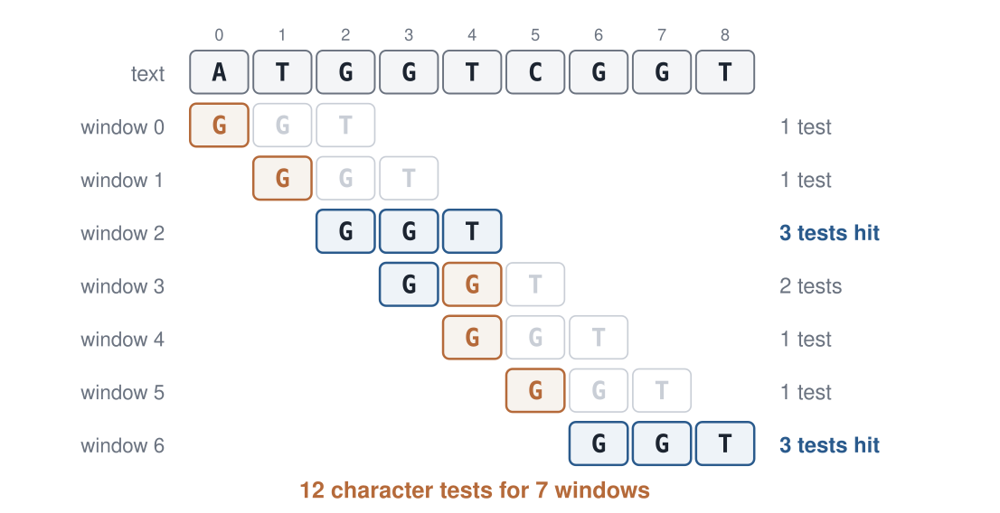{.sketch}

## What the scan costs

- There are $m - n + 1$ positions, and each costs up to $n$ letter comparisons, so the scan takes time $O(nm)$.
- Most comparisons are spent **rejecting** positions where the pattern does not occur.
- The text is read again, from the start, for every new pattern.

At genome scale: for one primer against the human genome, at least one comparison for each of 3 billion positions. For a thousand candidate primers, a thousand full passes over the genome.

## Many patterns at once {.section-head}

The first improvement: organise the patterns into a tree.

## The keyword tree

:::: {.split .fig-right}
::: {.pane}
Put all patterns into one tree: one letter per edge, and patterns that start the same way share a path.

- Patterns: $p_1 = \mathtt{GGT}$, $p_2 = \mathtt{GGG}$, $p_3 = \mathtt{ATG}$, $p_4 = \mathtt{CG}$.
- From each position of the text, follow the text's letters down the tree until a pattern ends (a hit) or no edge fits (a miss).
:::
::: {.pane}
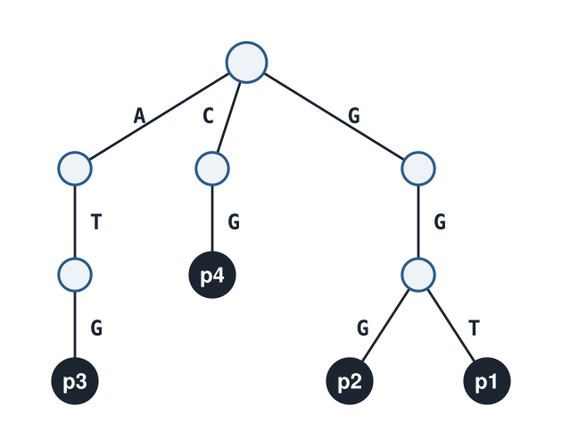{.sketch}
:::
::::

## Walking the text through the tree

From each start position, follow the text's letters down the tree until a pattern ends or no edge fits:

| start | 0 | 1 | 2 | 3 | 4 | 5 | 6 | 7 | 8 |
|---|---|---|---|---|---|---|---|---|---|
| letters read | 3 | 1 | 3 | 2 | 1 | 2 | 3 | 2 | 1 |
| hit | $p_3$ | | $p_1$ | | | $p_4$ | $p_1$ | | |

- At start 0 the walk reads $\mathtt{A}$, $\mathtt{T}$, $\mathtt{G}$ and ends at $p_3 = \mathtt{ATG}$.
- At start 1 the first letter, $\mathtt{T}$, has no edge from the root: one letter read, then move on.

## What the keyword tree saves

- **18 letters** read in total, for all four patterns at once.
- Four separate naive scans read $12 + 12 + 9 + 9 = $ **42 letters**.
- From each start, the walk reads at most the length of the longest pattern, however many patterns there are.

But the walk still **starts again** at every position: the letters at positions 3 and 4 were already read from position 2, and are read again.

## Don't start again from the root

:::: {.split .fig-right}
::: {.pane}
After a walk stops, the letters just read are known. Their **longest ending** that is also the start of a pattern tells us where to continue.

- After $\mathtt{ATG}$, the last $\mathtt{G}$ starts $\mathtt{GGT}$ and $\mathtt{GGG}$: continue from node $\mathtt{G}$.
- The dashed **fallback links** store this for every node.

With them the text is read once, left to right (Aho & Corasick, 1975).
:::
::: {.pane}
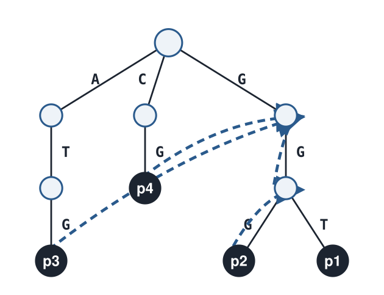{.sketch}
:::
::::

## Patterns or text?

- A keyword tree indexes the **patterns**: good for many patterns and one pass over a text.
- Each new batch of patterns still reads the whole genome again.

::: {.takeaway}
To stop rereading the genome, we must index the **text** instead.
:::

## Index the text {.section-head}

A tree that contains every suffix of the genome.

## The suffix tree

A **suffix** of $t$ is the text from some position to the end. Put **every suffix** of the text into one tree.

- End the text with a special letter $\mathtt{\$}$, so that no suffix is the beginning of another one.
- Each leaf is labelled with the position where its suffix starts.
- Any pattern that occurs in $t$ is the **beginning of some suffix**, so it can be read along a path from the root.

We build the tree for the short text $\mathtt{ACA\$}$, inserting the suffixes $\mathtt{\$}$, $\mathtt{A\$}$, $\mathtt{CA\$}$, $\mathtt{ACA\$}$ one at a time.

## Insert the first two suffixes

:::: {.split}
::: {.pane}
**$\mathtt{\$}$, starting at position 3**

{.sketch}
:::
::: {.pane}
**$\mathtt{A\$}$, starting at position 2**

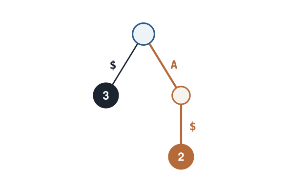{.sketch}
:::
::::

New edges are drawn in orange. Each leaf carries the starting position of its suffix.

## Insert $\mathtt{CA\$}$

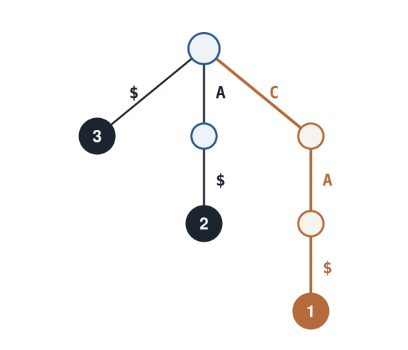{.sketch}

No edge from the root starts with $\mathtt{C}$, so the suffix gets a new branch. Its leaf is position 1.

## Insert $\mathtt{ACA\$}$

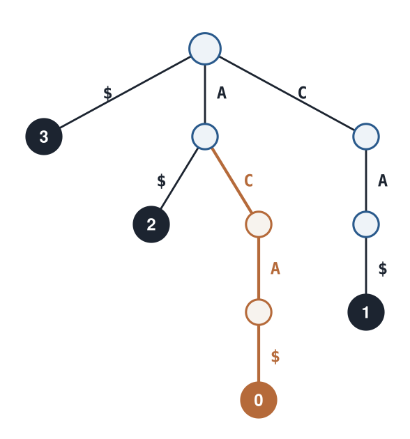{.sketch}

The suffix begins with $\mathtt{A}$, so it follows the existing $\mathtt{A}$ edge, then branches off with $\mathtt{CA\$}$. Four suffixes, four leaves.

## Compress the long paths

On longer texts, many nodes have only one child. We merge each such chain into one edge, labelled by its whole block of letters. Below: the suffix tree of $t = \mathtt{ATGGTCGGT\$}$.

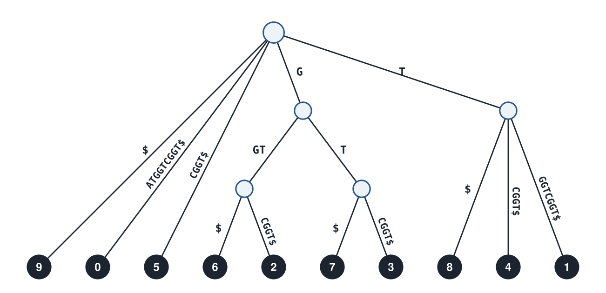{.sketch}

## Before compressing: one node per letter

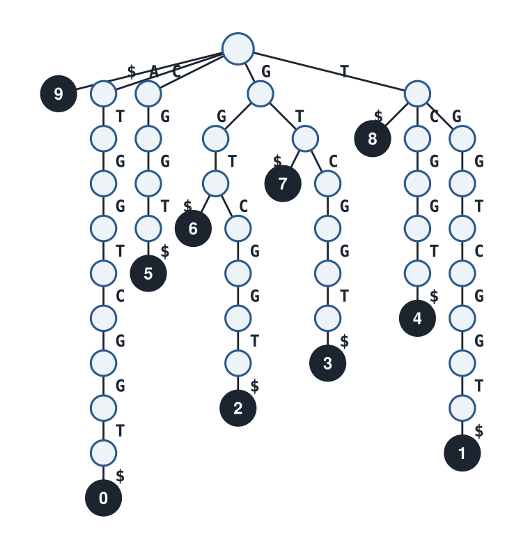{.sketch}

The same suffixes with one letter per edge: **48 nodes** for a text of 10 letters. The compressed tree on the previous slide has **15**.

## How big is the tree?

Suffix trees of random texts, with and without compressing:

| Text length $m$ | One letter per edge | Compressed |
|---|---|---|
| 10 | 48 | 15 |
| 101 | 4,906 | 164 |
| 1,001 | 497,305 | 1,636 |

- With one letter per edge, the tree grows like $m^2 / 2$: every suffix brings its own long chain.
- Compressed, it stays below $2m$.

## Why at most $2m$ nodes

- There is one **leaf** per suffix: $m$ leaves.
- Every **internal** node has at least two children, because single-child chains were merged.
- A tree in which every internal node branches has fewer internal nodes than leaves.

So the compressed tree has fewer than $2m$ nodes, and fewer than $2m$ edges.

## Edge labels point into the text

A label such as $\mathtt{GGTCGGT\$}$ is a stretch of the text. Store **where it starts** and **how long it is**, not the letters:

| Edge label | Start in $t$ | Length |
|---|---|---|
| $\mathtt{GGTCGGT\$}$ | 2 | 8 |
| $\mathtt{CGGT\$}$ | 5 | 5 |
| $\mathtt{GT}$ | 3 | 2 |

::: {.takeaway}
Two numbers per edge, fewer than $2m$ edges: the whole tree takes memory proportional to $m$.
:::

## Search $\mathtt{GGT}$

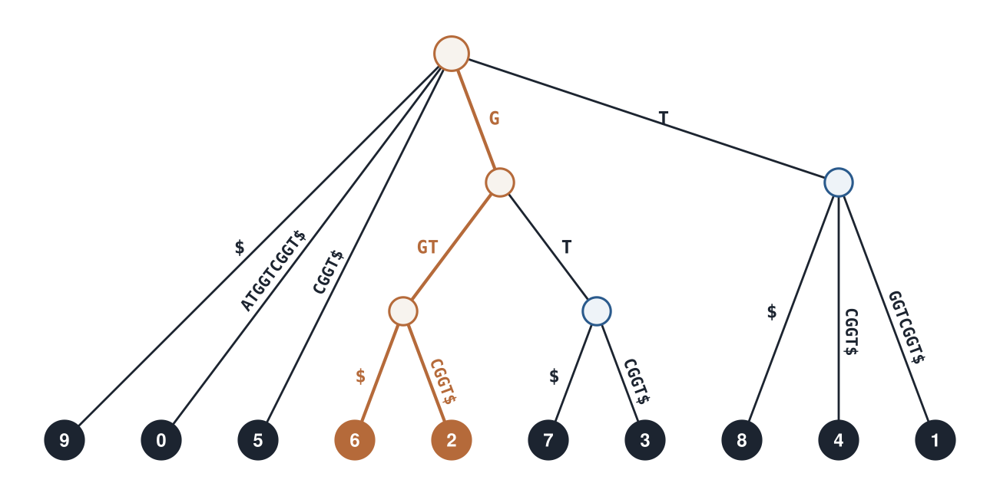{.sketch}

From the root, follow $\mathtt{G}$, then $\mathtt{GT}$: three letters read. Every leaf below that point is a hit: positions **6** and **2**.

## Search $\mathtt{GGGA}$: a miss

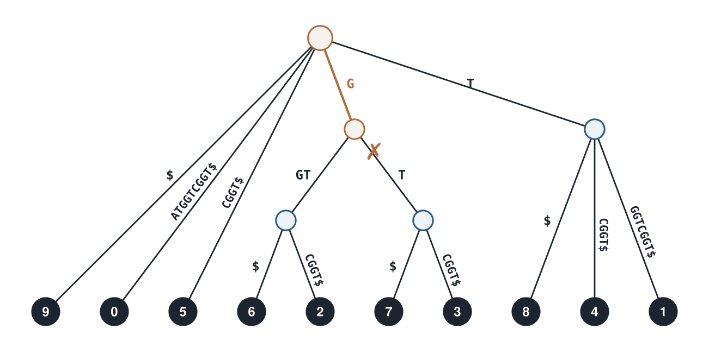{.sketch}

Follow $\mathtt{G}$; the next edge starts with $\mathtt{G}$ but continues with $\mathtt{T}$, not the $\mathtt{G}$ we need. The walk stops: the pattern does not occur. The text was never scanned.

## Why the text length drops out

- **Building** the tree is done **once**, in time proportional to the length of the text, $O(m)$ (how, below).
- **Searching** reads the pattern along the tree: $O(n)$ steps, plus one step per hit to list the leaves.

$$
T_{\text{query}} = O(n) \qquad \text{instead of} \qquad O(nm)
$$

::: {.takeaway}
After preprocessing, the time for a query depends on the length of the pattern, not on the length of the genome.
:::

## Building the tree the slow way

Insert the suffixes one at a time, each read from the root:

- For $\mathtt{ATGGTCGGT\$}$: $10 + 9 + \dots + 1 = 55$ letter steps.
- In general $m(m+1)/2$ steps: about 450 million for the 29,903 letters of SARS-CoV-2, about $5 \times 10^{18}$ for the human genome.

Most of these steps retrace paths that are already in the tree.

## Neighbouring suffixes share almost everything

Two suffixes inserted one after the other:

| starts at | suffix |
|---|---|
| 2 | $\mathtt{GGTCGGT\$}$ |
| 3 | $\mathtt{\phantom{G}GTCGGT\$}$ |

- The second is the first **without its first letter**.
- Inserting suffix 2, the walk from the root passes the node reached by reading $\mathtt{GGT}$.
- Suffix 3 must pass the node reached by reading $\mathtt{GT}$: the same letters, minus the first $\mathtt{G}$. Walking there from the root reads them all again.

## Where does a link point? Follow the occurrences

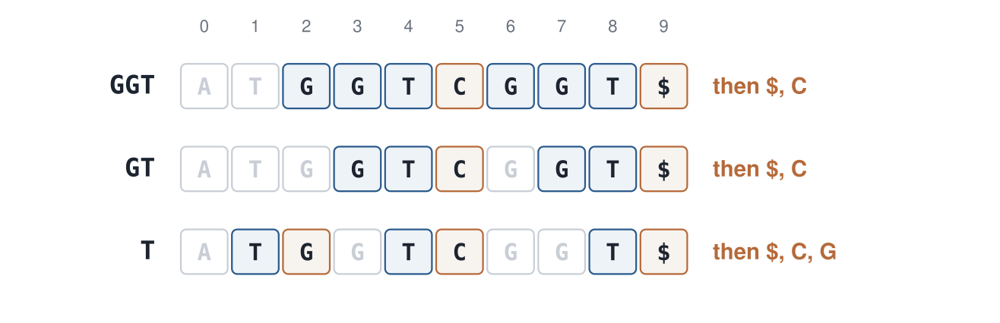{.sketch .below .tall}

Blue: each occurrence of the string. Orange: the letter that comes right after it.

## Why the target node always exists

- A node in the tree means: this string is followed by **at least two different letters** in the text. $\mathtt{GGT}$ is followed by $\mathtt{C}$ (at 2) and by $\mathtt{\$}$ (at 6).
- Drop the first letter. Inside every $\mathtt{GGT}$ sits a $\mathtt{GT}$, one position later, followed by the **same** letter: $\mathtt{C}$ (at 3) and $\mathtt{\$}$ (at 7).
- So $\mathtt{GT}$ also has two different next letters: the tree branches after it too, and there is a node for $\mathtt{GT}$.

::: {.takeaway}
Whenever there is a node for a string, there is a node for the same string without its first letter. The suffix link joins the two.
:::

## Suffix links

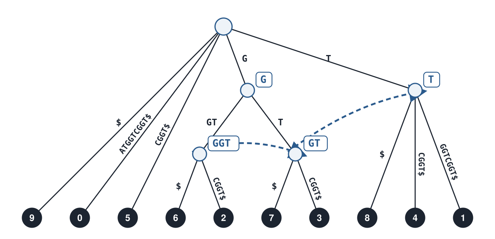{.sketch .below .tall}

Each internal node gets an arrow (dashed) to the node for the **same string without its first letter**: from the node for $\mathtt{GGT}$ to the node for $\mathtt{GT}$, and from $\mathtt{GT}$ to $\mathtt{T}$.

## Insert suffix 6 from the root

Insert the suffixes in order, longest first. Suffixes 0–5 are already in the tree. Suffix 6 is $\mathtt{GGT\$}$:

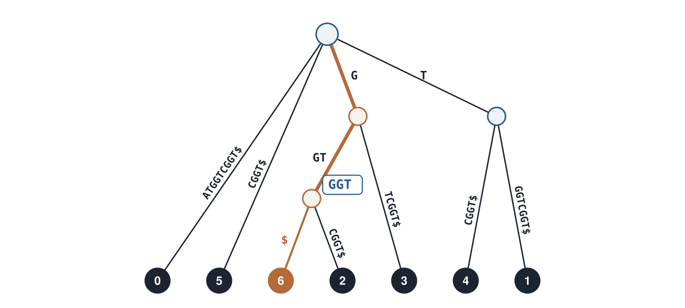{.sketch .below .tall}

Walk from the root reading $\mathtt{G}$, $\mathtt{G}$, $\mathtt{T}$: **3 letters**. No edge continues with $\mathtt{\$}$, so a new node $\mathtt{GGT}$ appears, with leaf 6 below it.

## Suffix 7: jump along the link

Suffix 7 is $\mathtt{GT\$}$: suffix 6 without its first $\mathtt{G}$. Suffix 6 branched off after $\mathtt{GGT}$, so suffix 7 branches off after $\mathtt{GT}$, and a node for $\mathtt{GT}$ appears.

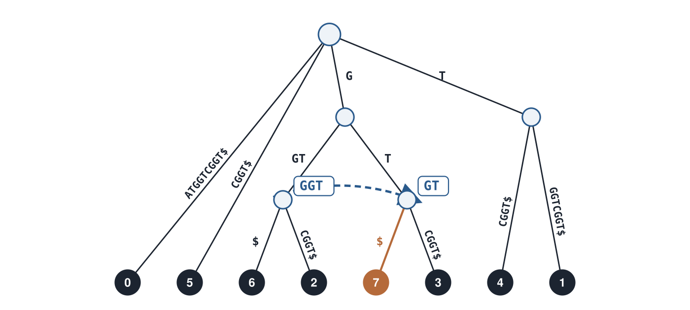{.sketch .below .tall}

This is the moment the link $\mathtt{GGT} \to \mathtt{GT}$ is made: it records where the next suffix went. Any later walk that reaches $\mathtt{GGT}$ can jump to $\mathtt{GT}$ without reading. Hang leaf 7 there.

## Suffix 8: one more jump

Suffix 8 is $\mathtt{T\$}$: drop the $\mathtt{G}$ again. It branches off after $\mathtt{T}$, and the link $\mathtt{GT} \to \mathtt{T}$ records that.

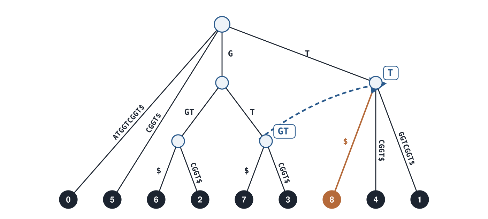{.sketch .below .tall}

The node for $\mathtt{T}$ already exists (suffix 4 made it). Hang leaf 8 below it.

## Suffix 9: back to the root

Suffix 9 is $\mathtt{\$}$. Dropping the $\mathtt{T}$ leaves the empty string, the root: the link $\mathtt{T} \to$ root.

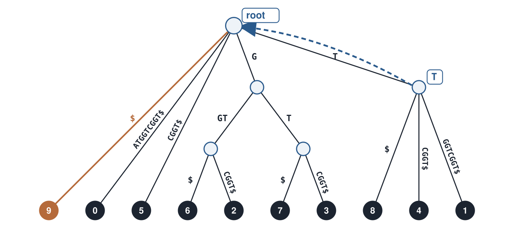{.sketch .below .tall}

Hang leaf 9 from the root. The tree is complete.

## Letters read, with and without links

| suffix | branches off after | letters read from the root | starting at the link target |
|---|---|---|---|
| 6 $\mathtt{GGT\$}$ | $\mathtt{GGT}$ | 3 | 3 |
| 7 $\mathtt{GT\$}$ | $\mathtt{GT}$ | 2 | 0 |
| 8 $\mathtt{T\$}$ | $\mathtt{T}$ | 1 | 0 |
| 9 $\mathtt{\$}$ | the root | 0 | 0 |

Each suffix branches off where the previous one did, minus its first letter. Starting there, the letters the previous suffix already matched are not read again.

## Building with suffix links

- After placing one suffix, jump along the link to where the next one goes, instead of starting again at the root. The same trick as the fallback links of the keyword tree: never reread letters already matched.
- Each link is created just after its node. If it is not there yet, step up one edge to a node that has a link, jump, and walk down the letters of that one edge.
- Over the whole text these walks add up to time proportional to $m$ (McCreight 1976; Ukkonen 1995).

::: {.takeaway}
Built once in $O(m)$, the suffix tree answers every later query in $O(n)$.
:::

## Back to the primer {.section-head}

Reading counts and repeats from the tree.

## How often does a primer occur?

The number of leaves below the end of a walk is the number of occurrences.

| Leaves below the walk | Meaning for a primer |
|---|---|
| none: the walk fails | the primer does not occur (wanted in the human genome) |
| exactly one | the primer occurs once (wanted in the virus genome) |
| several | the primer sits in a repeat and would bind in several places |

With a suffix tree of each genome, every candidate primer is checked by two short walks.

## What else the tree knows {.section-head}

Repeats, and stretches shared by two genomes.

## The longest repeat

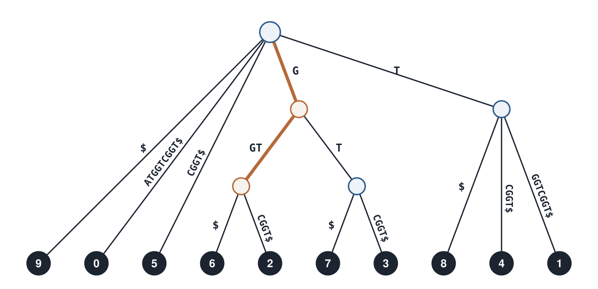{.sketch .below .tall}

A string that occurs twice ends at or above an **internal** node, because the two occurrences branch apart below it. The deepest internal node is the **longest repeat**: $\mathtt{GGT}$, at positions 6 and 2.

## Every internal node is a repeat

Visit every internal node once. Its path from the root is a string that occurs at least twice; the leaves below it are the positions.

| repeat | length | positions (leaves below) |
|---|---|---|
| $\mathtt{GGT}$ | 3 | 2, 6 |
| $\mathtt{GT}$ | 2 | 3, 7 |
| $\mathtt{G}$ | 1 | 2, 3, 6, 7 |
| $\mathtt{T}$ | 1 | 1, 4, 8 |

- Sorted by length, this lists the repeats longest first.
- Shorter repeats such as $\mathtt{GG}$ end partway along an edge above $\mathtt{GGT}$, with the same positions.
- One visit per node, fewer than $2m$ nodes: time proportional to the genome.

## Checking primers against repeats

Walk each candidate primer from the root, and count the leaves below the end of the walk:

| candidate | the walk ends | leaves below | verdict |
|---|---|---|---|
| $\mathtt{GGT}$ | at the internal node $\mathtt{GGT}$ | 2 (positions 6, 2) | binds twice: reject |
| $\mathtt{TCG}$ | inside the edge to leaf 4 | 1 (position 4) | binds once: keep |
| $\mathtt{GGGA}$ | the walk fails | 0 | not in the text |

For the real test: one leaf in the tree of the virus genome, and no leaf in the tree of the human genome.

## Repeats in real genomes

- About **half** of the human genome is repeats, mostly copies of mobile elements that spread over millions of years (Lander et al. 2001).
- The **Alu** element, about 300 letters long, occurs more than a million times: about 10% of the genome. A primer inside an Alu would bind a million times.
- In assembly (week 7), a read or $k$-mer shorter than a repeat cannot tell its copies apart.

::: {.takeaway}
Before a primer is ordered, its walk in the genome's suffix tree must end above exactly one leaf.
:::

## Two genomes in one tree

The closest known relative of SARS-CoV-2 is a bat virus, RaTG13: about 96% of their genomes are identical (Zhou et al. 2020). Which stretches do they share **exactly**?

- Put the suffixes of **both** genomes into one tree. End the first with $\mathtt{\#}$ and the second with $\mathtt{\$}$, so their suffixes stay apart.
- Colour each leaf by its genome.
- A stretch shared by both genomes begins a suffix of each, so the walk for it ends above leaves of **both** colours.

**Toy:** $t_1 = \mathtt{ATGGTCGGT}$ (dark leaves) and $t_2 = \mathtt{TTCGGA}$ (blue leaves, marked $'$).

## Which colours lie below each node?

- A leaf has the colour of its genome.
- An internal node has every colour of its children. Fill these in from the leaves upward: one visit per node.

| node | leaves below | colours | shared by both? |
|---|---|---|---|
| $\mathtt{TCGG}$ | 4, 1$'$ | both | yes |
| $\mathtt{GGT}$ | 2, 6 | $t_1$ only | no: a repeat inside $t_1$ |
| $\mathtt{CGG}$ | 5, 2$'$ | both | yes |
| $\mathtt{GG}$ | 2, 6, 3$'$ | both | yes |
| $\mathtt{A}$ | 0, 5$'$ | both | yes |

## The longest shared stretch

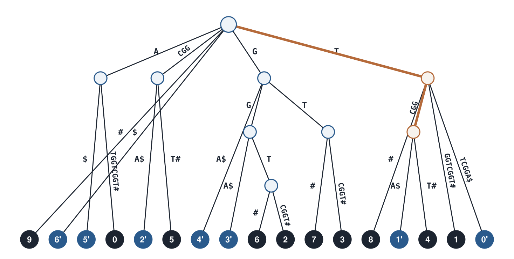{.sketch}

The deepest internal node with leaves of **both** colours: $\mathtt{TCGG}$, at position 4 of $t_1$ and position 1 of $t_2$.

## From the toy to the viruses

- For SARS-CoV-2 and RaTG13, about 30,000 letters each, the joint tree has fewer than 120,000 nodes. One upward pass lists every stretch the two genomes share exactly.
- Whole-genome aligners such as **MUMmer** use the long shared stretches as **anchors**, then align only the short gaps between them, with the dynamic programming of week 3.

## A sorted list instead of a tree {.section-head}

The leaves of the tree, read from left to right.

## The price of a suffix tree

A suffix tree stores several pointers for every letter of the text: even careful implementations need at least 10 bytes per letter.

- SARS-CoV-2 genome: about 30,000 letters, so well under a megabyte.
- Human genome: 3.1 billion letters, so more than 31 gigabytes, more than the memory of a typical computer.

Most of that memory is the tree's branching. The **order** of the leaves is what the search needs.

## The suffix array

:::: {.split .fig-right}
::: {.pane}
Sort the suffixes alphabetically, with $\mathtt{\$}$ first. Keep only their **start positions**:

$$9\;\; 0\;\; 5\;\; 6\;\; 2\;\; 7\;\; 3\;\; 8\;\; 4\;\; 1$$

These are the leaves of the suffix tree, read from left to right. Suffixes that begin with the same pattern stand in **neighbouring rows**.
:::
::: {.pane}
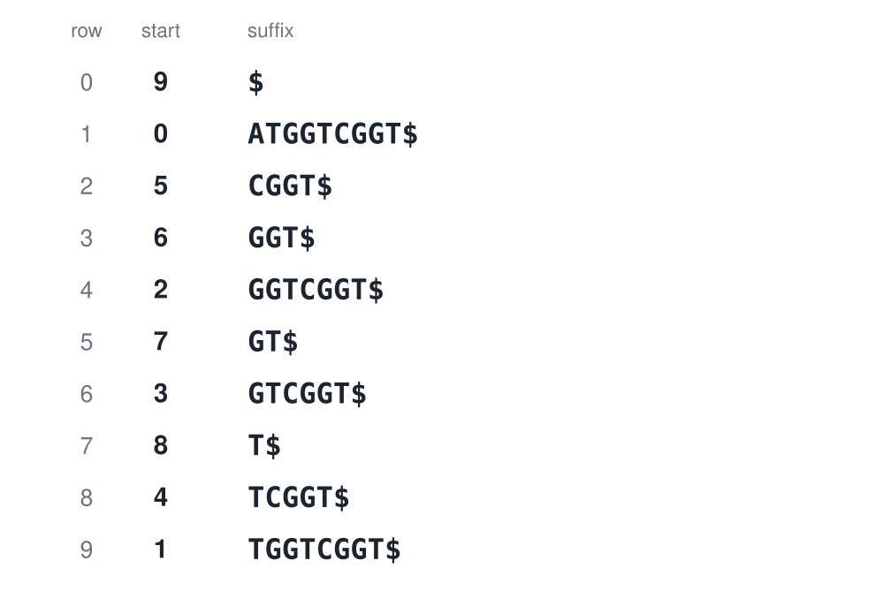{.sketch}
:::
::::

## Binary search for $\mathtt{GGT}$: step 1

:::: {.split .fig-right}
::: {.pane}
All rows 0–9 are possible. The middle row, 5, holds $\mathtt{GT\$}$. Compare letter by letter: $\mathtt{G} = \mathtt{G}$, then $\mathtt{G} < \mathtt{T}$. So $\mathtt{GGT}$ sorts **before** row 5: keep rows 0–4.
:::
::: {.pane}
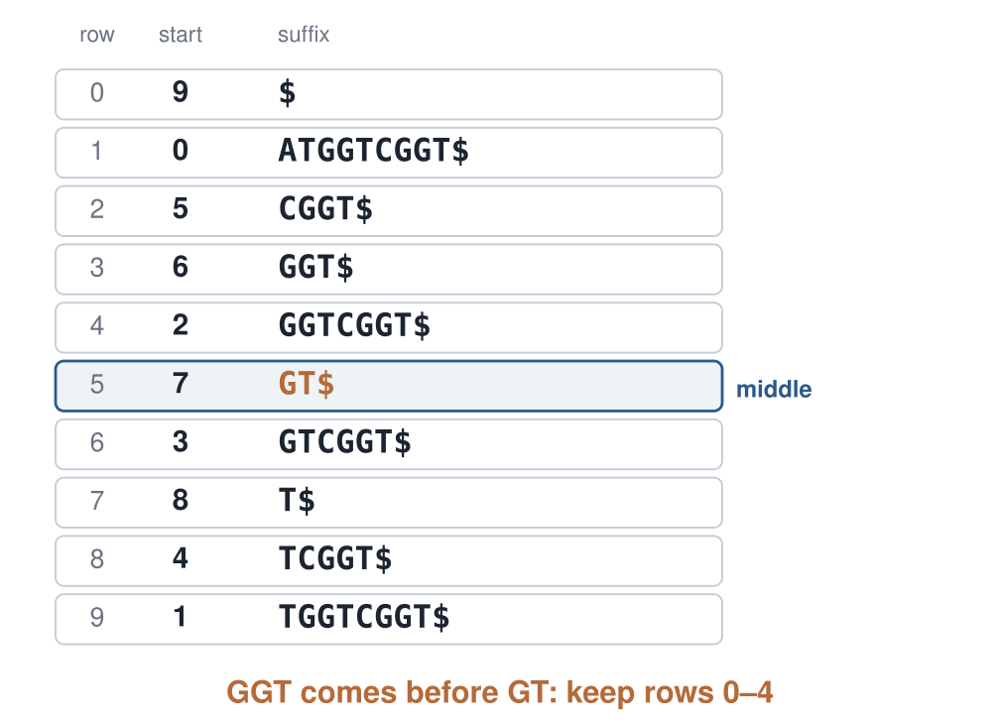{.sketch}
:::
::::

## Step 2

:::: {.split .fig-right}
::: {.pane}
The middle of rows 0–4 is row 2, $\mathtt{CGGT\$}$. Already the first letter decides: $\mathtt{G} > \mathtt{C}$, so $\mathtt{GGT}$ sorts **after** row 2: keep rows 3–4.
:::
::: {.pane}
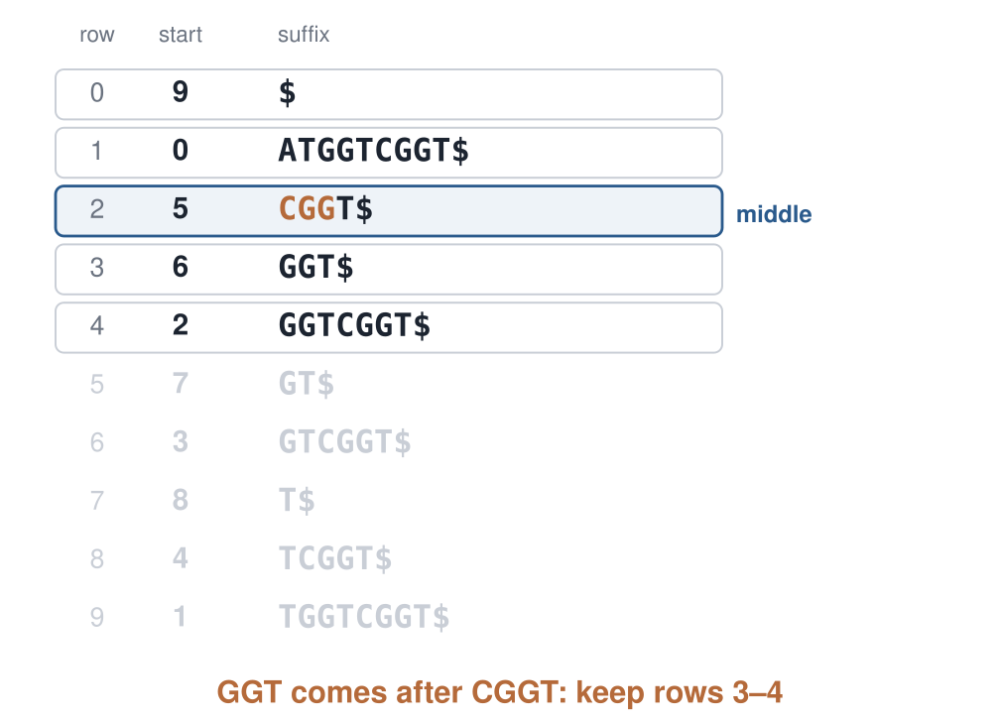{.sketch}
:::
::::

## Step 3

:::: {.split .fig-right}
::: {.pane}
Row 3 begins with $\mathtt{GGT}$. Row 4 does too, and row 2 does not: the matches are the **block** of rows 3–4, starting at positions 6 and 2. Only rows 5, 2, 3 and 4 were read, out of ten.
:::
::: {.pane}
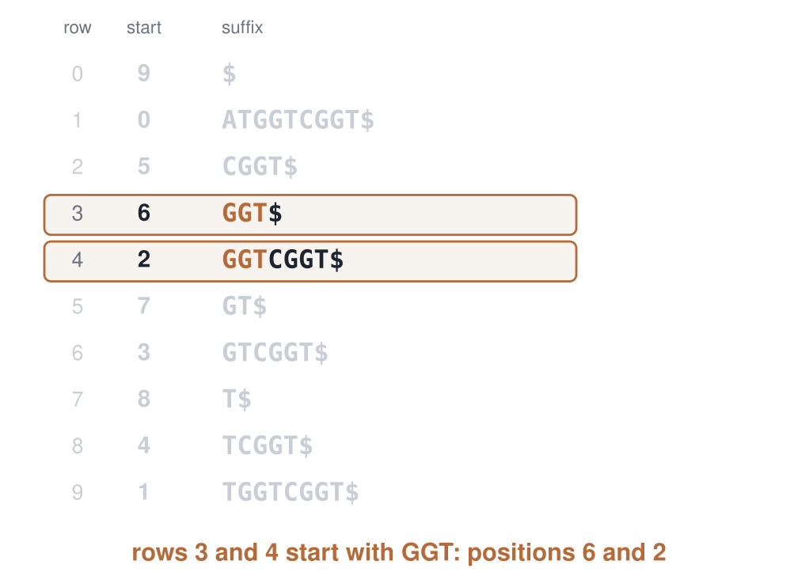{.sketch}
:::
::::

## What the sorted list costs

- **Search:** each step halves the rows. For the human genome, $\log_2(3.1 \times 10^9) \approx 32$ steps, each comparing at most $n$ letters: $O(n \log m)$.
- **Memory:** one start position per letter, 4 bytes each: about 12 gigabytes for the human genome, against more than 31 for the tree.

::: {.takeaway}
The suffix array keeps the fast search with a fraction of the memory. Next week we shrink it further, to a few gigabytes.
:::

## Which index to build?

| Situation | Index | Why |
|---|---|---|
| many patterns, one pass over a text | **keyword tree** of the patterns | no index of the text needed |
| one genome, searched again and again | **suffix tree** of the genome | each query is a walk of $O(n)$ steps; repeats and shared stretches come free |
| a large genome, little memory | **suffix array** | binary search, 4 bytes per letter |

## Open `labs/08-suffix.ipynb`

::: {.lab}
::: {.lab-tag}
Lab · ~20 minutes · Python
:::

1. Naive scan of $\mathtt{ATGGTCGGT}$ for $\mathtt{GGT}$: hits at 2 and 6, after 12 letter comparisons.
2. Walk the text through the keyword tree of four patterns: 18 letters against 42.
3. Build the suffix tree; count its nodes with and without compressing.
4. Search $\mathtt{GGT}$ and $\mathtt{GGGA}$; find the longest repeat and the longest stretch shared with $\mathtt{TTCGGA}$.
5. Build the suffix array and search it by binary search.
6. Answer Q1–Q3 without notes.
:::

## A bit of history

::: {.history}
- **Knuth, Morris & Pratt** (1977), **Boyer & Moore** (1977): faster scans of the text; each query still reads the whole text.
- **Aho & Corasick** (1975): keyword trees for searching many patterns at once.
- **Weiner** (1973): suffix trees built in linear time; **McCreight** (1976) and **Ukkonen** (1995) simplified the construction.
- **Manber & Myers** (1990): suffix arrays, the same suffixes stored as a sorted list.
- **Zhou et al.** (2020): the bat virus RaTG13, about 96% identical to SARS-CoV-2.
- **Corman et al.** (2020): the first SARS-CoV-2 PCR test, designed within days of the genome's release.
:::

## Tools that use this

::: {.tools}
- **MUMmer** compares whole genomes by finding the long stretches they share exactly, with a suffix tree or suffix array.
- **grep** and similar programs use fast scans (Boyer–Moore, Aho–Corasick): no index, one pass per search.
- Primer design tools check candidate primers against a genome index for unwanted matches.
:::

## Extensions

::: {.ext}
- **Searching with mismatches.** Split a pattern of $n$ letters into pieces. If it occurs with one mismatch, one of two halves occurs exactly: find that half with the index, then check the rest.
- **Neighbouring rows.** Comparing each row of the suffix array with the next gives every repeat of the genome (the longest-common-prefix array).
:::

## What you should be able to answer

::: {.muted}
Without notes. Q1–Q2 cover today's material; **Q3** asks about a situation we did not practise.
:::

::: {.qs}
::: {.q}
[Q1]{.tag} Why does the naive scan take time $O(nm)$? Where is most of the time spent?
:::
::: {.q}
[Q2]{.tag} Once the suffix tree of $t$ is built, why does searching for $p$ not depend on the length of $t$? How do you read off the number of occurrences?
:::
::: {.q .q3}
[Q3]{.tag} In the suffix array of $\mathtt{ATGGTCGGT\$}$, compare each row with the next one. How does that give you the longest repeat, without any tree? What is it?
:::
:::

::: notes
2–3 minutes. Pair-share Q3. A repeated string begins two suffixes, and sorted suffixes that share a beginning stand next to each other. The longest beginning shared by neighbouring rows is the longest repeat: rows 3 and 4 (GGT$ and GGTCGGT$) share GGT.
:::

## Summary

::: {.takeaway}
The naive scan takes time $O(nm)$. A keyword tree of the patterns, with fallback links, reads the text once.
:::

::: {.takeaway}
A suffix tree indexes the text: fewer than $2m$ nodes, edges as pointers, built in $O(m)$ with suffix links. Each query is a walk of $O(n)$ steps; repeats and shared stretches are internal nodes.
:::

::: {.takeaway}
A suffix array keeps only the order of the leaves: binary search in $O(n \log m)$, 4 bytes per letter.
:::

## Next week

**The Burrows–Wheeler transform.**

Before a patient's virus sequences can be shared, every one of millions of reads must be checked against the human genome. A suffix tree of that genome does not fit in memory, and even its suffix array needs 12 gigabytes. Next week we keep one letter from each row of the sorted list, and get an index that is both **small** and **searchable**.

## Reading

::: {.read}
- Gusfield (1997). *Algorithms on Strings, Trees, and Sequences*, chapters 5–7.
- Jones & Pevzner (2004). *An Introduction to Bioinformatics Algorithms*, chapter 9.
- Corman et al. (2020). Detection of 2019 novel coronavirus (2019-nCoV) by real-time RT-PCR. *Eurosurveillance* 25.
- Zhou et al. (2020). A pneumonia outbreak associated with a new coronavirus of probable bat origin. *Nature* 579.
- Manber & Myers (1993). Suffix arrays: a new method for on-line string searches. *SIAM Journal on Computing* 22.
- Ukkonen (1995). On-line construction of suffix trees. *Algorithmica* 14.
:::
