## Recap

- **Week 7:** we assembled the SARS-CoV-2 genome from reads.
- **Week 8:** a suffix tree of a genome answers "where does this pattern occur?" in time proportional to the pattern, not the genome.
- The **suffix array** (also week 8) kept only the sorted order of the suffixes: binary search, 4 bytes per letter.

The price was still memory: about 12 gigabytes for the human genome, more than 31 for the tree.

## Mapping reads {.section-head}

Millions of short reads have to be placed on a long genome.

## Sharing a patient's virus sequences

During the pandemic, sequencing labs read the virus from millions of patient swabs. Each swab gave millions of reads: some from the virus, many from the patient.

- The **viral reads** are placed on the reference genome to find mutations, such as the change at position 23,403 that alters the spike protein (D614G), which spread worldwide in 2020.
- Before the data may be shared publicly, every **human read** must be removed to protect the patient's privacy.
- To recognise a human read, we look it up in the 3-billion-letter human genome.

::: {.takeaway}
Millions of searches against the human genome, on an ordinary lab computer: the search must be fast **and** the index must fit in memory.
:::

## Two jobs at once

| | Store the genome in little memory | Find a pattern without scanning |
|---|---|---|
| compressed file (e.g. zip) | yes | no: it must be unpacked first |
| suffix tree (week 8) | no: tens of gigabytes | yes |
| **Burrows–Wheeler index** | **yes** | **yes** |

## The idea of this week

::: {.idea}
Sort all suffixes of the text, as in week 8, but keep only the letter **immediately before** each suffix. That string of letters, the **Burrows–Wheeler transform (BWT)**, compresses well, can be turned back into the text, and can be searched, without ever building a tree.
:::

::: {.goals}
By the end of this meeting you should be able to:

1. Compute the BWT of a short string.
2. Recover the text from its BWT by the last-to-first rule.
3. Find a pattern by walking it backward through the BWT.
4. Explain how sorting haplotypes site by site finds recombination breakpoints.
:::

## Problem statement

::: {.io}
::: {.in}
**Input**

A text $T$ that ends with a unique letter $\mathtt{\$}$, smaller than every other letter.
:::
::: {.arrow}
→
:::
::: {.out}
**Output**

Its transform $L = \mathrm{BWT}(T)$, a rearrangement of the letters of $T$, from which we can recover $T$ and search for patterns.
:::
:::

## Three small texts

::: {.toy}
**Three small texts.**

- $\mathtt{ACA\$}$: to see the connection with last week's suffixes.
- $\mathtt{ACTGGAC\$}$: the DNA example for the transform and its inversion.
- $\mathtt{abracadabra\$}$: many copies of $\mathtt{a}$, to watch equal letters during the search.

The lab notebook `labs/09-bwt.ipynb` computes every table on these slides.
:::

## The transform {.section-head}

Last week's sorted suffixes, stored as one string.

## Last week's suffixes, without the tree

Sort the suffixes of $\mathtt{ACA\$}$. Next to each one, write the letter that comes **immediately before** it in the text (for the full text, wrap around to the last letter, $\mathtt{\$}$).

| sorted suffix | starts at | letter before it |
|---|---|---|
| $\mathtt{\$}$ | 3 | $\mathtt{A}$ |
| $\mathtt{A\$}$ | 2 | $\mathtt{C}$ |
| $\mathtt{ACA\$}$ | 0 | $\mathtt{\$}$ |
| $\mathtt{CA\$}$ | 1 | $\mathtt{A}$ |

Read the last column top to bottom: $\mathrm{BWT}(\mathtt{ACA\$}) = \mathtt{AC\$A}$. Four letters, no tree.

## Rotations, step 1: write them all

:::: {.split .fig-right}
::: {.pane}
Take $T = \mathtt{ACTGGAC\$}$. Move the first letter to the end, again and again:

- $\mathtt{ACTGGAC\$}$ starts at position 0;
- $\mathtt{CTGGAC\$A}$ starts at position 1;
- $\mathtt{TGGAC\$AC}$ starts at position 2; …

Eight letters, eight rotations. The grey letters came round from the front of the text.
:::
::: {.pane}
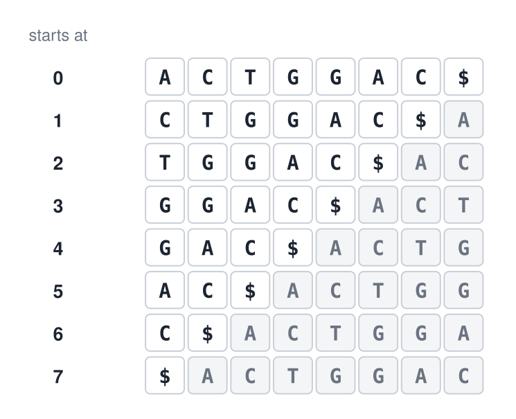{.sketch}
:::
::::

## Rotations, step 2: sort the rows

:::: {.split .fig-right}
::: {.pane}
Sort the rows like words in a dictionary, with $\mathtt{\$}$ first.

- Two rows start with $\mathtt{AC}$. The third letter decides: $\mathtt{\$}$ before $\mathtt{T}$, so $\mathtt{AC\$ACTGG}$ (start 5) comes before $\mathtt{ACTGGAC\$}$ (start 0).

A comparison never reads past the unique $\mathtt{\$}$, so sorting rotations is sorting suffixes: the start column is the suffix array of week 8.
:::
::: {.pane}
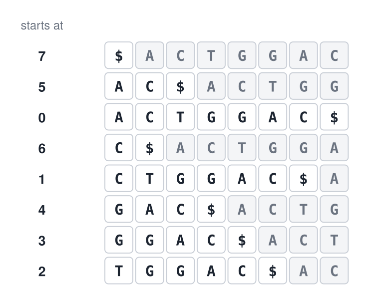{.sketch}
:::
::::

## Rotations, step 3: read the last column

:::: {.split .fig-right}
::: {.pane}
Two columns matter:

- **First column** $F$: the letters of $T$ in sorted order, $\mathtt{\$AACCGGT}$.
- **Last column** $L$: read it top to bottom, $\mathtt{CG\$AAGTC}$.

$L$ is the transform. In each row, $L$ holds the letter just before the row's start in the text, as in the $\mathtt{ACA\$}$ table.
:::
::: {.pane}
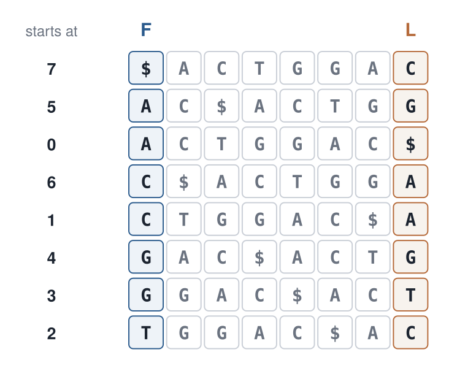{.sketch}
:::
::::

## Why the transform compresses

Equal stretches of text sort next to each other, so the letters before them, in $L$, come out in **runs**.

- $T = \mathtt{abababa\$}$ gives $L = \mathtt{abbb\$aaa}$: three $\mathtt{b}$s together, then three $\mathtt{a}$s.
- Genomes are full of repeats, so their transforms contain long runs.
- Runs are easy to compress: the program **bzip2** is built on exactly this transform (Burrows & Wheeler, 1994).

The transform is only useful if we can undo it. That is the next part.

## Getting the text back {.section-head}

The transform loses no information.

## Method 1: rebuild the table by sorting

We are given only $L = \mathtt{CG\$AAGTC}$, and we rebuild the sorted table one column at a time.

- Each round: write $L$ as a new column **in front** of the columns we have, then sort the rows.
- After round $k$ we know the first $k$ columns of the table.
- After 8 rounds we know the whole table, and the text is the row that ends with $\mathtt{\$}$.

## Round 1: sort $L$

:::: {.split .fig-right}
::: {.pane}
Start with $L$ alone and sort its letters.

The result is $\mathtt{\$AACCGGT}$: the first column $F$. Both columns hold the same letters, so sorting $L$ gives $F$.
:::
::: {.pane}
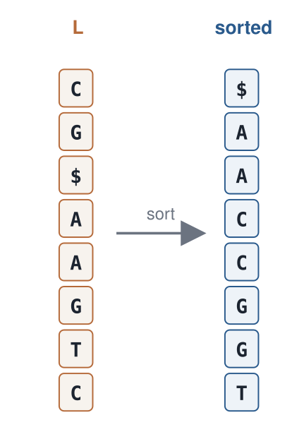{.sketch}
:::
::::

## Round 2: put $L$ in front, sort again

:::: {.split .fig-right}
::: {.pane}
Write $L$ in front of $F$, row by row: $\mathtt{C\$}$, $\mathtt{GA}$, $\mathtt{\$A}$, …

In each row the $L$ letter comes just before the $F$ letter in the text. So each pair is **two neighbouring letters of the text**, and we have all eight of them.

Sort the pairs: they are the first two columns of the table.
:::
::: {.pane}
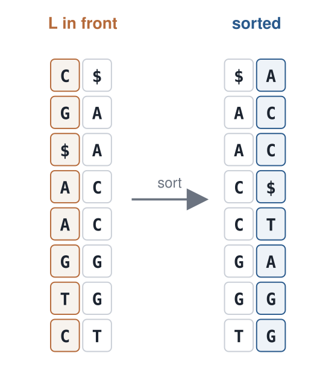{.sketch}
:::
::::

## Round 3: the same move once more

:::: {.split .fig-right}
::: {.pane}
Write $L$ in front of the two columns: $\mathtt{C\$A}$, $\mathtt{GAC}$, $\mathtt{\$AC}$, …

Again, each row's $L$ letter comes just before the row's first two letters, so each is **three neighbouring letters** of the text. Sorted, they are the first three columns.

Each round adds one letter on the left and one column to the table.
:::
::: {.pane}
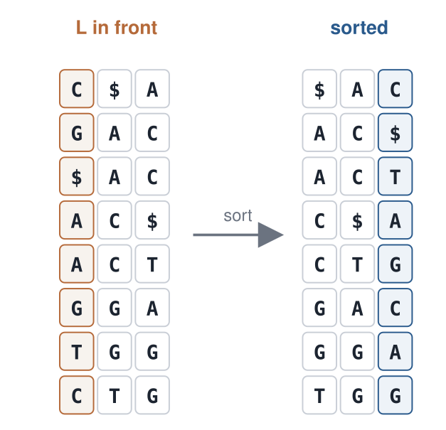{.sketch}
:::
::::

## After 8 rounds

| row | round 1 | round 2 | round 3 | … | round 8 |
|---|---|---|---|---|---|
| 0 | `$` | `$A` | `$AC` | … | `$ACTGGAC` |
| 1 | `A` | `AC` | `AC$` | … | `AC$ACTGG` |
| 2 | `A` | `AC` | `ACT` | … | `ACTGGAC$` |
| 3 | `C` | `C$` | `C$A` | … | `C$ACTGGA` |
| 4 | `C` | `CT` | `CTG` | … | `CTGGAC$A` |
| 5 | `G` | `GA` | `GAC` | … | `GAC$ACTG` |
| 6 | `G` | `GG` | `GGA` | … | `GGAC$ACT` |
| 7 | `T` | `TG` | `TGG` | … | `TGGAC$AC` |

The table is complete. The row that **ends** with $\mathtt{\$}$ is the text: $\mathtt{ACTGGAC\$}$.

## Method 2: walk the text backward

:::: {.split .fig-right}
::: {.pane}
Method 2 reads the text **one letter at a time, from the end**, using only $F$ and $L$.

- Each row starts at some position of the text. We do not know which.
- Its $L$ letter is the letter **just before** that position: one letter of the text.
- To read the letter before that, we must move to the row that starts **at** it.
:::
::: {.pane}
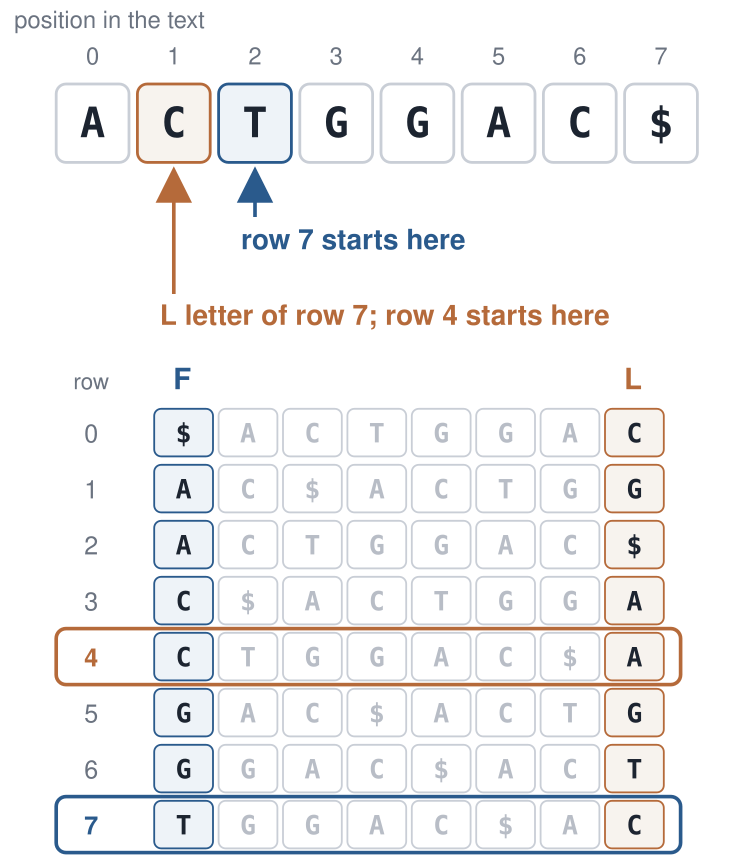{.sketch .big}
:::
::::

## The walk, if we had $F$ and $L$

:::: {.split .fig-right}
::: {.pane}
First pretend we have both columns, and that every letter carries its position in the text (grey numbers).

- **Start** in row 0. Its $F$ letter is $\mathtt{\$}$, the end of the text.
- **Read across** the row: its $L$ letter is the $\mathtt{C}$ at position 6, the letter just before $\mathtt{\$}$.

Text so far: $\mathtt{C\$}$.
:::
::: {.pane}
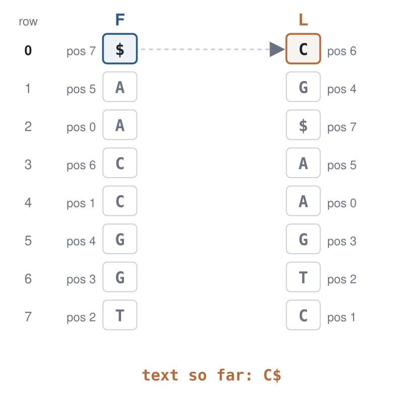{.sketch .big}
:::
::::

## Walk, step 1: find that $\mathtt{C}$ in $F$

:::: {.split .fig-right}
::: {.pane}
- **Jump:** the $\mathtt{C}$ at position 6 is the $F$ letter of row 3. Go to row 3.
- **Read across:** row 3 has in $L$ the $\mathtt{A}$ at position 5.

Text so far: $\mathtt{AC\$}$.
:::
::: {.pane}
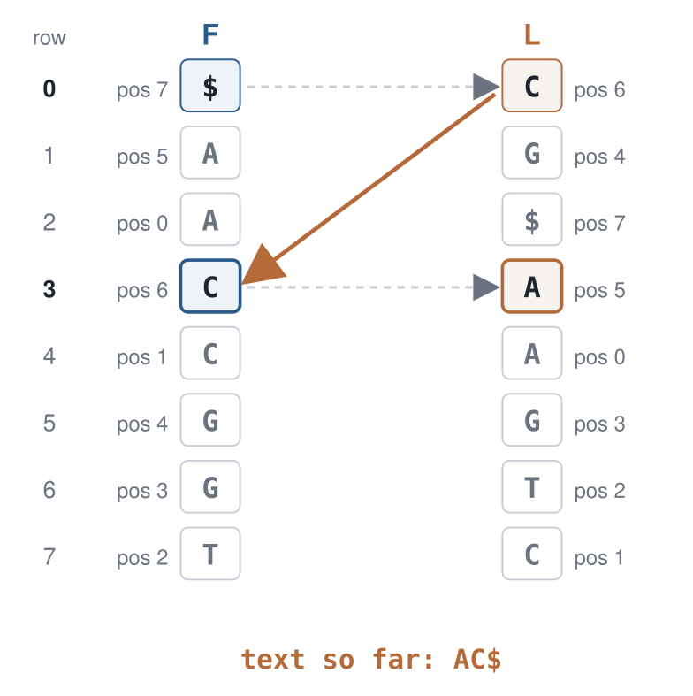{.sketch .big}
:::
::::

## Walk, step 2: find that $\mathtt{A}$ in $F$

:::: {.split .fig-right}
::: {.pane}
- **Jump:** the $\mathtt{A}$ at position 5 is the $F$ letter of row 1. Go to row 1.
- **Read across:** row 1 has in $L$ the $\mathtt{G}$ at position 4.

Text so far: $\mathtt{GAC\$}$.
:::
::: {.pane}
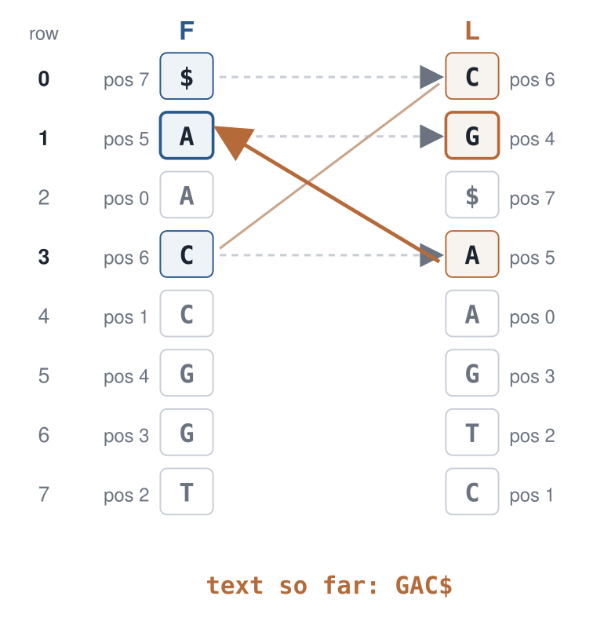{.sketch .big}
:::
::::

## Walk, step 3: find that $\mathtt{G}$ in $F$

:::: {.split .fig-right}
::: {.pane}
- **Jump:** the $\mathtt{G}$ at position 4 is the $F$ letter of row 5. Go to row 5.
- **Read across:** row 5 has in $L$ the $\mathtt{G}$ at position 3.

Text so far: $\mathtt{GGAC\$}$. Two moves repeat: **jump** from $L$ to the same letter in $F$, **read across** to $L$.
:::
::: {.pane}
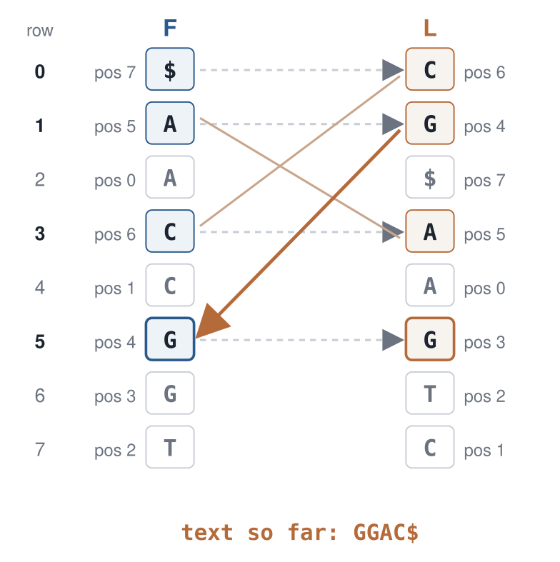{.sketch .big}
:::
::::

## The whole walk

:::: {.split .fig-right}
::: {.pane}
Rows visited: $0 \to 3 \to 1 \to 5 \to 6 \to 7 \to 4 \to 2$.

In row 2 the $L$ letter is $\mathtt{\$}$ again: we are back at the end, and every letter has been read once.

Letters read: $\mathtt{C, A, G, G, T, C, A}$. Backwards, that is the text $\mathtt{ACTGGAC\$}$.
:::
::: {.pane}
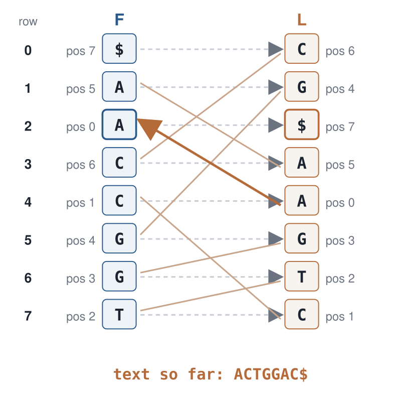{.sketch .big}
:::
::::

## But we are given only $L$

The walk used two things we do not have.

1. **The column $F$.** Easy: $F$ holds the same letters as $L$, sorted. Sort $L$, or just count its letters.
2. **The positions.** Each jump needs to find **the same** letter in $F$. With positions, "the $\mathtt{C}$ at position 6" is unambiguous. Without them, $F$ has two $\mathtt{C}$s, in rows 3 and 4. Which one?

The next slides show that the copies of a letter can be told apart from $L$ alone, by counting: the **ranks**.

## T-ranks: naming the letters

:::: {.split .fig-right}
::: {.pane}
The **T-rank** of a letter counts the earlier copies of the same letter **in the text**: the first $\mathtt{a}$ of $\mathtt{abracadabra\$}$ is $\mathtt{a}_0$, the last is $\mathtt{a}_4$.

Read the $\mathtt{a}$s in the sorted table:

- in $F$: $\mathtt{a}_4, \mathtt{a}_3, \mathtt{a}_0, \mathtt{a}_1, \mathtt{a}_2$
- in $L$: $\mathtt{a}_4, \mathtt{a}_3, \mathtt{a}_0, \mathtt{a}_1, \mathtt{a}_2$

**The same order.** Equal letters keep their order from $F$ to $L$.
:::
::: {.pane}
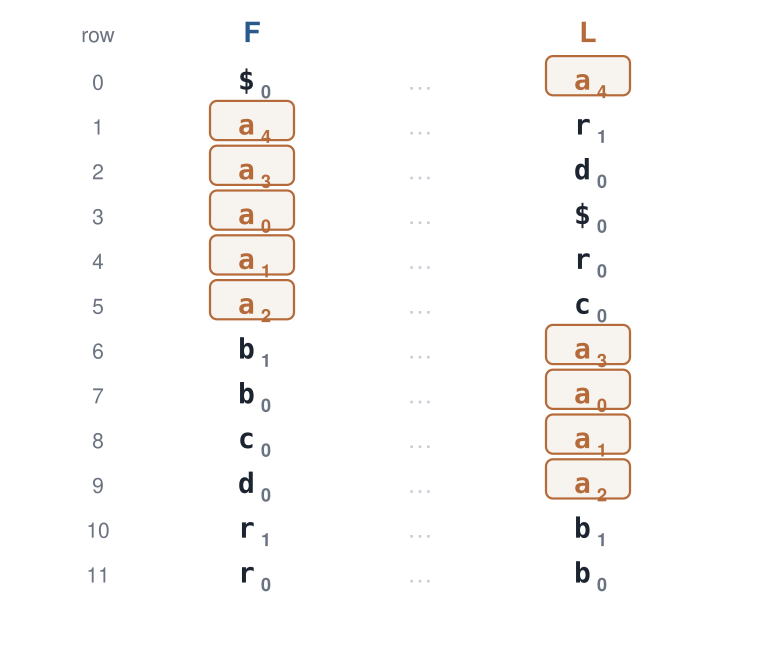{.sketch}
:::
::::

## Why the order is kept

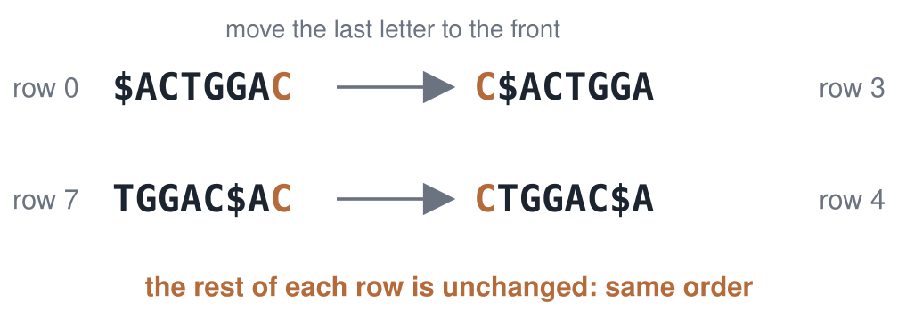{.sketch .below}

Rows 0 and 7 both end in $\mathtt{C}$. Row 0 comes first because $\mathtt{\$ACTGGA}$ sorts before $\mathtt{TGGAC\$A}$. Move the $\mathtt{C}$ to the front: both rows now start with $\mathtt{C}$ and continue with exactly those strings, so they land in rows 3 and 4, **in the same order**. The argument holds for every letter.

## B-ranks: counting down a column

:::: {.split .fig-right}
::: {.pane}
T-ranks need the text. Instead, the **B-rank** of a letter counts the copies of the same letter **above it in its column**.

The $\mathtt{C}$s in $L$ of $\mathtt{ACTGGAC\$}$:

- row 0: no $\mathtt{C}$ above, B-rank 0;
- row 7: one $\mathtt{C}$ above (row 0), B-rank 1.

In $F$ they sit in rows 3 and 4.
:::
::: {.pane}
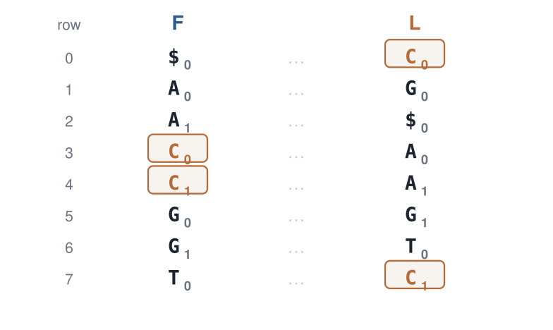{.sketch}
:::
::::

## The $k$-th $\mathtt{C}$ of $L$ is the $k$-th $\mathtt{C}$ of $F$

Equal letters keep their order from $L$ to $F$. So the B-rank says **which** of the $\mathtt{C}$ rows of $F$ holds the same letter:

| in $L$ | B-rank | same letter in $F$ |
|---|---|---|
| row 0, $\mathtt{C}$ | 0 | the first $\mathtt{C}$ row of $F$: row 3 |
| row 7, $\mathtt{C}$ | 1 | the second $\mathtt{C}$ row of $F$: row 4 |

$$
\text{row in } F = (\text{first row of } \mathtt{C} \text{ in } F) + \text{B-rank in } L
$$

The only thing still missing is where each letter's rows start in $F$.

## Where each letter starts in $F$

:::: {.split .fig-right}
::: {.pane}
**We need** the first row of each letter in $F$: every jump lands in that letter's rows.

- $F$ is $L$ sorted, so equal letters form one **block**, in the order $\mathtt{\$}$, $\mathtt{A}$, $\mathtt{C}$, $\mathtt{G}$, $\mathtt{T}$.
- The $\mathtt{C}$ block starts after all smaller letters: one $\mathtt{\$}$ and two $\mathtt{A}$s. So it starts in row 3.
:::
::: {.pane}
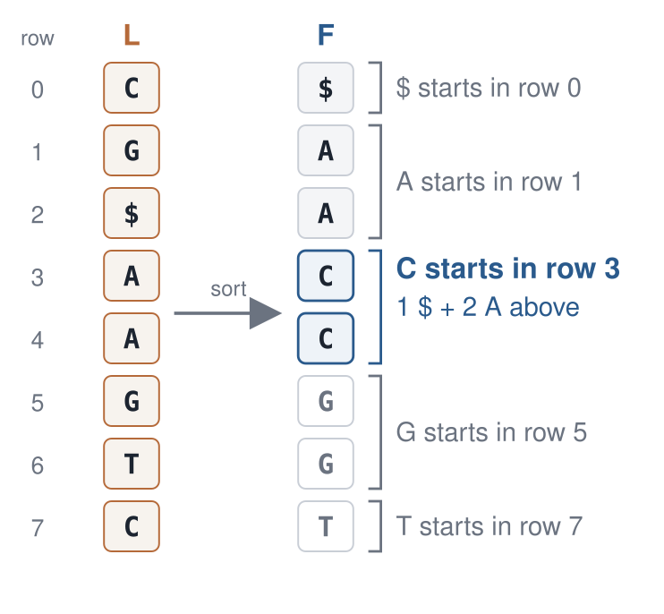{.sketch .big}
:::
::::

## Counting instead of sorting

We do not even need to sort. Count the letters of $L = \mathtt{CG\$AAGTC}$, and add up the counts of the smaller letters:

| letter $c$ | $\mathtt{\$}$ | $\mathtt{A}$ | $\mathtt{C}$ | $\mathtt{G}$ | $\mathtt{T}$ |
|---|---|---|---|---|---|
| copies in $L$ | 1 | 2 | 2 | 2 | 1 |
| first row in $F$, $F_c$ | 0 | $0 + 1 = 1$ | $1 + 2 = 3$ | $3 + 2 = 5$ | $5 + 2 = 7$ |

Each $F_c$ is the previous $F_c$ plus the previous letter's count. For DNA this is five numbers, computed in one pass over $L$.

## One jump: the candidates

:::: {.split .fig-right}
::: {.pane}
**Goal:** from row 7, find the row that starts one position earlier in the text.

1. **Which letter does it start with?** The $L$ letter of row 7: $\mathtt{C}$.
2. **Which rows start with $\mathtt{C}$?** They begin at $F_{\mathtt{C}} = 3$, and $L$ has two $\mathtt{C}$s: rows 3 and 4.
:::
::: {.pane}
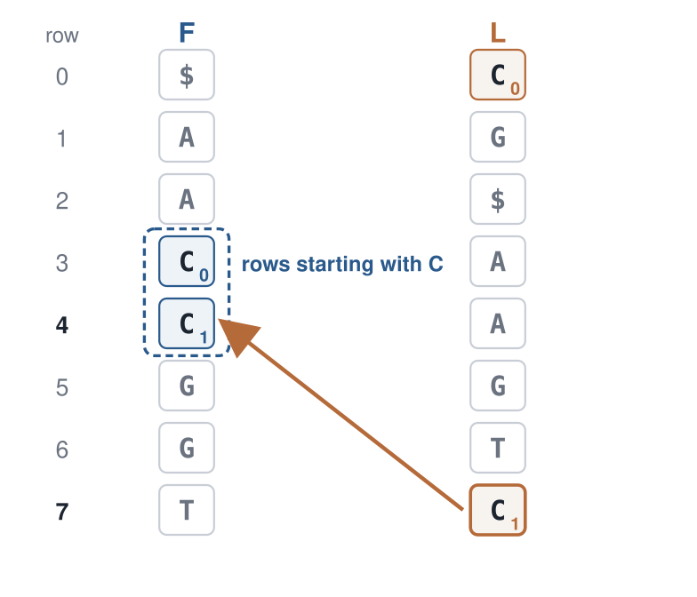{.sketch}
:::
::::

## One jump: which candidate

:::: {.split .fig-right}
::: {.pane}
3. **Which of rows 3 and 4?** Count the $\mathtt{C}$s above row 7 in $L$: one, in row 0. So row 7 holds the **second** $\mathtt{C}$ of $L$, B-rank 1.

Equal letters keep their order, so it is the **second** $\mathtt{C}$ row of $F$: $3 + 1 = 4$.

**Answer:** row 4, which starts at position 1.
:::
::: {.pane}
{.sketch}
:::
::::

## Checking the jump

| row | the row as a string | starts at position |
|---|---|---|
| 7 | $\mathtt{TGGAC\$A}\,\mathbf{\mathtt{C}}$ | 2 |
| 4 | $\mathbf{\mathtt{C}}\,\mathtt{TGGAC\$A}$ | 1 |

Row 4 is row 7 with its last letter moved to the front: the same $\mathtt{C}$, now at the start. We moved one position back in the text and read one letter, $\mathtt{C}$, on the way.

## The last-to-first rule

Written once for every row $r$, with $c$ the letter of $L$ in row $r$:

$$
\mathrm{LF}(r) = F_c + \text{B-rank of } c \text{ in row } r \text{ of } L
$$

- Row $r$ of the table starts somewhere in the text; $L$ holds the letter just before that start.
- Row $\mathrm{LF}(r)$ starts **at** that letter: one position earlier in the text.

::: {.takeaway}
One jump costs one count and one addition, and moves one letter backward through the text.
:::

## The same walk, from $L$ alone

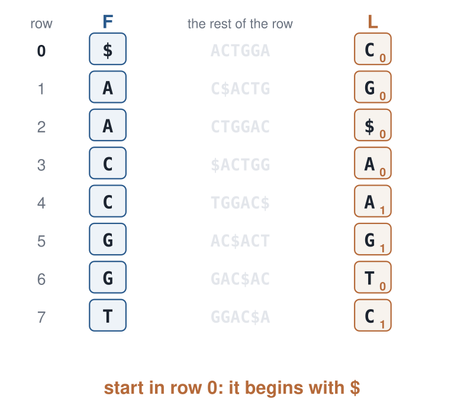{.sketch .huge}

No positions now: the small numbers are B-ranks, and each jump is $F_c + \text{B-rank}$.

## Where the walk starts

We hold only $L$. Yet one row is known before we read anything:

- Every text ends with $\mathtt{\$}$, which occurs **once** and is **smaller** than every other letter.
- So among all rotations, the one that starts with $\mathtt{\$}$ sorts first. It is **always row 0**, whatever the text.
- That rotation is the end of the text followed by its beginning, here $\mathtt{\$ACTGGAC}$. Its $L$ letter is the letter just before $\mathtt{\$}$: the **last letter of the text**.

::: {.takeaway}
Start in row 0. We know it starts with $\mathtt{\$}$ from the sorting rule alone, so the $L$ letter there is the last letter of the text.
:::

## Step 1: the last letter

:::: {.split .fig-right}
::: {.pane}
In row 0, $L = \mathtt{C}$: the text ends in $\mathtt{C\$}$.

- No $\mathtt{C}$ above row 0 in $L$: B-rank 0.
- $\mathrm{LF}(0) = F_{\mathtt{C}} + 0 = 3 + 0 = 3$.

Row 3 begins with that $\mathtt{C}$.
:::
::: {.pane}
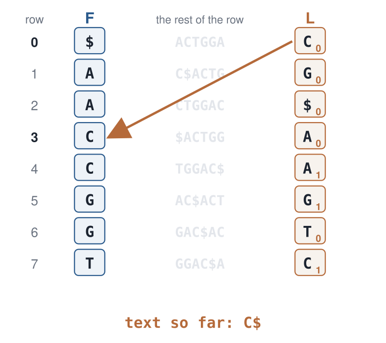{.sketch}
:::
::::

## Step 2: one letter further back

:::: {.split .fig-right}
::: {.pane}
In row 3, $L = \mathtt{A}$: the letter before that $\mathtt{C}$.

- No $\mathtt{A}$ above row 3 in $L$: B-rank 0.
- $\mathrm{LF}(3) = F_{\mathtt{A}} + 0 = 1 + 0 = 1$.

Text so far: $\mathtt{AC\$}$.
:::
::: {.pane}
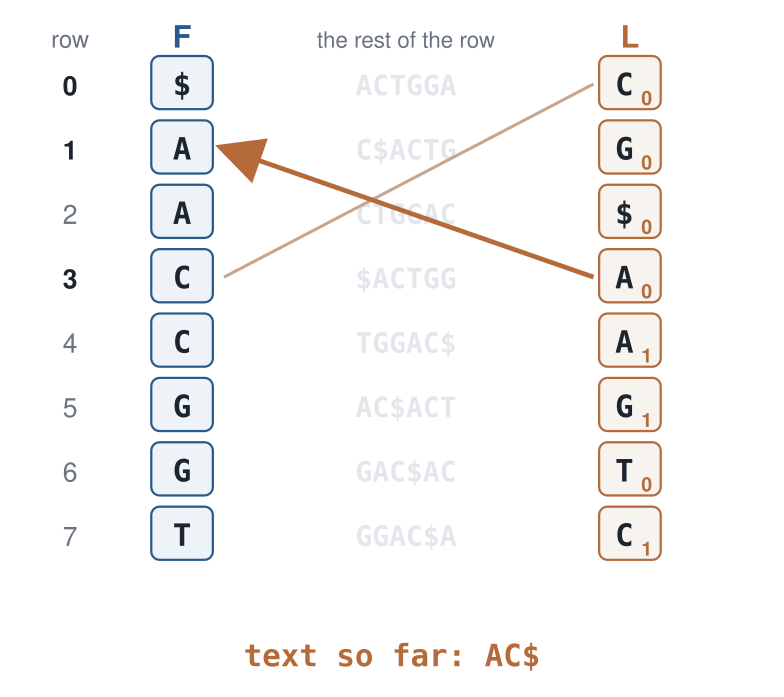{.sketch}
:::
::::

## Step 3

:::: {.split .fig-right}
::: {.pane}
In row 1, $L = \mathtt{G}$.

- No $\mathtt{G}$ above row 1 in $L$: B-rank 0.
- $\mathrm{LF}(1) = F_{\mathtt{G}} + 0 = 5 + 0 = 5$.

Text so far: $\mathtt{GAC\$}$.
:::
::: {.pane}
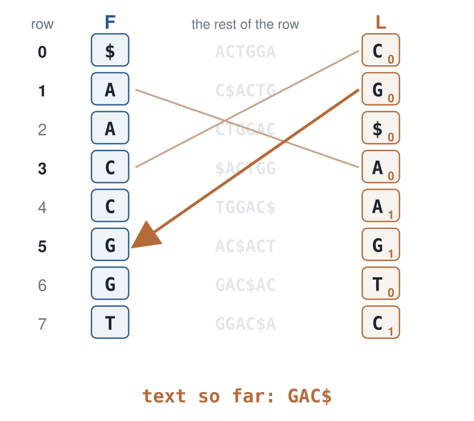{.sketch}
:::
::::

## Step 4: the second $\mathtt{G}$

:::: {.split .fig-right}
::: {.pane}
In row 5, $L = \mathtt{G}$ again. Now the B-rank matters.

- One $\mathtt{G}$ above row 5 in $L$ (row 1): B-rank 1.
- $\mathrm{LF}(5) = F_{\mathtt{G}} + 1 = 5 + 1 = 6$.

Text so far: $\mathtt{GGAC\$}$. Without the B-rank we could not tell rows 5 and 6 apart.
:::
::: {.pane}
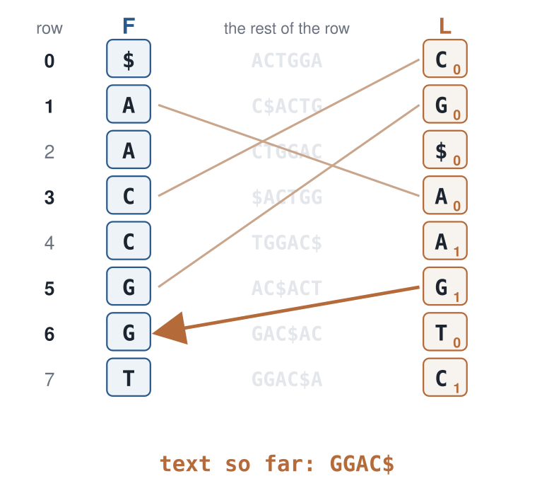{.sketch}
:::
::::

## The whole thread

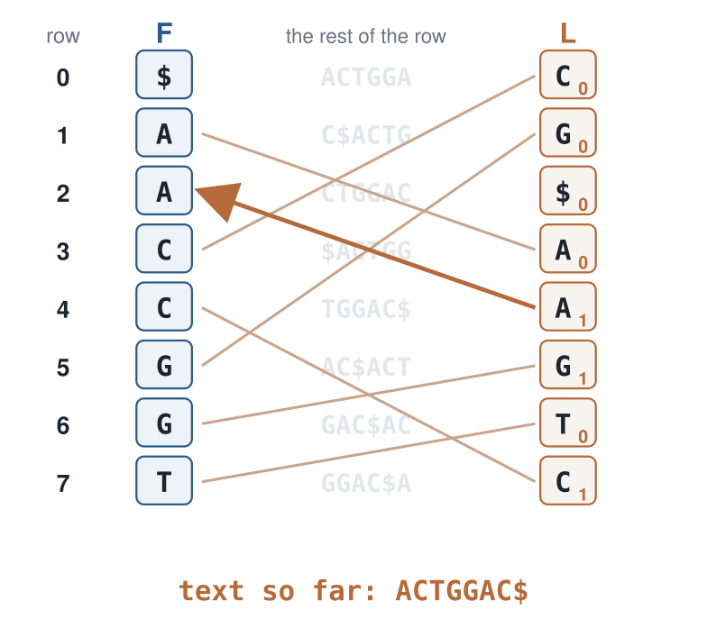{.sketch .huge}

## The thread as a table

The same walk, written down: read $L$ in the current row, and jump to $F_c + \text{B-rank}$.

::: {.small}
| step | row | letter in $L$ | its B-rank | next row |
|---|---|---|---|---|
| 1 | 0 | $\mathtt{C}$ | 0 | $3 + 0 = 3$ |
| 2 | 3 | $\mathtt{A}$ | 0 | $1 + 0 = 1$ |
| 3 | 1 | $\mathtt{G}$ | 0 | $5 + 0 = 5$ |
| 4 | 5 | $\mathtt{G}$ | 1 | $5 + 1 = 6$ |
| 5 | 6 | $\mathtt{T}$ | 0 | $7 + 0 = 7$ |
| 6 | 7 | $\mathtt{C}$ | 1 | $3 + 1 = 4$ |
| 7 | 4 | $\mathtt{A}$ | 1 | $1 + 1 = 2$ |
| 8 | 2 | $\mathtt{\$}$ | | stop |
:::

The letters read, $\mathtt{CAGGTCA}$, are the text **backwards**: $T = \mathtt{ACTGGAC\$}$.

## What inversion costs

- **Method 1**, rebuilding the table: $n$ rounds, each sorting $n$ rows. Far too slow for a genome.
- **Method 2**, last to first: one pass over $L$ to count $F_c$ and the B-ranks, then $n$ jumps. Time proportional to $n$.

::: {.takeaway}
The transform loses nothing: from $L$ alone, $n$ last-to-first jumps rebuild the text, back to front.
:::

## Searching backward {.section-head}

The same jump finds patterns.

## Matching rows form a block

:::: {.split .fig-right}
::: {.pane}
Where does $\mathtt{abra}$ occur in $\mathtt{abracadabra\$}$?

- Each occurrence is the **start** of one sorted row: rows 2 and 3 begin with $\mathtt{abra}$.
- The rows are sorted, so all rows that begin with $\mathtt{abra}$ sit **together**, in one block.

To search, we find that block, without reading the text.
:::
::: {.pane}
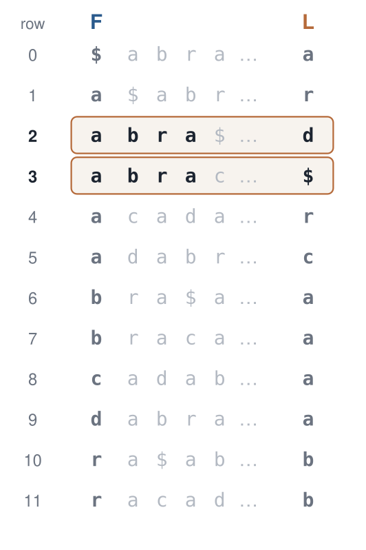{.sketch .xbig}
:::
::::

## The plan: grow the pattern from the right

We find the block one letter at a time, starting from the **last** letter:

$$
\mathtt{a} \;\to\; \mathtt{ra} \;\to\; \mathtt{bra} \;\to\; \mathtt{abra}
$$

Each step puts one letter **in front** of what we have matched. That is exactly the move of last-to-first: from a row, the $L$ letter is the letter just before it.

::: {.takeaway}
A suffix tree reads the pattern forward from the root. The Burrows–Wheeler index reads it **backward**, and needs no tree.
:::

## Search $\mathtt{abra}$, step 1: the last letter

:::: {.split .fig-right}
::: {.pane}
Start with $\mathtt{a}$.

The rows that begin with $\mathtt{a}$ are the $\mathtt{a}$ block of $F$: rows **1 to 5**, one for each $\mathtt{a}$ in the text.

How we know it from $L$ alone: count. In $L$, only one letter is smaller than $\mathtt{a}$, namely $\mathtt{\$}$. So the $\mathtt{a}$ block starts in row 1. $L$ has five $\mathtt{a}$s, so it ends in row 5.
:::
::: {.pane}
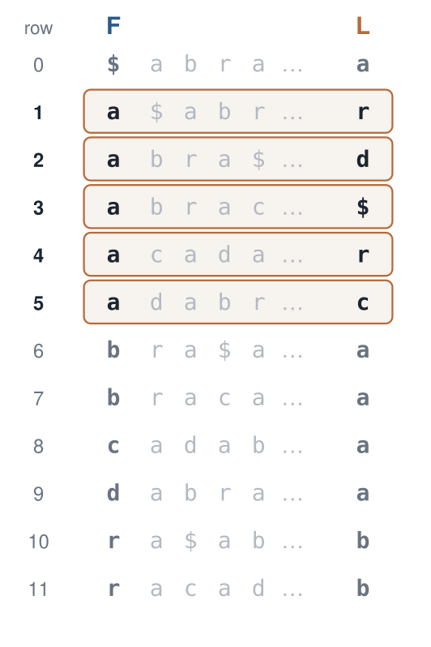{.sketch .xbig}
:::
::::

## Step 2: put $\mathtt{r}$ in front

:::: {.split .fig-right}
::: {.pane}
Which of rows 1–5 can grow into $\mathtt{ra}$?

1. **Look at $L$** in the grey block: the letter before each $\mathtt{a}$. Rows 1 and 4 have $\mathtt{r}$ (circled).
2. **Jump**, as in the inversion: those are the first two $\mathtt{r}$s of $L$, so they land in the first two $\mathtt{r}$ rows of $F$.

New block: rows **10 and 11**, which begin with $\mathtt{ra}$.
:::
::: {.pane}
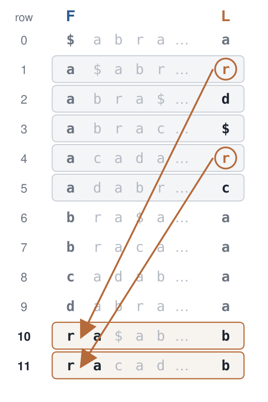{.sketch .xbig}
:::
::::

## Step 3: put $\mathtt{b}$ in front

:::: {.split .fig-right}
::: {.pane}
1. **Look at $L$** in rows 10–11: both are $\mathtt{b}$.
2. **Jump:** they are the first two $\mathtt{b}$s of $L$, so they land in the first two $\mathtt{b}$ rows of $F$.

New block: rows **6 and 7**, which begin with $\mathtt{bra}$.
:::
::: {.pane}
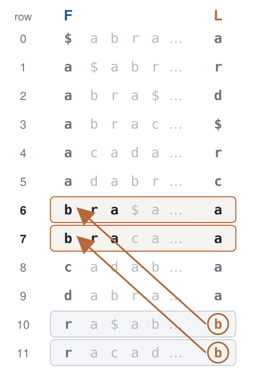{.sketch .xbig}
:::
::::

## Step 4: put $\mathtt{a}$ in front

:::: {.split .fig-right}
::: {.pane}
1. **Look at $L$** in rows 6–7: both are $\mathtt{a}$.
2. **Jump:** one $\mathtt{a}$ of $L$ lies above them (row 0), so they are the second and third $\mathtt{a}$s. They land in the second and third $\mathtt{a}$ rows of $F$.

New block: rows **2 and 3**, which begin with $\mathtt{abra}$.
:::
::: {.pane}
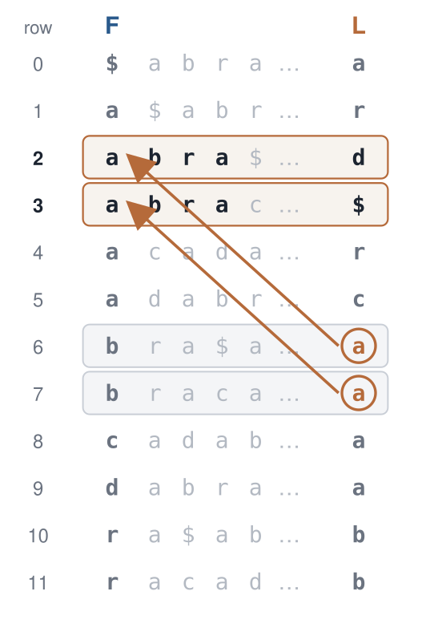{.sketch .xbig}
:::
::::

## Where in the text?

The block says **which rows** begin with $\mathtt{abra}$, not where they are in the text. For that the index stores one more column: the position where each sorted row starts. It is the "starts at" column of the sorted rotations, the suffix array of week 8.

| row | starts at | the row |
|---|---|---|
| 2 | 7 | $\mathtt{abra\$abracad}$ |
| 3 | 0 | $\mathtt{abracadabra\$}$ |

Look up rows 2 and 3: $\mathtt{abra}$ occurs at positions **0 and 7**.

## A miss: $\mathtt{acb}$

:::: {.split .fig-right}
::: {.pane}
- Last letter $\mathtt{b}$: rows 6–7.
- Put $\mathtt{c}$ in front: **look at $L$** in rows 6–7. Both are $\mathtt{a}$, there is no $\mathtt{c}$.
- Nothing to jump with: the block is empty, and $\mathtt{cb}$ (so also $\mathtt{acb}$) does not occur.

We looked at two letters of $L$. The text itself was never read.
:::
::: {.pane}
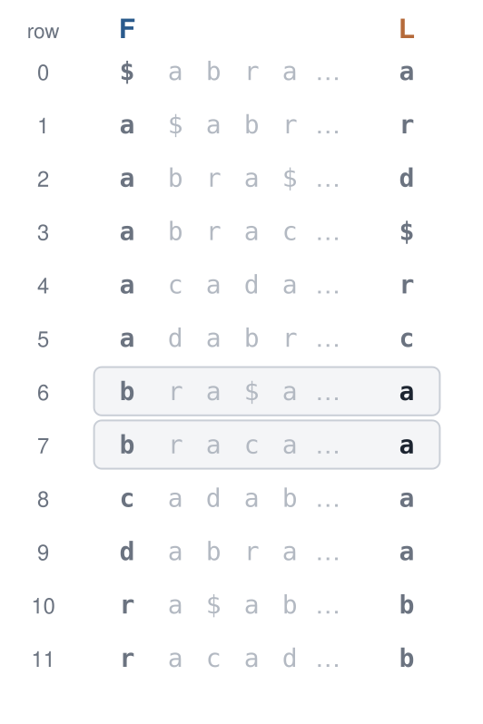{.sketch .xbig}
:::
::::

## What each step costs

Each step does two things:

- **look at $L$** inside the current block, and keep the rows with the new letter;
- **jump** those rows to $F$, as in the inversion.

The kept rows always land next to each other, because equal letters keep their order. So the new block is again one run of rows, and the next step can start.

The implementation below does the "look at $L$" part by counting, so each step costs a couple of lookups, however large the block.

## Implementing the search {.section-head}

Five steps, each a few lines of Python.

## The list

To search a text $T$ for a pattern $p$:

1. **Transform.** Sort the rotations of $T$. Keep $L$, and the text position where each row starts.
2. **Where each letter starts in $F$.** For each letter $c$: $F_c$ = number of letters in $L$ smaller than $c$.
3. **Counts above each row.** For each letter $c$ and each row $r$: $\mathrm{occ}_c(r)$ = copies of $c$ in $L$ above row $r$.
4. **Walk the pattern backward.** Start with all rows. For each letter of $p$, last to first, jump the block by counting. Stop if it is empty.
5. **Report.** The rows left in the block start at the text positions where $p$ occurs.

Steps 1–3 are done once per text. Step 4 runs for every pattern.

## Step 1: the transform

```python
def bwt(T):
    rows = sorted(range(len(T)), key=lambda i: T[i:] + T[:i])
    L = "".join(T[i - 1] for i in rows)
    return L, rows
```

- `rows` lists the start position of each sorted rotation: the suffix array of week 8.
- `T[i - 1]` is the letter before the start. For `i = 0`, Python's `T[-1]` wraps to the last letter, `$`.

For $\mathtt{abracadabra\$}$: `L = "ard$rcaaaabb"`, `rows = [11, 10, 7, 0, 3, 5, 8, 1, 4, 6, 9, 2]`.

## Step 2: where each letter starts in $F$

```python
def first_rows(L):
    first, total = {}, 0
    for c in sorted(set(L)):
        first[c] = total
        total += L.count(c)
    return first
```

Go through the letters in sorted order and keep a running total of how many came before.

For $\mathtt{abracadabra\$}$: `{'$': 0, 'a': 1, 'b': 6, 'c': 8, 'd': 9, 'r': 10}`. One `$`, then five `a`s, so the `b`s start in row 6.

## Step 3: counts above each row

```python
def occ_table(L):
    occ = {c: [0] for c in set(L)}
    for letter in L:
        for c in occ:
            occ[c].append(occ[c][-1] + (letter == c))
    return occ
```

Walk down $L$ once. Each list grows by one entry per row: the old count, plus 1 if this row holds that letter. The lists have $n + 1$ entries, so `occ[c][n]` counts the whole column.

## Step 3, in numbers

$L = \mathtt{ard\$rcaaaabb}$:

::: {.small}
| row $r$ | 0 | 1 | 2 | 3 | 4 | 5 | 6 | 7 | 8 | 9 | 10 | 11 | 12 |
|---|---|---|---|---|---|---|---|---|---|---|---|---|---|
| $L$ | a | r | d | \$ | r | c | a | a | a | a | b | b | |
| $\mathrm{occ}_{\mathtt{a}}(r)$ | 0 | 1 | 1 | 1 | 1 | 1 | 1 | 2 | 3 | 4 | 5 | 5 | 5 |
| $\mathrm{occ}_{\mathtt{r}}(r)$ | 0 | 0 | 1 | 1 | 1 | 2 | 2 | 2 | 2 | 2 | 2 | 2 | 2 |
| $\mathrm{occ}_{\mathtt{b}}(r)$ | 0 | 0 | 0 | 0 | 0 | 0 | 0 | 0 | 0 | 0 | 0 | 1 | 2 |
:::

$\mathrm{occ}_c(r)$ counts rows $0$ to $r-1$ only: the $\mathtt{a}$ in row 0 shows up first in $\mathrm{occ}_{\mathtt{a}}(1)$.

## Step 4, the idea: jump a block by counting

In the sketches we circled the $c$s in $L$ and jumped each one. The program keeps the block as two numbers, rows $lo$ up to $hi$ (not included), and counts instead:

- The $c$s of $L$ **above** the block are skipped: there are $\mathrm{occ}_c(lo)$ of them. So the first kept $c$ is $c$ number $\mathrm{occ}_c(lo)$, and it lands in row $F_c + \mathrm{occ}_c(lo)$.
- All $c$s above row $hi$ number $\mathrm{occ}_c(hi)$, so the kept ones end just before row $F_c + \mathrm{occ}_c(hi)$.

$$
lo' = F_c + \mathrm{occ}_c(lo), \qquad hi' = F_c + \mathrm{occ}_c(hi)
$$

If $lo' = hi'$, no $c$ was kept: the block is empty.

## Step 4: walk the pattern backward

```python
def backward_search(p, first, occ, n):
    lo, hi = 0, n
    for c in reversed(p):
        if c not in first:
            return 0, 0
        lo = first[c] + occ[c][lo]
        hi = first[c] + occ[c][hi]
        if lo >= hi:
            return 0, 0
    return lo, hi
```

Two lines do the work: the block jump, once for $lo$ and once for $hi$. Starting from all rows, the first update gives the block of the last letter, so no special case is needed.

## Step 4, in numbers

Search $\mathtt{abra}$, reading the table of step 3:

| letter | $lo = F_c + \mathrm{occ}_c(lo)$ | $hi = F_c + \mathrm{occ}_c(hi)$ | rows begin with |
|---|---|---|---|
| start | 0 | 12 | anything |
| $\mathtt{a}$ | $1 + \mathrm{occ}_{\mathtt{a}}(0) = 1$ | $1 + \mathrm{occ}_{\mathtt{a}}(12) = 6$ | $\mathtt{a}$ |
| $\mathtt{r}$ | $10 + \mathrm{occ}_{\mathtt{r}}(1) = 10$ | $10 + \mathrm{occ}_{\mathtt{r}}(6) = 12$ | $\mathtt{ra}$ |
| $\mathtt{b}$ | $6 + \mathrm{occ}_{\mathtt{b}}(10) = 6$ | $6 + \mathrm{occ}_{\mathtt{b}}(12) = 8$ | $\mathtt{bra}$ |
| $\mathtt{a}$ | $1 + \mathrm{occ}_{\mathtt{a}}(6) = 2$ | $1 + \mathrm{occ}_{\mathtt{a}}(8) = 4$ | $\mathtt{abra}$ |

The same blocks as in the figures: rows 1–5, 10–11, 6–7, 2–3.

## Step 5: report the positions

```python
def find(T, p):
    L, rows = bwt(T)
    lo, hi = backward_search(p, first_rows(L), occ_table(L), len(L))
    return sorted(rows[lo:hi])
```

The block is rows 2–3, and `rows[2:4] = [7, 0]`. So $\mathtt{abra}$ starts at positions 0 and 7 of $\mathtt{abracadabra\$}$.

| pattern | $\mathtt{abra}$ | $\mathtt{a}$ | $\mathtt{cad}$ | $\mathtt{acb}$ |
|---|---|---|---|---|
| `find` returns | `[0, 7]` | `[0, 3, 5, 7, 10]` | `[4]` | `[]` |

## Test it against a plain scan

```python
import random
for _ in range(300):
    T = "".join(random.choice("ACGT") for _ in range(30)) + "$"
    p = "".join(random.choice("ACGT") for _ in range(3))
    scan = [i for i in range(len(T)) if T.startswith(p, i)]
    assert find(T, p) == scan
```

The plain scan reads the whole text for every pattern. It is slow but obviously right, so it is the reference to test against.

::: {.takeaway}
About 30 lines in all. A real mapper uses the same five steps.
:::

## The index in memory

The sorted table is never stored. The index keeps:

- the string $L$: one letter per letter of the text, and highly compressible;
- for each letter, the row where it starts in $F$ (four numbers for DNA);
- counts of each letter in $L$ above every row: the $\mathrm{occ}$ table;
- the text position where each row starts, to report where a match lies.

::: {.takeaway}
For the human genome this index is several times smaller than a suffix tree, and every search is still a backward walk.
:::

## Back to the patient sample

- Every read is searched backward in the index of the human genome. Reads that are found are human and are removed before the data are shared.
- The remaining reads are searched in the SARS-CoV-2 reference and placed at their positions, where mutations such as D614G become visible.
- Programs such as **Bowtie** (Langmead et al., 2009) and **BWA** (Li & Durbin, 2009) do exactly this, for millions of reads per sample.

::: {.takeaway}
Reads contain sequencing errors, so real mappers also allow a few mismatches during the backward walk. The engine is still the last-to-first jump.
:::

## Beyond read mapping {.section-head}

The same sorting trick, on other data.

## Where the transform is used

- **Compression:** bzip2 compresses ordinary files with it.
- **Assembly:** the de Bruijn graph of week 7 can be stored as a string much like $L$, so that a human-sized graph fits in a few gigabytes (Bowe et al. 2012).
- **Pangenomes:** thousands of genomes of one species are nearly identical, so their joint transform is made of long runs; indexes that store only the runs stay small (Gagie et al. 2018).
- **Haplotypes:** the positional transform sorts chromosomes from a population, and finds where recombination has cut and joined them.

## Haplotypes are mosaics

- A **haplotype** is the sequence of alleles along one chromosome copy. At each variable site we write 0 or 1.
- In every generation, **recombination** cuts the two parental copies and joins the pieces. Over many generations, a haplotype becomes a patchwork of stretches copied from older haplotypes.
- The place where the copied source changes is a **recombination breakpoint**.
- Two people who share a long stretch inherited it from a recent common ancestor: **identity by descent**.

## A small panel

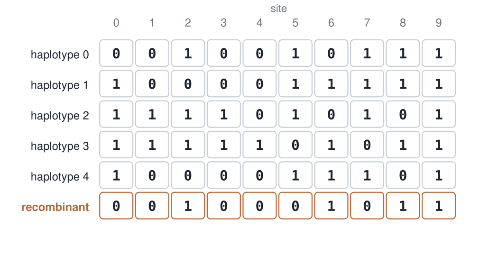{.sketch .huge}

Five haplotypes and one recombinant, ten sites. Whom did the recombinant copy, and where did it switch?

## What we want to find

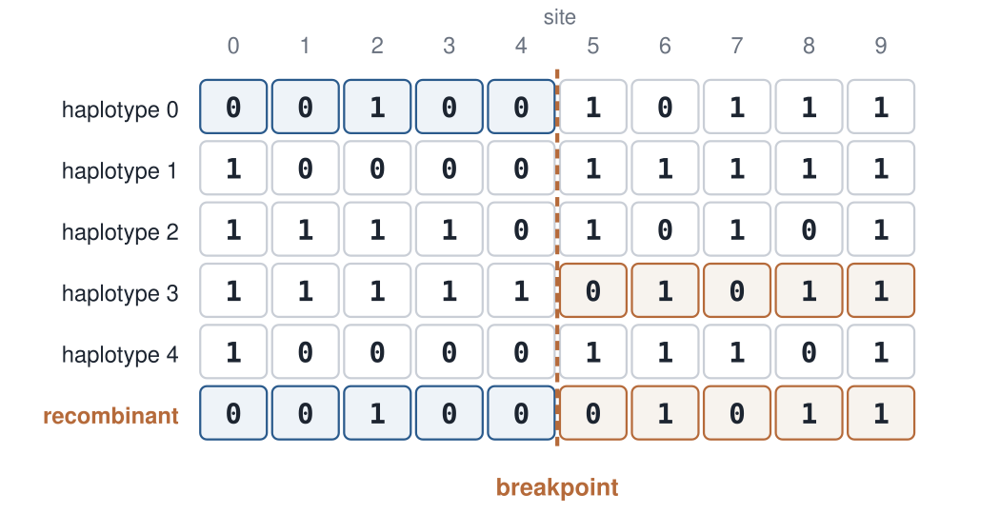{.sketch .huge}

$r$ copies haplotype 0 at sites 0–4, then haplotype 3. A biobank has far too many haplotypes to compare every pair.

## The idea in words

Walk along the chromosome from left to right, one site at a time, and keep the haplotypes in a **sorted list**.

- **Sorted by what?** By the alleles read backward from the current site. Haplotypes that agree on a long stretch just behind us end up next to each other, like words with a long common start in a dictionary.
- **Updating is cheap.** At each new site, every haplotype gains one allele at the front. The 0s go first, then the 1s, each group in its old order. No re-sorting.

## How a breakpoint shows up

Watch the recombinant's neighbour in the sorted list.

- **While it copies haplotype 0,** the two agree at every new site. They stay side by side, and their shared stretch grows by one site each step.
- **At the breakpoint** the recombinant switches to copying haplotype 3. It now disagrees with haplotype 0, so the split separates them.
- **Its new neighbour** is haplotype 3, and their shared stretch starts again from one site.

::: {.takeaway}
A change of neighbour, with a shared stretch that drops back to one site, marks a recombination breakpoint.
:::

## The question at one site

At site 4, read every haplotype **backward**, from site 4 down to site 0, and count how long it agrees with $r$:

| haplotype | sites 4, 3, 2, 1, 0 | agrees with $r$ for |
|---|---|---|
| $r$ | `0 0 1 0 0` | |
| 0 | `0 0 1 0 0` | 5 sites |
| 1 | `0 0 0 0 1` | 2 sites |
| 2 | `0 1 1 1 1` | 1 site |
| 3 | `1 1 1 1 1` | 0 sites |
| 4 | `0 0 0 0 1` | 2 sites |

The best partner at site 4 is haplotype 0: the longest stretch that **ends** here.

## Sort the backward strings

Sort the same rows as words, read backward from site 4:

| position | haplotype | sites 4, 3, 2, 1, 0 |
|---|---|---|
| 0 | 1 | `0 0 0 0 1` |
| 1 | 4 | `0 0 0 0 1` |
| 2 | 0 | `0 0 1 0 0` |
| 3 | $r$ | `0 0 1 0 0` |
| 4 | 2 | `0 1 1 1 1` |
| 5 | 3 | `1 1 1 1 1` |

The best partner, haplotype 0, is now a **neighbour** of $r$. Last week's rule again: in sorted order, the longest shared start is with the row above or below.

## From one site to the next

:::: {.split .fig-right}
::: {.pane}
To go from site 4 to site 5, we do **not** sort again.

- Read each haplotype's allele at site 5, in the old order.
- Put the 0s first, then the 1s, **each group in its old order**.

$r$ and haplotype 0 disagree at site 5, so they are split apart. $r$ now sits next to haplotype 3, which also has 0.
:::
::: {.pane}
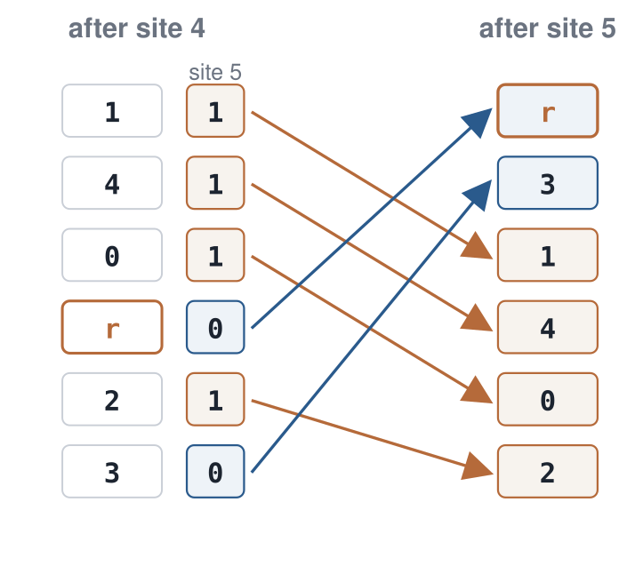{.sketch}
:::
::::

## Why the new order is sorted

The backward word at site 5 is the allele at site 5 followed by the backward word at site 4.

- Two haplotypes with different alleles at site 5: the 0 comes first. That is the split.
- Two haplotypes with the same allele: the rest of the word decides, and that was already sorted at site 4. That is "each group in its old order".

::: {.takeaway}
This is the argument for the last-to-first rule, with sites in place of letters: equal first letters keep their old order.
:::

## The order at every site

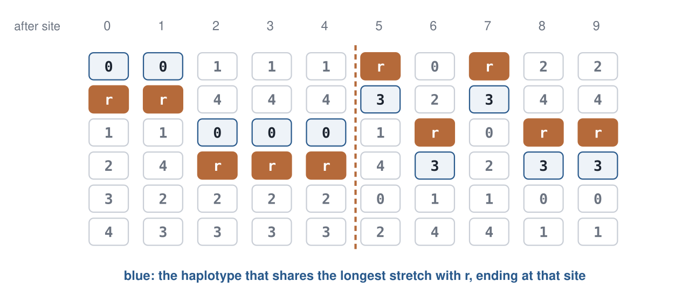{.sketch .huge}

Each column is the sorted order after one site, from one pass of splits. The blue box is $r$'s best partner, and it always sits next to $r$.

## The stretch grows, then restarts

Follow $r$'s best neighbour and the length of their shared stretch, ending at each site:

| site | 0 | 1 | 2 | 3 | 4 | 5 | 6 | 7 | 8 | 9 |
|---|---|---|---|---|---|---|---|---|---|---|
| neighbour | 0 | 0 | 0 | 0 | 0 | 3 | 3 | 3 | 3 | 3 |
| shared sites | 1 | 2 | 3 | 4 | 5 | 1 | 2 | 3 | 4 | 5 |

- Sites 0–4: the stretch with haplotype 0 grows by one site at each step.
- Site 5: $r$ and haplotype 0 differ, the partner becomes haplotype 3, and the count starts again at 1.

The switch of partner between sites 4 and 5 is the **recombination breakpoint**.

## What one pass costs

- Each site: one split of the current order, one look at every haplotype. No pair of haplotypes is ever compared directly.
- Whole panel: time proportional to haplotypes × sites. Comparing all pairs would cost haplotypes² × sites.
- This is the **positional Burrows–Wheeler transform** (Durbin 2014). Positional, because the haplotypes are sorted again at each site.

## Shared stretches at biobank scale

- **hap-IBD** (Zhou, Browning & Browning 2020) scans sorted haplotypes for long shared stretches: about 231 billion segments among 485,346 UK Biobank participants.
- Methods that describe each haplotype as a copy of a few others, with switches at breakpoints, use the same sorting to search large panels quickly (Lunter 2019).

::: {.takeaway}
The positional transform sorts haplotypes instead of suffixes. Keeping equal letters in order turns a search over all pairs into a single pass.
:::

## Open `labs/09-bwt.ipynb`

::: {.lab}
::: {.lab-tag}
Lab · ~40 minutes · Python
:::

1. Compute the BWT of $\mathtt{ACA\$}$ and $\mathtt{ACTGGAC\$}$; check $\mathtt{AC\$A}$ and $\mathtt{CG\$AAGTC}$.
2. Invert $\mathtt{CG\$AAGTC}$ by sorting, then by last-to-first; print each jump of the thread.
3. Print T-ranks and B-ranks for $\mathtt{abracadabra\$}$.
4. Search $\mathtt{abra}$ and $\mathtt{acb}$ backward; watch the block shrink.
5. Write the search yourself in five functions; the test cell checks each step and compares with a plain scan.
6. Sort the haplotype panel site by site and find the recombinant's breakpoint.
7. Answer Q1–Q3 without notes.
:::

## A bit of history

::: {.history}
- **Burrows & Wheeler** (1994): the transform, invented for data compression; **bzip2** uses it.
- **Ferragina & Manzini** (2000): the FM-index, the transform plus counts, which makes it searchable.
- **Langmead et al.** (2009) and **Li & Durbin** (2009): **Bowtie** and **BWA** map short reads to the human genome on ordinary computers.
- **Hunt et al.** (2022): removing human reads from SARS-CoV-2 data before sharing.
- **Durbin** (2014): the positional transform for haplotypes; **Zhou, Browning & Browning** (2020): hap-IBD.
:::

## Tools that use this

::: {.tools}
- **bzip2** compresses files with the transform.
- **Bowtie 2**, **BWA**, **HISAT2** map sequencing reads with a Burrows–Wheeler index of the reference genome.
- Host-read removal pipelines map reads to the human genome and discard the matches.
:::

## Extensions

::: {.ext}
- **Mismatches:** when the block becomes empty, try the other letters at that position and continue; this is how mappers tolerate sequencing errors.
- **Pangenomes:** many genomes of one species are very repetitive, so their joint transform has long runs and compresses especially well.
:::

## What you should be able to answer

::: {.muted}
Without notes. Q1–Q2 cover today's material; **Q3** asks about a situation we did not practise.
:::

::: {.qs}
::: {.q}
[Q1]{.tag} What do the T-rank and the B-rank of a letter count? Why does the last-to-first jump only need B-ranks?
:::
::: {.q}
[Q2]{.tag} Why does the search read the pattern from its last letter to its first? What does an empty block mean?
:::
::: {.q .q3}
[Q3]{.tag} A read differs from the genome by one sequencing error, so the backward search ends with an empty block. At which step does it become empty, and how could the search be changed to still find the read's position?
:::
:::

::: notes
2–3 minutes. Pair-share Q3. The block empties at the first letter (from the right) that is wrong, or soon after. Allow one substitution: at that step, try the other three letters, continue each nonempty block, and accept a match with one mismatch.
:::

## Summary

::: {.takeaway}
The BWT is the column of letters before each sorted suffix. Repeats make it compress well.
:::

::: {.takeaway}
Equal letters keep their order from $F$ to $L$, so the $k$-th copy of a letter in $L$ is the $k$-th in $F$. This last-to-first jump recovers the text backwards.
:::

::: {.takeaway}
The same jump searches a pattern from its last letter, shrinking a block of rows. The index fits in a few gigabytes for the human genome.
:::

## Next week

**Algorithms on trees.**

Placing reads on the reference reveals each sample's mutations. Comparing the mutations of thousands of samples tells us how the samples are related: a **family tree of the virus**, rebuilt from data. There are far too many possible trees to try them all.

## Reading

::: {.read}
- Burrows & Wheeler (1994). A block-sorting lossless data compression algorithm. *DEC SRC Research Report* 124.
- Ferragina & Manzini (2000). Opportunistic data structures with applications. *FOCS*.
- Langmead et al. (2009). Ultrafast and memory-efficient alignment of short DNA sequences to the human genome. *Genome Biol.* 10.
- Li & Durbin (2009). Fast and accurate short read alignment with Burrows–Wheeler transform. *Bioinformatics* 25.
- Hunt et al. (2022). ReadItAndKeep: rapid decontamination of SARS-CoV-2 sequencing reads. *Bioinformatics* 38.
- Durbin (2014). Efficient haplotype matching and storage using the positional Burrows–Wheeler transform (PBWT). *Bioinformatics* 30.
- Zhou, Browning & Browning (2020). A fast and simple method for detecting identity-by-descent segments in large-scale data. *Am. J. Hum. Genet.* 106.
:::
