## Recap

- **Week 7:** the SARS-CoV-2 genome was assembled from reads.
- **Weeks 8–9:** reads from patient samples are placed on that reference, which reveals each sample's mutations.

This week we compare the mutations of many samples. The question becomes: **how are the samples related?** The answer is a tree.

## Trees, a second time

We have met trees before, as **tools**:

- **Week 5:** a tree of choices, pruned by branch-and-bound; a tree that stores keys.
- **Week 8:** keyword trees and suffix trees, built to index a genome.

There we **chose** the tree's shape, to make a search fast. This week the tree is the **answer**: the history of the samples, which nobody observed. Its shape is unknown, and the algorithms must infer it from the data.

At the end, the circle closes: inside one species, trees become a way to **store** genomes again.

## Virus family trees {.section-head}

Shared mutations reveal shared ancestry.

## The family tree of a pandemic

From 2020 on, laboratories worldwide shared millions of SARS-CoV-2 genomes. The project Nextstrain placed a sample of them in one tree, updated almost daily (Hadfield et al., 2018).

- Each leaf is one patient's virus genome; each branch is a line of descent.
- Groups of related samples, the **branches** of the tree, became the named variants: Alpha, Delta, Omicron.
- The tree showed where the virus spread, and when a new variant began to grow.

::: {.takeaway}
Nobody observed the ancestry of these viruses. The tree is **inferred** from the genomes, and it is only as good as the algorithm that builds it.
:::

## A mutation marks a branch

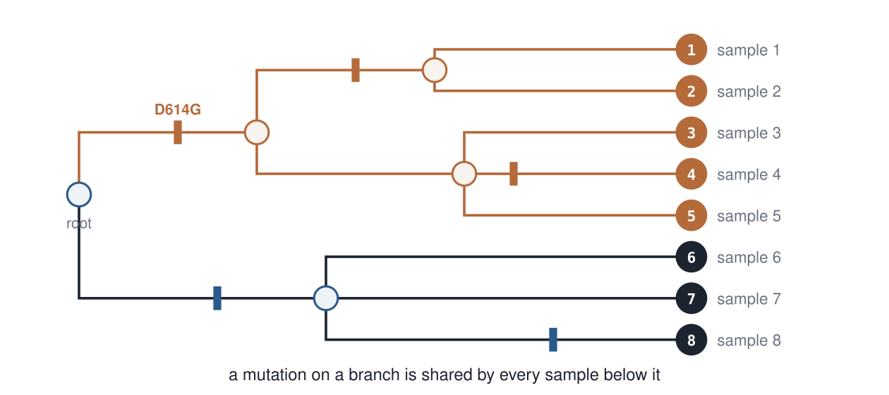{.sketch}

A mutation that arose on a branch is inherited by every sample below it. Here the spike mutation D614G is shared by samples 1–5, so they form a group.

## Reading a tree

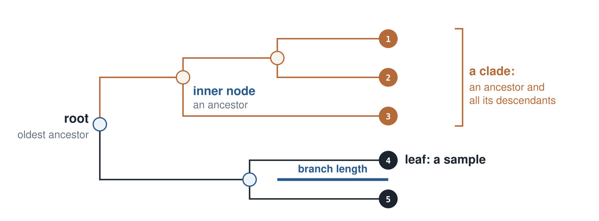{.sketch .huge}

## The words we need

- **Leaf:** a sample we observed, here a virus genome.
- **Inner node:** an ancestor we never observed. Its sequence must be inferred.
- **Branch length:** how much change happened along a branch, usually in substitutions per site.
- **Clade:** an ancestor with all its descendants. A variant such as Delta is a clade.

The leaves are data. Everything else, the shape, the inner nodes and the branch lengths, is what the algorithms of today compute.

## Rooted and unrooted trees

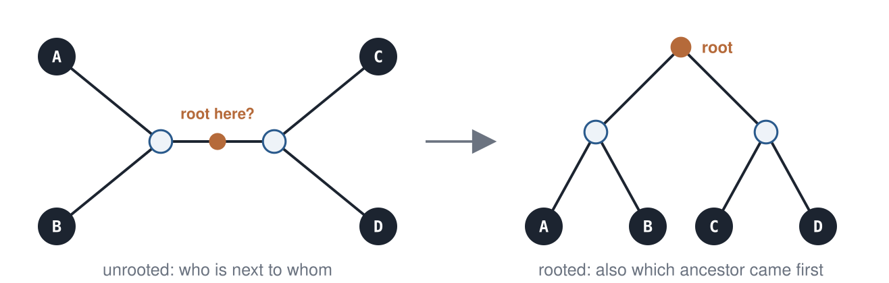{.sketch}

Most methods return an **unrooted** tree: who is next to whom. The root, the oldest ancestor, is placed afterwards, for example on the branch to an **outgroup**, a sample known to lie outside the group, or by the sampling dates.

## Four ways to get a tree

| Method | Uses | Asks |
|---|---|---|
| **neighbour-joining** | distances between pairs | which samples are neighbours? |
| **parsimony** | the sequences | which tree needs the fewest mutations? |
| **likelihood** | sequences + a model of mutation | which tree makes the data most probable? |
| **Bayesian** | likelihood + prior beliefs | how probable is each tree, given the data? |

From top to bottom the methods use more information, give richer answers, and cost much more computing time. All four are in use today, for different jobs.

## The idea of this week

::: {.idea}
There are far too many trees to try them all. We **build** one greedily, by repeatedly joining the two samples that look like neighbours. To **score** a given tree we fill values from the leaves to the root, one node at a time, using only the node's two children: dynamic programming on a tree. To say **how sure** we are, we either resample the data (bootstrap) or let a random walk visit trees in proportion to their probability (Bayesian).
:::

::: {.goals}
By the end of this meeting you should be able to:

1. Explain why the number of trees makes trying them all impossible.
2. Run neighbour-joining on four samples, and explain the bootstrap.
3. Score a tree by parsimony (Fitch) and by likelihood (Felsenstein), and say what a posterior probability of a tree means.
:::

## Problem statement

::: {.io}
::: {.in}
**Input**

An alignment of $n$ genomes: one row per sample, one column per position.
:::
::: {.arrow}
→
:::
::: {.out}
**Output**

A tree with branch lengths, and for each branch a measure of how well the data support it.
:::
:::

::: {.toy}
**Running example.** Four samples $A, B, C, D$, twenty sites, used throughout: distances, neighbour-joining, bootstrap, parsimony, likelihood and Bayesian. A three-leaf tree showing $\mathtt{C}, \mathtt{C}, \mathtt{T}$ for the step-by-step scoring. The lab notebook `labs/10-trees.ipynb` computes every number.
:::

## Too many trees {.section-head}

Why we cannot try every tree.

## How the number of trees grows

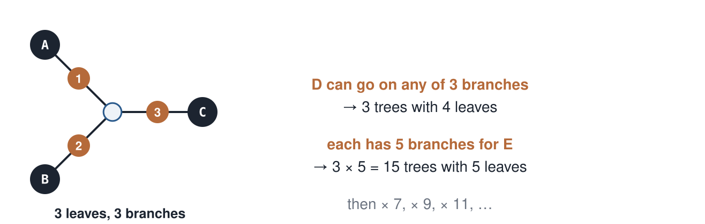{.sketch}

Build trees by adding one leaf at a time. A new leaf can go on **any branch** of the tree so far, and every choice gives a different tree. Each added leaf also adds two branches.

## Counting trees

:::: {.split .fig-right}
::: {.pane}
Multiplying the choices, unrooted trees on $n$ labelled leaves:

$$
1 \cdot 3 \cdot 5 \cdots (2n-5)
$$

::: {.small}
| leaves $n$ | trees |
|--:|--:|
| 3 | 1 |
| 4 | 3 |
| 5 | 15 |
| 10 | 2,027,025 |
| 20 | about $2 \times 10^{20}$ |
:::
:::
::: {.pane}
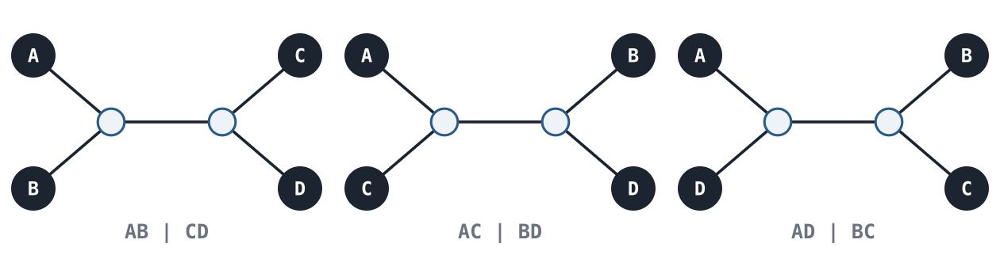{.sketch}

The three trees on four leaves.
:::
::::

## Why counting matters

- Each new leaf multiplies the count, so it grows faster than any power of 2.
- With 20 samples there are more trees than there are grains of sand on Earth; a pandemic data set has thousands of samples.
- Trying every tree is exhaustive search over a space we can never finish (weeks 2 and 5).

::: {.takeaway}
We need methods that build a good tree directly, and methods that score one tree quickly and improve it step by step.
:::

## From genomes to distances {.section-head}

The input of neighbour-joining.

## Four genomes, twenty sites

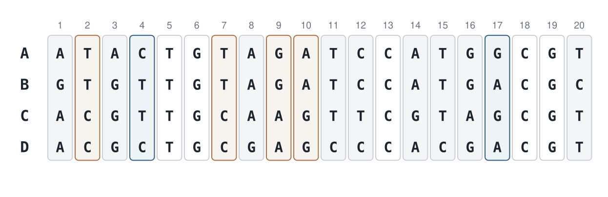{.sketch .wide}

- **White:** all agree. **Grey:** one sample differs from the rest.
- **Orange:** $A, B$ share a letter that $C, D$ lack (columns 2, 7, 9, 10).
- **Blue:** pairs against that grouping: $A, D$ (column 4), $A, C$ (column 17).

## Counting differences

The distance between two samples: the number of columns in which they differ.

- $A$ and $B$ differ in columns 1, 3, 4, 17, 20: $d_{AB} = 5$.
- Doing this for every pair gives the table we will join:

|  | A | B | C | D |
|--:|--:|--:|--:|--:|
| A | 0 | 5 | 9 | 9 |
| B | 5 | 0 | 10 | 10 |
| C | 9 | 10 | 0 | 8 |
| D | 9 | 10 | 8 | 0 |

## Some changes are hidden

:::: {.split .fig-right}
::: {.pane}
A site can change twice, $\mathtt{A} \to \mathtt{G} \to \mathtt{A}$, and we see no difference at all.

- Short branches: almost every change shows.
- Long branches: differences level off at $3/4$, the value for two unrelated sequences.

Programs **correct** counted differences upward with a model of mutation (Jukes & Cantor, 1969). Our toy uses the raw counts.
:::
::: {.pane}
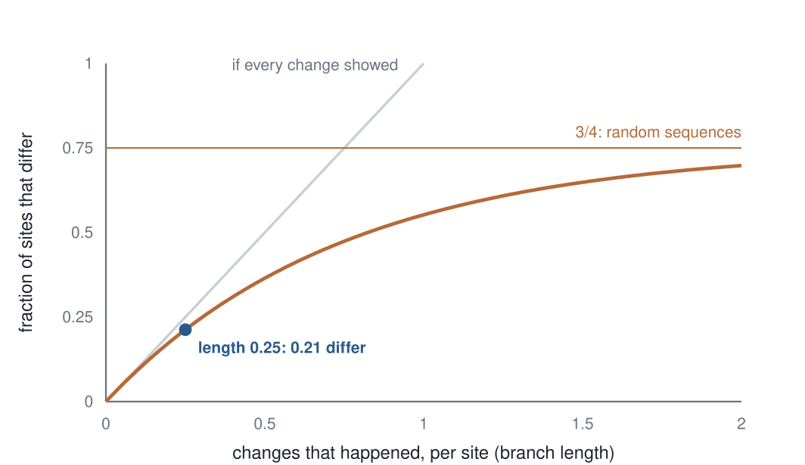{.sketch}
:::
::::

## Neighbour-joining {.section-head}

Join the two samples that look like neighbours, then repeat.

## Greedy joining

Neighbour-joining (Saitou & Nei, 1987) is a greedy algorithm (weeks 2 and 6):

1. Start with $n$ samples and their table of distances.
2. Choose the pair that looks most like neighbours, and join them through a new inner node $u$.
3. Replace the pair by $u$ in the table, with distances from $u$ to everyone else.
4. Repeat until three nodes remain, then join them.

The question is what "looks most like neighbours" means.

## The closest pair is not always a pair of neighbours

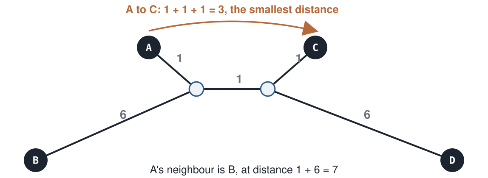{.sketch}

$B$ and $D$ sit on long branches: they changed a lot. $A$ is closest to $C$, yet $A$'s neighbour in the tree is $B$. Joining the closest pair would build the wrong tree.

## Correcting for long branches

Let $R_i = \sum_k d_{ik}$ be the total distance of sample $i$ to all others. A sample on a long branch has a large $R_i$: it is far from **everybody**.

Neighbour-joining joins the pair with the smallest

$$
Q_{ij} = (n-2)\, d_{ij} - R_i - R_j .
$$

- $d_{ij}$ small: the two are close to each other.
- $R_i + R_j$ large: they are far from everyone else, so their own distance is less surprising.

## $Q$ on the long-branch tree

Distances from the tree: $d_{AB} = 7$, $d_{AC} = 3$, $d_{AD} = 8$, $d_{BC} = 8$, $d_{BD} = 13$, $d_{CD} = 7$. Row sums $R_A = 18$, $R_B = 28$, $R_C = 18$, $R_D = 28$.

| pair | $2\,d_{ij}$ | $R_i + R_j$ | $Q_{ij}$ |
|---|---|---|---|
| $AC$ (closest) | 6 | 36 | −30 |
| $AB$ | 14 | 46 | **−32** |
| $CD$ | 14 | 46 | **−32** |
| $AD$, $BC$, $BD$ | | | −30 |

$Q$ picks $AB$ (or $CD$): the true neighbours, although they are not the closest pair.

## Back to our four samples

:::: {.split}
::: {.pane}
|  | A | B | C | D | $R$ |
|--:|--:|--:|--:|--:|--:|
| A | 0 | 5 | 9 | 9 | 23 |
| B | 5 | 0 | 10 | 10 | 25 |
| C | 9 | 10 | 0 | 8 | 27 |
| D | 9 | 10 | 8 | 0 | 27 |
:::
::: {.pane}
- The row sums $R$ are in the last column.
- With $n = 4$, the factor is $n - 2 = 2$.
- Next: compute $Q$ for every pair.
:::
::::

## Step 1: the $Q$ values

| pair | $2\,d_{ij}$ | $R_i + R_j$ | $Q_{ij}$ |
|---|---|---|---|
| $AB$ | 10 | 48 | **−38** |
| $AC$ | 18 | 50 | −32 |
| $AD$ | 18 | 50 | −32 |
| $BC$ | 20 | 52 | −32 |
| $BD$ | 20 | 52 | −32 |
| $CD$ | 16 | 54 | **−38** |

The smallest value, −38, appears twice. With four samples, joining $A$ with $B$ or $C$ with $D$ gives the same tree. We join $A$ and $B$.

## Step 2: where $u$ sits between $A$ and $B$

The new node $u$ splits the distance $d_{AB} = 5$ into two branches.

- Start from the middle: $2.5$ each.
- Then shift $u$ **towards** the sample that is closer to everyone else. $R_A = 23 < R_B = 25$, so $A$'s branch is shorter.

$$
\delta_A = \tfrac{1}{2}\, d_{AB} + \frac{R_A - R_B}{2(n-2)} = 2.5 + \frac{23 - 25}{4} = 2, \qquad \delta_B = 5 - 2 = 3
$$

## Step 2: distances from $u$

:::: {.split .fig-right}
::: {.pane}
How far is $u$ from $C$? Add the two paths to $C$, and remove the part that does not lead through $u$:

$$
d_{uC} = \tfrac{1}{2}(d_{AC} + d_{BC} - d_{AB}) = \tfrac{1}{2}(9 + 10 - 5) = 7
$$

In the same way $d_{uD} = 7$. The table shrinks from four samples to three nodes: $u$, $C$, $D$.
:::
::: {.pane}
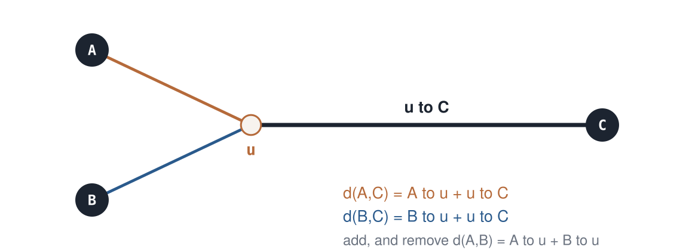{.sketch}
:::
::::

## Step 3: the last three nodes

Three nodes remain, $u$, $C$, $D$, with $d_{uC} = 7$, $d_{uD} = 7$, $d_{CD} = 8$. They meet at one more inner node; the three branch lengths solve $x + y = 7$, $x + z = 7$, $y + z = 8$:

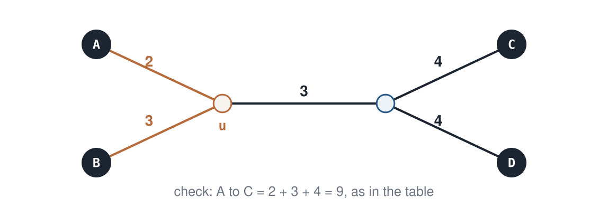{.sketch .below}

$x = 3$ (to $u$), $y = z = 4$ (to $C$ and $D$). The tree reproduces every distance in the table.

## Why neighbour-joining is still used

- **Fast.** Each step computes $Q$ for all pairs, $O(n^2)$ work, over $n - 3$ steps: $O(n^3)$. For 1,000 samples that is about $10^9$ simple steps: seconds.
- **Exact when the distances fit a tree.** Then it returns that tree (as in our toy).
- **Huge data.** Faster variants handle tens of thousands of genomes, where other methods give up.
- **A starting point.** Its tree is where slower methods begin their search.

Its weakness: it only sees the distance table. Once the sequences are reduced to one number per pair, information is lost, and noisy distances can lead to a wrong join.

## How sure are we? The bootstrap {.section-head}

Resample the data, rebuild the tree, count.

## One tree is not the whole answer

Neighbour-joining grouped $A$ with $B$. How much should we trust that?

- Four columns support $AB \mid CD$ (columns 2, 7, 9, 10).
- One supports $AD \mid BC$ (column 4), one $AC \mid BD$ (column 17).

With other columns, sampled by chance, the answer might change. We cannot sequence the virus again, but we can **imitate** sampling again.

## A branch is a split

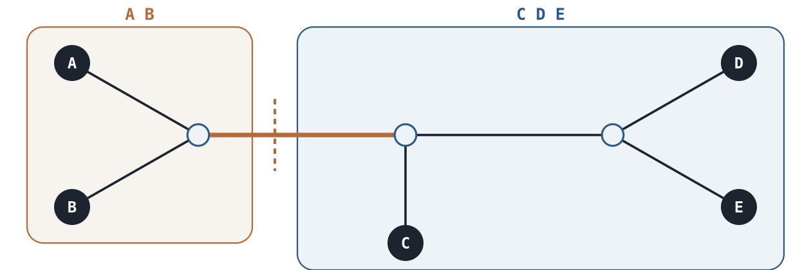{.sketch}

Cutting one inner branch splits the samples into two groups, here $AB \mid CDE$. "Does the tree contain this branch?" is the same question as "does it contain this split?". Support is measured branch by branch.

## Resample the columns

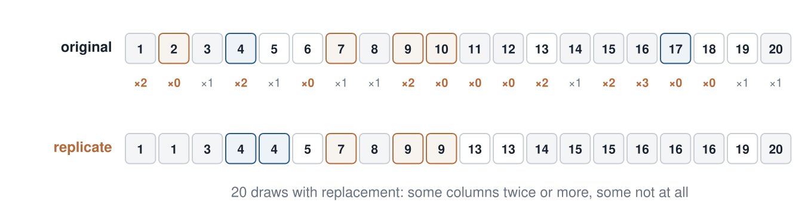{.sketch .wide}

Draw 20 columns from the 20 we have, **with replacement**. Some columns appear twice or three times, some not at all. The result is a new alignment of the same size, a **bootstrap replicate** (Felsenstein, 1985).

## One replicate, start to finish

The replicate above has these distances:

|  | A | B | C | D |
|--:|--:|--:|--:|--:|
| A | 0 | 6 | 10 | 7 |
| B | 6 | 0 | 10 | 11 |
| C | 10 | 10 | 0 | 9 |
| D | 7 | 11 | 9 | 0 |

Run neighbour-joining on this table, exactly as before. It joins $A$ with $B$ again: this replicate **supports** $AB \mid CD$.

## Repeat 1,000 times

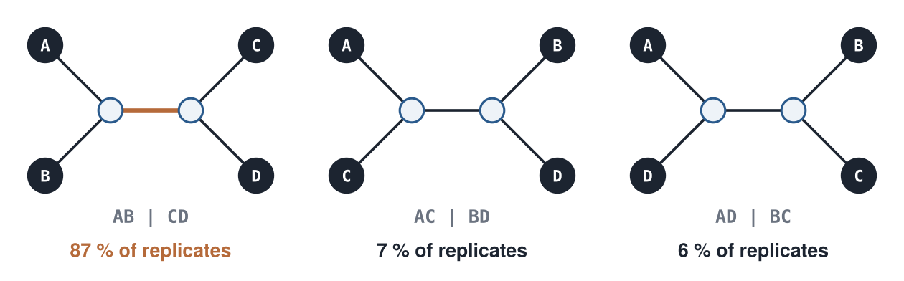{.sketch}

Each replicate gives one tree. We count how often each split appears. When two trees tie, each gets half a vote.

## Reading support values

:::: {.split .fig-right}
::: {.pane}
The count is written on the branch: **87**.

- It means: in 87 % of resampled data sets, the method found this branch again.
- Branches with support near 100 are robust; below about 70 they are often treated as unresolved.
- It is **not** the probability that the branch is true. It measures how stable the answer is under resampling.
:::
::: {.pane}
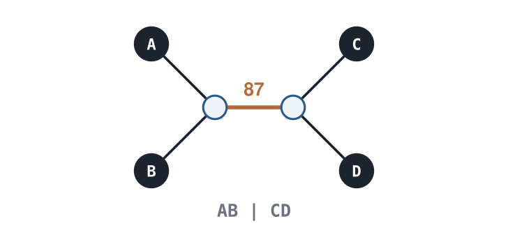{.sketch}
:::
::::

## What the bootstrap costs

- One tree per replicate: 1,000 replicates cost 1,000 times one tree.
- With neighbour-joining this is cheap: seconds to minutes.
- With likelihood it can take days. Programs therefore use faster approximations, such as the ultrafast bootstrap (Minh et al., 2013).

::: {.takeaway}
The bootstrap asks: if we had sampled other sites, would we get the same branch? It needs nothing but the tree method itself, run many times.
:::

## Scoring a tree: parsimony {.section-head}

How many mutations does a tree need?

## Parsimony

Given a tree and one column of an alignment (one letter per leaf), assign letters to the inner nodes so that the number of **changes** along the branches is as small as possible.

- That smallest number is the **parsimony score** of the tree for this column.
- Columns are scored independently, and their scores are added.
- A tree that explains the data with fewer mutations is preferred.

## Fitch's algorithm: the upward pass

Fill a set of letters at every node, from the leaves to the root (Fitch, 1971):

- At a leaf: the set holding its observed letter.
- At an inner node with children's sets $R$ and $S$:
  - if $R \cap S$ is not empty, the node's set is $R \cap S$: no change needed;
  - otherwise the node's set is $R \cup S$, and we **count one change**.

A node depends only on its two children, like a cell of the tourist table in week 3.

## Fitch on $\mathtt{C}, \mathtt{C}, \mathtt{T}$

:::: {.split .fig-right}
::: {.pane}
- Inner node $u$, children $\{\mathtt{C}\}$ and $\{\mathtt{C}\}$: the intersection is $\{\mathtt{C}\}$, no change.
- Root, children $\{\mathtt{C}\}$ and $\{\mathtt{T}\}$: the intersection is empty, so the set is $\{\mathtt{C}, \mathtt{T}\}$ and we count one change.

The tree needs **one** change for this column.
:::
::: {.pane}
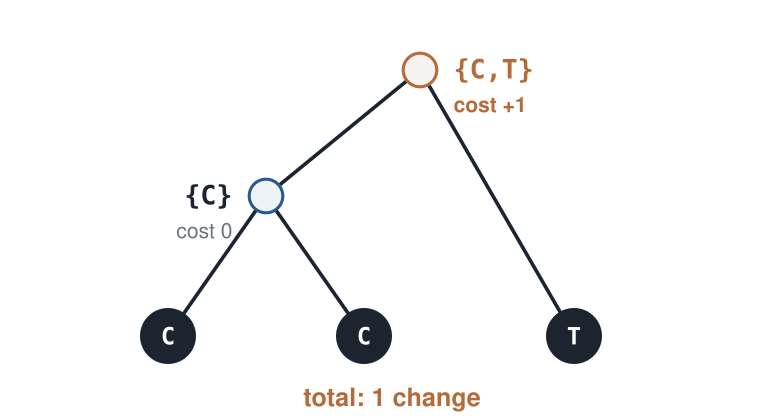{.sketch}
:::
::::

## The downward pass: where is the change?

Choose a letter from the root's set, then go down: if the parent's letter is in the child's set, copy it; otherwise choose a letter from the child's set, which marks a change on that branch.

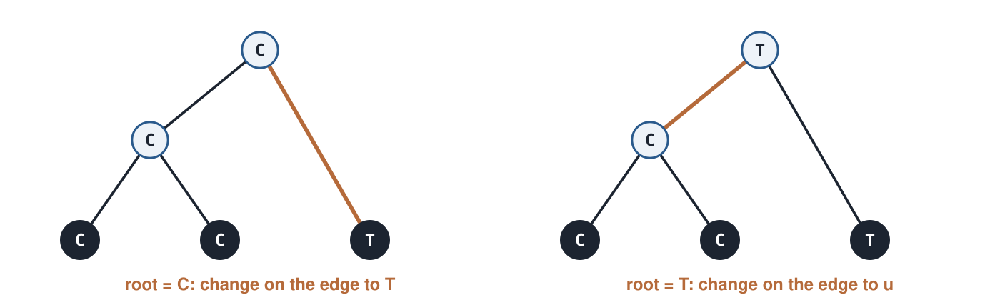{.sketch .below}

Both choices give **one** change, on different branches. The score is unique; the placement of the mutation need not be.

## Scoring the three trees on our toy

Run Fitch on every column, for each of the three trees on four leaves. Columns of the same kind cost the same:

| columns | how many | $AB \mid CD$ | $AC \mid BD$ | $AD \mid BC$ |
|---|---|---|---|---|
| all agree | 5 | 0 | 0 | 0 |
| one sample differs | 9 | 1 each | 1 each | 1 each |
| $A, B$ vs $C, D$ | 4 | 1 each | 2 each | 2 each |
| $A, C$ vs $B, D$ | 1 | 2 | 1 | 2 |
| $A, D$ vs $B, C$ | 1 | 2 | 2 | 1 |
| **total** | 20 | **17** | **20** | **20** |

## The most parsimonious tree

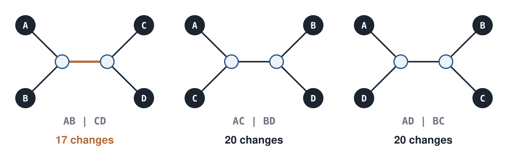{.sketch}

$AB \mid CD$ needs 17 changes, the other two 20. Only columns that group two samples against two decide; a column in which one sample differs costs one change on every tree.

## When parsimony goes wrong

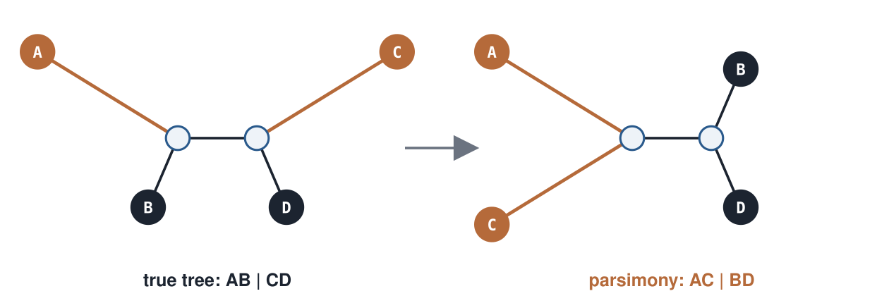{.sketch}

$A$ and $C$ sit on **long** branches: many changes, some of them to the same letter by chance. Parsimony reads those chance matches as shared mutations and groups $A$ with $C$. This error is called **long-branch attraction** (Felsenstein, 1978). More data do not fix it: parsimony only becomes more certain of the wrong tree.

## Scoring a tree: likelihood {.section-head}

How probable are the data, given the tree?

## Why parsimony is not enough

Parsimony counts changes but ignores branch lengths. A mutation on a long branch, where much time has passed, is far more likely than one on a short branch.

**Likelihood** asks instead: given the tree, its branch lengths and a model of mutation, how probable are the letters we observe at the leaves?

- Each branch carries probabilities of staying the same or changing.
- Long branches change often; parallel changes on two long branches are **expected**, not surprising. This protects against long-branch attraction.

## From branch length to probability

:::: {.split .fig-right}
::: {.pane}
The model turns a branch length into the probability that a site ends up different: the curve from the distance part.

- Short branch: small probability of change.
- Long branch: close to the value for unrelated sequences.

In the small example that follows, every branch keeps its letter with probability 0.8 and changes with probability 0.2.
:::
::: {.pane}
{.sketch}
:::
::::

## The sum that explodes

The letters at the inner nodes are unknown, so the likelihood sums over every possible assignment of them.

- With 2 inner nodes and 4 letters: $4^2 = 16$ assignments to add up.
- With 1,000 inner nodes: $4^{1000}$ assignments, far too many to list.

The same trick as Fitch helps: compute, at every node, a value that summarises its whole subtree.

## Felsenstein's pruning: what each node stores

:::: {.split .fig-wide}
::: {.pane}
At every node $s$ and for every letter $a$ (Felsenstein, 1981):

$L_s(a)$ = probability of the letters **below** $s$, if $s$ has letter $a$.

- With two letters, each node stores two numbers: one for $\mathtt{C}$, one for $\mathtt{T}$.
- **Leaves:** the letter is known: $(1, 0)$ for $\mathtt{C}$, $(0, 1)$ for $\mathtt{T}$.
- **Inner nodes:** unknown. We fill them from the leaves upward.
:::
::: {.pane}
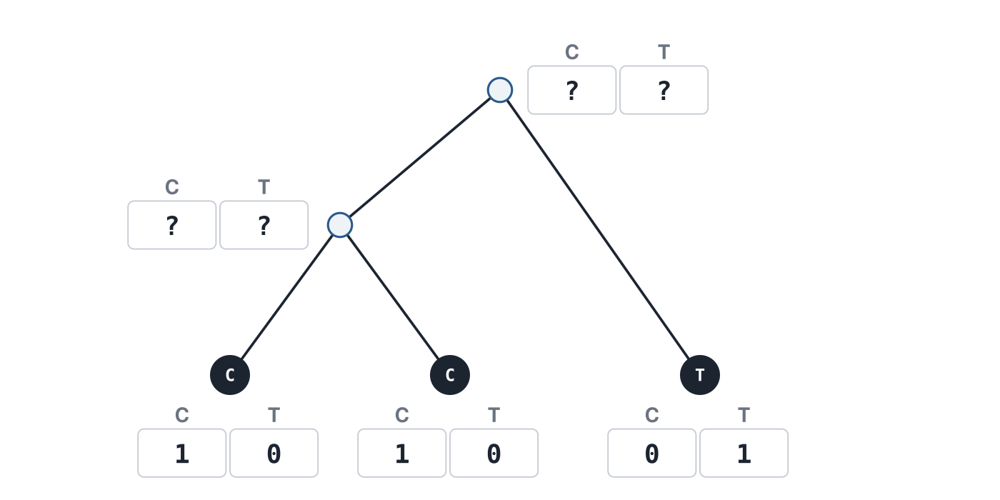{.sketch}
:::
::::

## The rule for one node

:::: {.split .fig-wide}
::: {.pane}
$$
L_s(a) = \Bigl(\sum_x P(a \to x)\, L_l(x)\Bigr) \Bigl(\sum_y P(a \to y)\, L_r(y)\Bigr)
$$

- **Each branch** gives one sum: go from the parent's letter $a$ to each letter of the child, times what the child already stores.
- **The node** multiplies its two branches: the two children evolve independently.
:::
::: {.pane}
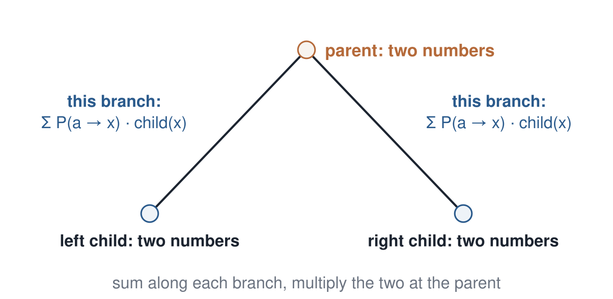{.sketch}
:::
::::

## Step 1: node $u$

:::: {.split .fig-wide}
::: {.pane}
Both branches of $u$ lead to a leaf showing $\mathtt{C}$. The factors sit **on the branches**:

- If $u = \mathtt{C}$: each branch stays, $0.8$. So $L_u(\mathtt{C}) = 0.8 \cdot 0.8 = 0.64$.
- If $u = \mathtt{T}$: each branch changes, $0.2$. So $L_u(\mathtt{T}) = 0.2 \cdot 0.2 = 0.04$.

$u$ now stores $(0.64, 0.04)$, a summary of everything below it.
:::
::: {.pane}
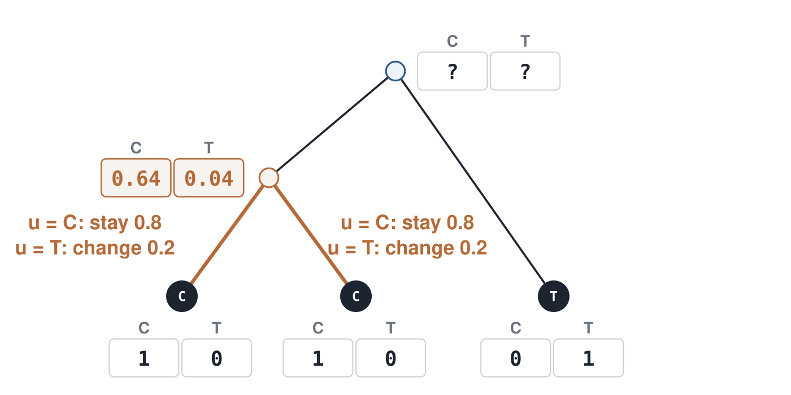{.sketch}
:::
::::

## Step 2: the root, if it has $\mathtt{C}$

:::: {.split .fig-wide}
::: {.pane}
- **Branch to $u$:** $u$ keeps $\mathtt{C}$ ($0.8 \cdot 0.64$) or switches to $\mathtt{T}$ ($0.2 \cdot 0.04$). Sum: $0.52$.
- **Branch to the leaf $\mathtt{T}$:** from $\mathtt{C}$ it must change: $0.2$.

Multiply: $L_{\text{root}}(\mathtt{C}) = 0.52 \cdot 0.2 = 0.104$.

The root never looks at the leaves below $u$: it uses $u$'s two numbers.
:::
::: {.pane}
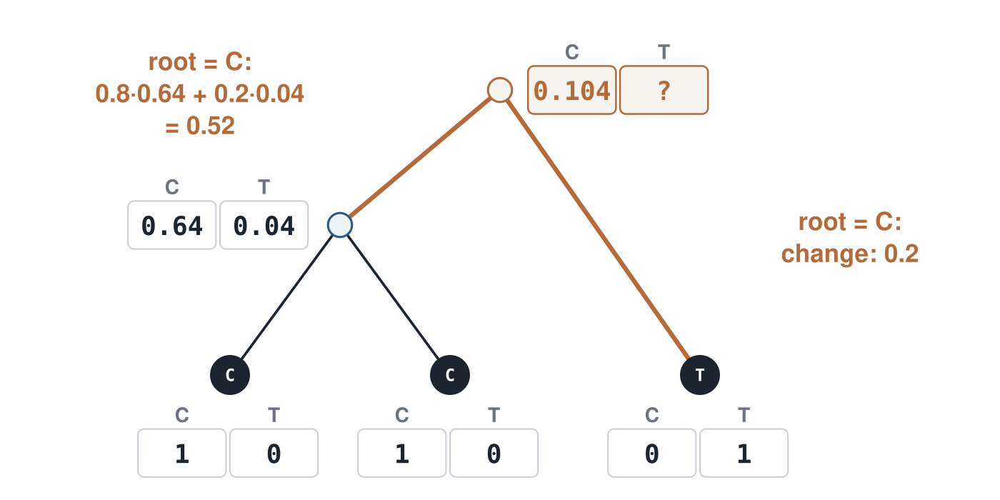{.sketch}
:::
::::

## Step 3: the root, if it has $\mathtt{T}$

:::: {.split .fig-wide}
::: {.pane}
- **Branch to $u$:** $u$ switches to $\mathtt{C}$ ($0.2 \cdot 0.64$) or keeps $\mathtt{T}$ ($0.8 \cdot 0.04$). Sum: $0.16$.
- **Branch to the leaf $\mathtt{T}$:** it stays: $0.8$.

Multiply: $L_{\text{root}}(\mathtt{T}) = 0.16 \cdot 0.8 = 0.128$.
:::
::: {.pane}
{.sketch}
:::
::::

## The likelihood of the tree

:::: {.split .fig-wide}
::: {.pane}
If both letters are equally likely at the root:

$$
L = \tfrac{1}{2}\,(0.104 + 0.128) = 0.116
$$

Fitch said: at least one change. Likelihood says how probable the data are, counting every way the change could have happened, weighted by the branches.
:::
::: {.pane}
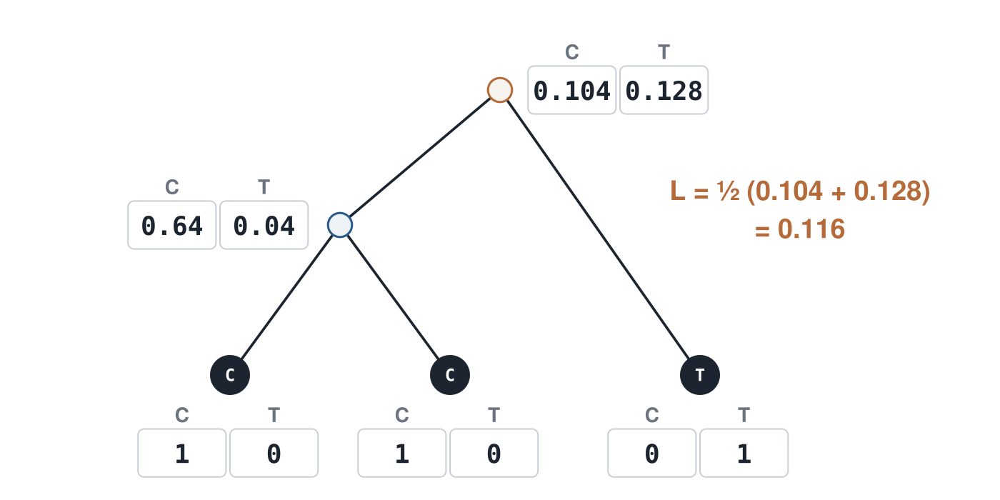{.sketch}
:::
::::

## Change one branch, recompute one path

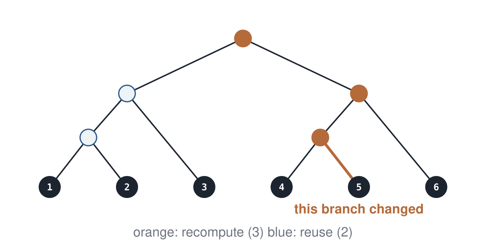{.sketch}

A search changes one branch length, or moves one subtree, at a time. The vectors below the change and beside it stay valid; only those on the path up to the root are recomputed. In a tree of thousands of samples, that is often a few dozen nodes instead of thousands.

## From one column to a whole genome

- Columns are treated as independent, so the likelihood of the alignment is the **product** over columns.
- Products of many small numbers become too small for a computer, so programs add **logarithms** instead: the log-likelihood.
- Each column takes one pass over the tree: time proportional to the number of nodes.

::: {.takeaway}
Do not list inner-node letters. One pass from the leaves to the root per column gives the exact likelihood.
:::

## The three trees by likelihood

For each tree on our toy, the program also adjusts the five branch lengths until the likelihood is as large as possible:

| tree | log-likelihood | likelihood, relative to the best |
|---|---|---|
| $AB \mid CD$ | −88.17 | 1 |
| $AC \mid BD$ | −90.78 | 0.074 |
| $AD \mid BC$ | −90.78 | 0.074 |

$AB \mid CD$ makes the data about $e^{2.61} \approx 13.6$ times more probable than either alternative. This is the **maximum-likelihood tree**.

## Searching for the best tree

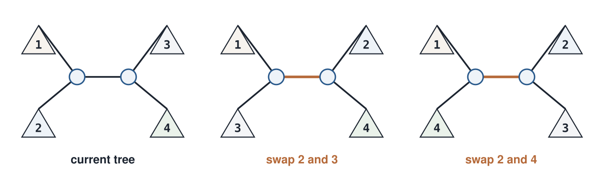{.sketch}

Programs start from a neighbour-joining or parsimony tree and try small rearrangements: around one inner branch, swap two subtrees. If the likelihood improves, keep the new tree and repeat. For four leaves the two swaps reach exactly the other two trees.

## Why likelihood is slow

For 1,000 virus genomes of 30,000 sites:

- **One score:** 30,000 columns × about 2,000 branches × 16 products: about $10^9$ steps.
- **Branch lengths:** every candidate tree needs its branch lengths optimised, which means many scores.
- **Search:** thousands of candidate trees.

Together: hours to days, where neighbour-joining needs seconds. The result is usually worth it: likelihood uses every column and the branch lengths, and is the standard for published trees.

## Bayesian trees {.section-head}

Not one best tree, but how probable each tree is.

## From one best tree to many good ones

The maximum-likelihood tree is one answer. But two trees can explain the data almost equally well, and then the single best tree hides the doubt.

Bayesian methods give a different kind of answer: a **probability for every tree**, given the data.

- "The probability that $A$ and $B$ form a clade is 0.87."
- "The common ancestor of these samples lived between November and December."

## Bayes' rule for trees

$$
P(\text{tree} \mid \text{data}) = \frac{P(\text{data} \mid \text{tree}) \cdot P(\text{tree})}{P(\text{data})}
$$

- $P(\text{data} \mid \text{tree})$: the **likelihood**, computed by pruning, as before.
- $P(\text{tree})$: the **prior**, what we believe before seeing the data.
- $P(\text{tree} \mid \text{data})$: the **posterior**, what we believe after seeing the data.
- $P(\text{data})$: the same number for every tree. It only makes the posteriors add up to 1.

## What goes into the prior

The prior states assumptions openly, as probabilities:

- **Tree shapes:** often, every tree is equally probable.
- **Branch lengths:** short branches more probable than very long ones.
- **Time:** with sampling dates and a mutation rate, branches become years. The prior can then describe how fast the epidemic grew.

With a flat prior over trees, the posterior is the likelihood, rescaled to add up to 1.

## The three trees by Bayes' rule

Flat prior: each of the three trees gets $1/3$. To keep the toy small, each tree keeps its best branch lengths.

| tree | likelihood, relative | × prior | posterior |
|---|---|---|---|
| $AB \mid CD$ | 1 | 1/3 | $\dfrac{1}{1 + 0.074 + 0.074} = 0.87$ |
| $AC \mid BD$ | 0.074 | 1/3 | 0.064 |
| $AD \mid BC$ | 0.074 | 1/3 | 0.064 |

The $1/3$ cancels: with a flat prior, divide each likelihood by their sum.

## We cannot sum over all trees

For four samples the sum $P(\text{data})$ has three terms. For 20 samples it has about $2 \times 10^{20}$, each with its own branch lengths.

We cannot compute every posterior. We can **sample** trees instead, so that each tree turns up as often as its posterior probability says.

The tool is a random walk with a clever rule: **Markov chain Monte Carlo** (Metropolis et al., 1953; Hastings, 1970).

## A random walk among trees

Start at any tree. Repeat many times:

1. **Propose** a neighbouring tree, for example by one swap of subtrees.
2. Compare likelihood × prior of the new tree with the current one.
3. **Better:** move there. **Worse:** move there only with probability $\dfrac{\text{new}}{\text{current}}$; otherwise stay.

From $AB \mid CD$ a proposal to $AC \mid BD$ is accepted with probability $0.074$; the reverse move is always accepted.

## The walk on our three trees

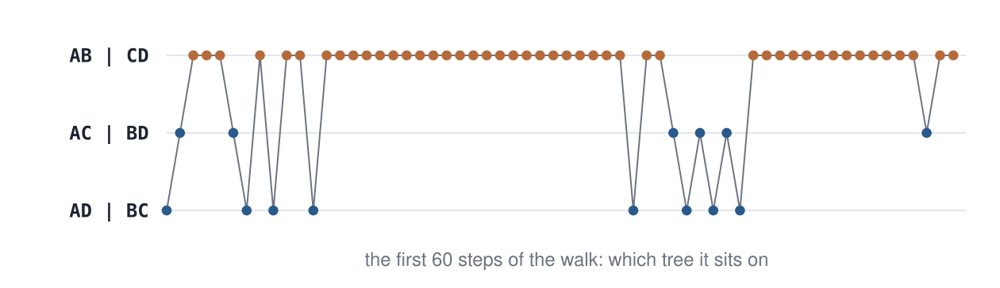{.sketch}

The walk starts on a poor tree, finds $AB \mid CD$ within a few steps, and then sits there most of the time, with short visits to the others.

## Time spent is the posterior

Count the steps spent on each tree, over 10,000 steps:

| tree | share of steps | posterior from Bayes' rule |
|---|---|---|
| $AB \mid CD$ | 0.876 | 0.872 |
| $AC \mid BD$ | 0.063 | 0.064 |
| $AD \mid BC$ | 0.061 | 0.064 |

The walk never computed $P(\text{data})$, yet its visits match the posterior. With millions of trees the same rule works: the walk only ever compares two trees.

## Posterior and bootstrap, side by side

| | bootstrap support | posterior probability |
|---|---|---|
| $AB \mid CD$ on our toy | 87 % | 0.87 |
| how it is made | resample columns, rebuild | random walk among trees |
| what it means | how stable the branch is | probability the branch is right, **if the model and prior are right** |

Here the two numbers agree. They need not: posteriors are often higher than bootstrap values on the same data, and both depend on the model.

## What Bayesian methods add, and what they cost

- **Uncertainty built in:** every clade gets a probability.
- **Time:** with sampling dates, branches are measured in years. When did a variant start to spread? How fast did it grow?
- **Cost:** millions of steps, each with a new likelihood. Days to weeks, for hundreds to a few thousand genomes.

Programs: **MrBayes** (Huelsenbeck & Ronquist, 2001) and **BEAST** (Drummond & Rambaut, 2007), the second built for dated virus trees.

## Which method today? {.section-head}

Speed against detail.

## Four methods side by side

| | speed | typical data size | what you get |
|---|---|---|---|
| **neighbour-joining** | seconds | up to $10^5$ genomes | one tree, quick |
| **parsimony** | fast | millions, by placing new genomes | one tree, mutations on branches |
| **likelihood** | hours to days | up to about $10^4$ | best tree, standard for publication |
| **Bayesian** | days to weeks | up to about $10^3$ | probabilities, dated trees |

The more a method models, the more it can say, and the fewer genomes it can handle.

## A typical workflow

1. **Align** the genomes to a reference (weeks 3, 8–9).
2. **Start** with a fast tree: neighbour-joining or parsimony.
3. **Improve** it by likelihood, with rearrangements.
4. **Support:** bootstrap values on every branch.
5. **Time:** for a focused question (when did this variant start?), a Bayesian analysis of a few hundred genomes.

Each step uses the method that is just good enough for its job.

## Back to the virus

- **Nextstrain** builds its trees by likelihood (IQ-TREE), then fits dates to the branches (TreeTime; Sagulenko et al., 2018).
- **UShER** (Turakhia et al., 2021) keeps one tree of millions of SARS-CoV-2 genomes. Each new genome is **placed** on the branch where it adds the fewest mutations: parsimony, one genome at a time.
- Bayesian analyses with BEAST dated the origins of variants and the start of local outbreaks.

The branches carrying D614G, and later those of Alpha, Delta and Omicron, are read directly off these trees.

## Addendum: trees within a species {.section-head}

The coalescent, and genomes stored as trees.

## Across species, within a species

| | across species | within a species |
|---|---|---|
| samples | one genome per species | many individuals of one species |
| the tree | the history we want | random: who happened to be whose ancestor |
| along the genome | one tree, mostly | a different tree every few thousand bases |
| field | **phylogenetics** | **coalescent theory**, population genetics |

Virus samples from one epidemic sit in between: one species, but their tree is what we want. Bayesian programs such as BEAST use the coalescent as the **prior** for that tree.

## Why the tree is random within a species

In a population, every individual inherits its genes from parents drawn from the generation before. Follow the ancestry of a sample **backwards**:

- Two gene copies have the same parent copy, by chance, with probability $1/N$ per generation, in a population of $N$ gene copies.
- When that happens, their two lines of ancestry **merge**: they coalesce.
- Going back further, the lines keep merging until one common ancestor is left.

The resulting tree is a random outcome of who reproduced. Its expected shape depends on the population: its size, growth and structure.

## The coalescent

:::: {.split .fig-right}
::: {.pane}
With $k$ lines there are $k(k-1)/2$ pairs that could merge (Kingman, 1982). Expected wait for the next merge:

$$
\frac{2N}{k(k-1)} \text{ generations}
$$

- Many lines: merges come fast.
- The last two lines wait $N$ generations, more than all other merges together.
:::
::: {.pane}
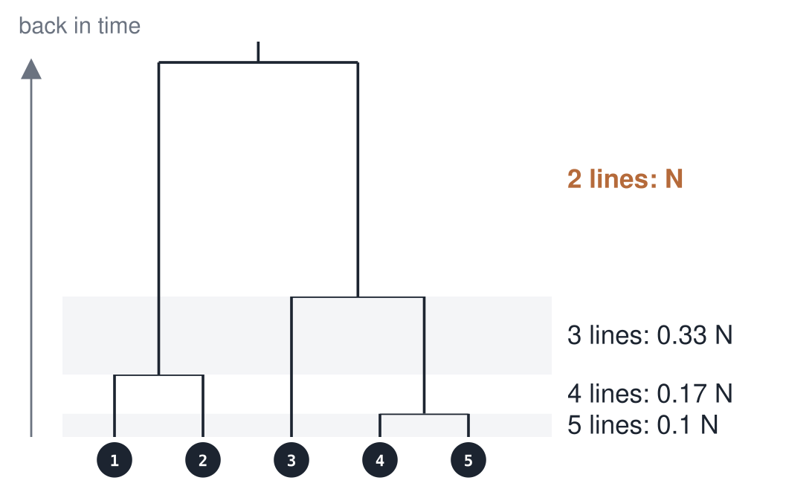{.sketch}
:::
::::

## What the coalescent is used for

- **Population size.** Two samples differ, on average, at about $2N\mu$ sites per site, where $\mu$ is the mutation rate per generation. Diversity measures $N$.
- **Growth.** A fast-growing population, such as an epidemic, gives star-like trees with long outer branches. Virus trees reveal how fast an outbreak grew.
- **The prior for Bayesian trees:** how probable is a tree shape, given a population history?

::: {.takeaway}
Across species, the tree is the result. Within a species, the tree is a random draw, and the **population history** is the result.
:::

## Many species: gene trees inside a species tree

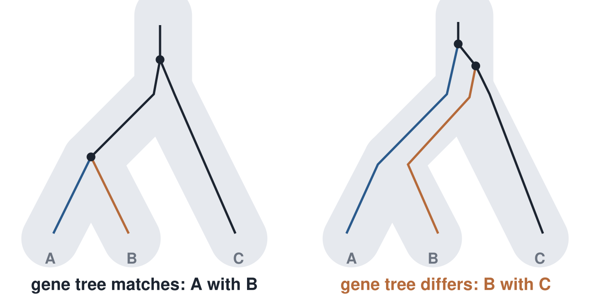{.sketch}

Draw the species tree as wide tubes: each tube is a population. Inside, the lines of ancestry of one gene coalesce as before. If they fail to merge in the short ancestor of $A$ and $B$, the gene tree can group $B$ with $C$. This is the **multispecies coalescent**.

## Why gene trees and species trees disagree

| cause | what happened | where in the genome |
|---|---|---|
| **incomplete lineage sorting** | lines did not merge before the next split (left) | scattered, many short stretches |
| **introgression** | genes crossed between species after they split | long stretches, recent |
| **convergence** | the same mutation arose twice independently | single sites |

Disagreement is not noise to be removed. Each cause is a piece of biology, and the multispecies coalescent tells us how much of the first one to expect.

## Examples

- **Incomplete lineage sorting:** in about 30 % of the genome, humans are closer to gorillas than to chimpanzees, or chimpanzees to gorillas (Scally et al., 2012).
- **Introgression:** non-African humans carry about 2 % Neanderthal DNA (Green et al., 2010).
- **Adaptive introgression:** a variant of the gene *EPAS1*, which helps Tibetans live at high altitude, came from Denisovans (Huerta-Sánchez et al., 2014). Butterflies of the genus *Heliconius* exchanged wing-pattern genes.
- **Convergence:** the spike mutation N501Y arose independently in Alpha, Beta and Gamma. Parsimony sees one shared mutation; the tree shows three.

## Telling the causes apart

Take two sister species $P_1, P_2$, a third species $P_3$, and an outgroup. Count sites where $P_3$ shares the new allele with only one of the sisters:

- $\mathrm{ABBA}$: $P_2$ and $P_3$ share it. $\mathrm{BABA}$: $P_1$ and $P_3$ share it.
- Incomplete lineage sorting makes both patterns **equally often**.
- Introgression between $P_2$ and $P_3$ adds only $\mathrm{ABBA}$.

$$
D = \frac{\mathrm{ABBA} - \mathrm{BABA}}{\mathrm{ABBA} + \mathrm{BABA}}
$$

$D$ near 0: lineage sorting is enough. $D$ clearly above 0: gene flow. This is how Neanderthal introgression was first shown (Green et al., 2010; Durand et al., 2011).

## From many gene trees to one species tree

- **Two steps:** build one tree per gene by likelihood, then find the species tree that best explains how often each gene tree occurs, for example with ASTRAL (Mirarab et al., 2014).
- **All at once:** Bayesian programs such as StarBEAST and BPP sample species tree and gene trees together, with the multispecies coalescent as the model linking them.

::: {.takeaway}
Phylogenetics and the coalescent are one model at two scales: populations inside species, gene trees inside the species tree.
:::

## Recombination: one tree per stretch

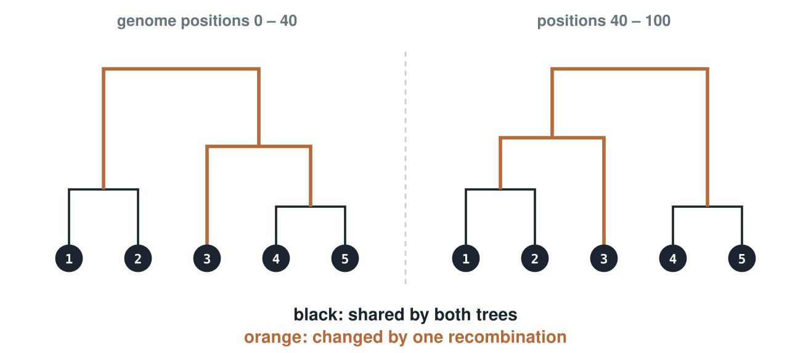{.sketch}

Week 9: a haplotype is a mosaic, copied from different ancestors in different stretches. So each stretch of the genome has its **own** genealogy. Neighbouring trees differ by one recombination; most branches are shared. Together they form the **ancestral recombination graph**.

## A mutation is a branch

:::: {.split .fig-right}
::: {.pane}
A mutation sits on one branch of the genealogy. Every sample below that branch carries it, every other sample does not.

So a whole column of the genotype table, one entry per sample, is stored as **one branch**.

For 100,000 samples, that is one number instead of 100,000.
:::
::: {.pane}
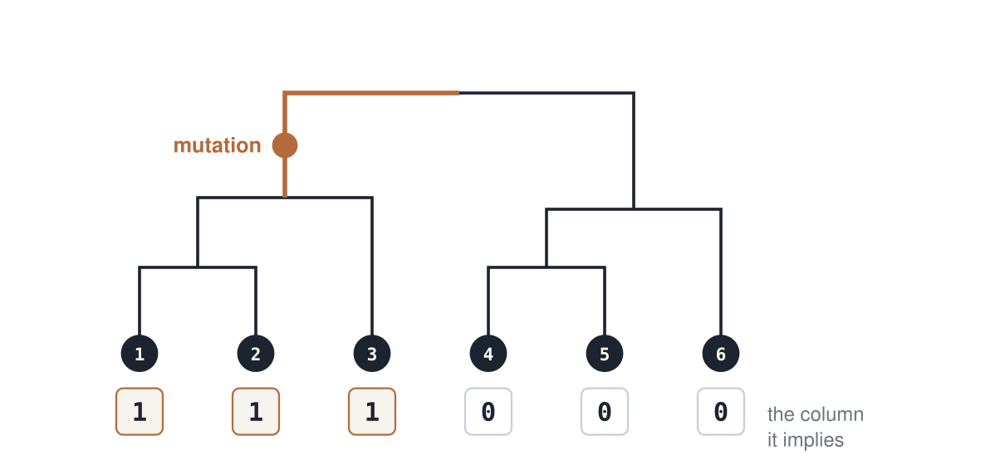{.sketch}
:::
::::

## Store the trees, not the table

Neighbouring trees share most branches, so each branch is stored **once**, with the stretch of genome where it exists. In the two trees above ($u$ above samples 1, 2; $v$ above 4, 5):

| parent | children | genome positions |
|---|---|---|
| $u$ | 1, 2 | 0 – 100 |
| $v$ | 4, 5 | 0 – 100 |
| $w$ | 3, $v$ | 0 – 40 |
| root | $u$, $w$ | 0 – 40 |
| $x$ | $u$, 3 | 40 – 100 |
| root | $x$, $v$ | 40 – 100 |

This is a **tree sequence**: a table of branches, each with its interval.

## Statistics from the trees

:::: {.split .fig-right}
::: {.pane}
How many pairs of samples differ at this site? Read it off the branch:

- The mutation sits above $k = 3$ of $n = 6$ samples.
- Pairs with one sample below and one not: $k(n - k) = 9$ of 15 differ.

Summed over mutations, this is the diversity. Along the genome, only changed branches are updated.
:::
::: {.pane}
{.sketch}
:::
::::

## Inferring tree sequences from real genomes

- **tsinfer** (Kelleher et al., 2019) builds ancestral haplotypes, then describes each sample as a **mosaic** copied from them: the same copying idea as the positional transform of week 9.
- **Relate** (Speidel et al., 2019) and **ARG-Needle** (Zhang et al., 2023) infer the trees for hundreds of thousands of genomes.
- **tsdate** dates every ancestor. One tree sequence combines thousands of modern and ancient human genomes (Wohns et al., 2022), and shows where and when ancestors lived.
- **Forward simulations** (SLiM; Haller et al., 2019) record the tree sequence as they run, including selection.

## Why tree sequences matter

- **Compact:** the genomes of hundreds of thousands of people fit in a fraction of the space of the usual variant tables (Kelleher et al., 2019).
- **Fast:** statistics such as diversity are computed tree by tree, updating only the branches that change, instead of reading the whole table.
- **Simulation:** whole chromosomes for hundreds of thousands of samples are simulated as tree sequences in minutes (msprime; Kelleher et al., 2016).
- **One library,** **tskit**, stores them and computes the statistics, for simulated and real data alike.

::: {.takeaway}
The circle closes: within a species, the tree is again a **data structure**, as in weeks 5 and 8, and the cheapest way to store many genomes.
:::

## Open `labs/10-trees.ipynb`

::: {.lab}
::: {.lab-tag}
Lab · at home, or shown in class · Python
:::

1. Neighbour-joining on the four samples: compute $R$ and $Q$, join, and print the branch lengths 2, 3, 3, 4, 4.
2. Fitch on $\mathtt{C}, \mathtt{C}, \mathtt{T}$, then on the toy alignment for all three trees: 17, 20, 20.
3. Pruning on the three-leaf tree: $(0.64, 0.04)$ at $u$, $L = 0.116$. Change the probability of change to 0.4 and rerun.
4. Bootstrap: resample the twenty columns 1,000 times and count the splits.
5. A random walk over the three trees: compare the share of steps with the posterior.
6. Answer Q1–Q3 without notes.
:::

## A bit of history

::: {.history}
- **Fitch** (1971): parsimony on a given tree.
- **Felsenstein** (1978): long-branch attraction; (1981) likelihood by pruning; (1985) the bootstrap.
- **Saitou & Nei** (1987): neighbour-joining.
- **Rannala & Yang** (1996), **Huelsenbeck & Ronquist** (2001): Bayesian trees by random walks.
- **Kingman** (1982): the coalescent.
- **Hadfield et al.** (2018), **Turakhia et al.** (2021): trees of a pandemic, in real time.
- **Green et al.** (2010): Neanderthal DNA in living humans.
- **Kelleher et al.** (2016, 2019): tree sequences for simulating and storing genomes.
:::

## Tools that use this

::: {.tools}
- **IQ-TREE**, **RAxML-NG**: likelihood trees, rearrangement search, bootstrap.
- **FastTree**: approximate likelihood for very large alignments.
- **MrBayes**, **BEAST**: Bayesian trees; BEAST adds dates.
- **UShER**: parsimony placement of millions of genomes.
- **Nextstrain**: builds and displays virus trees, with mutations placed on branches.
- **msprime**, **tskit**, **tsinfer**, **Relate**: simulate, store and infer tree sequences.
- **ASTRAL**, **StarBEAST**: species trees from many gene trees.
:::

## Extensions

::: {.ext}
- **Better models:** different rates for different sites and different kinds of mutation; the pruning algorithm stays the same, only $P(a \to x)$ changes.
- **Migration and structure:** the coalescent extends to several populations exchanging migrants; the shape of the trees then tells where lineages lived.
:::

## What you should be able to answer

::: {.muted}
Without notes. Q1–Q2 cover today's material; **Q3** asks about a situation we did not practise.
:::

::: {.qs}
::: {.q}
[Q1]{.tag} Why can we not try every tree on 20 samples? What does neighbour-joining do instead, and why does it use $Q$ rather than the smallest distance?
:::
::: {.q}
[Q2]{.tag} A branch has bootstrap support 87 and posterior probability 0.87. How was each number made, and what does each mean?
:::
::: {.q .q3}
[Q3]{.tag} Score the same three-leaf tree by Fitch for the column $\mathtt{C}, \mathtt{T}, \mathtt{T}$ (left pair $\mathtt{C}, \mathtt{T}$; right leaf $\mathtt{T}$). How many changes, and how many ways to place them?
:::
:::

::: notes
2–3 minutes. Pair-share Q3. Node u: {C} and {T} → union {C,T}, one change. Root: {C,T} ∩ {T} = {T}, no change. Total 1. Downward pass: root T, u T (T is in u's set), change on the branch to the C leaf: one placement.
:::

## Summary

::: {.takeaway}
Too many trees to try: build greedily (neighbour-joining, fast), score by dynamic programming on the tree (Fitch, pruning).
:::

::: {.takeaway}
Support: resample columns (bootstrap), or a random walk that visits trees as often as their posterior probability.
:::

::: {.takeaway}
Within a species the tree is random (coalescent), changes along the genome, and stores genomes as a tree sequence.
:::

## Next week

**Clustering and projection.**

Neighbour-joining repeatedly joined the closest pair and built a tree. Next week we use the same idea without assuming evolution: **hierarchical clustering** groups cells or genes by repeatedly merging the closest groups, and the merges again form a tree.

## Reading

::: {.read}
- Jones & Pevzner (2004). *An Introduction to Bioinformatics Algorithms*, chapter 10.
- Felsenstein (2004). *Inferring Phylogenies*. Sinauer.
- Yang & Rannala (2012). Molecular phylogenetics: principles and practice. *Nat. Rev. Genet.* 13.
- Saitou & Nei (1987). The neighbor-joining method. *Mol. Biol. Evol.* 4.
- Hadfield et al. (2018). Nextstrain: real-time tracking of pathogen evolution. *Bioinformatics* 34.
- Turakhia et al. (2021). Ultrafast sample placement on existing trees (UShER). *Nat. Genet.* 53.
- Kelleher et al. (2019). Inferring whole-genome histories in large population datasets. *Nat. Genet.* 51.
- Degnan & Rosenberg (2009). Gene tree discordance, phylogenetic inference and the multispecies coalescent. *Trends Ecol. Evol.* 24.
:::
